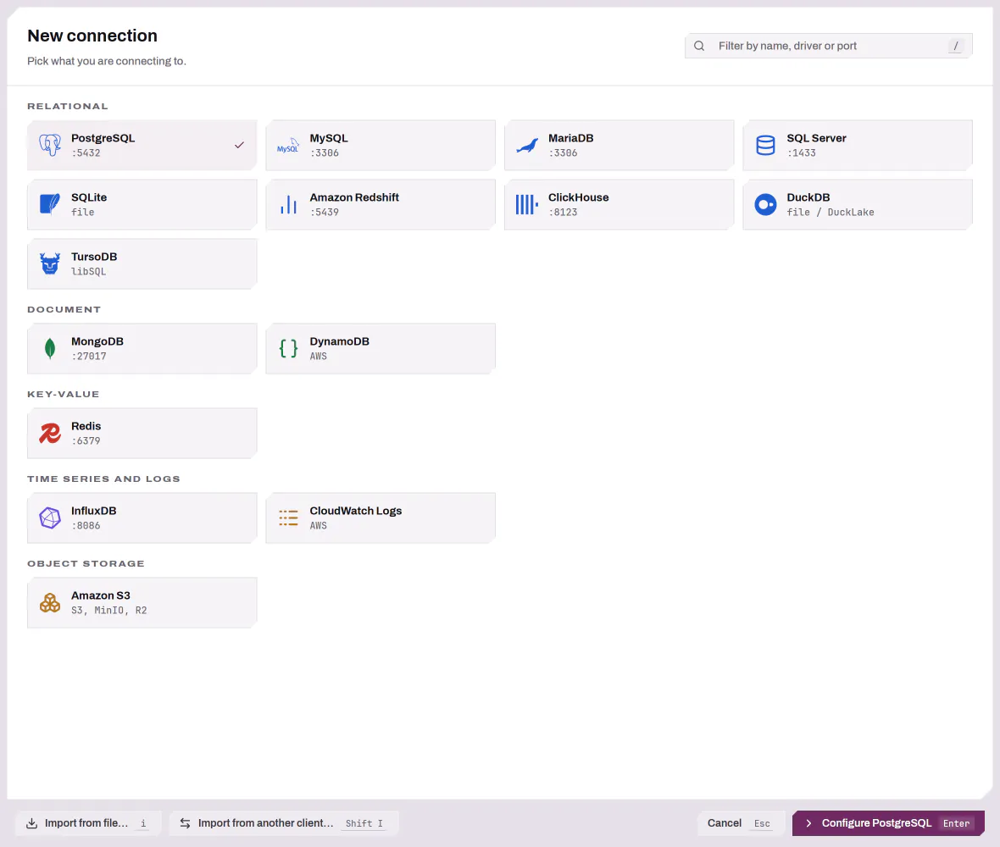
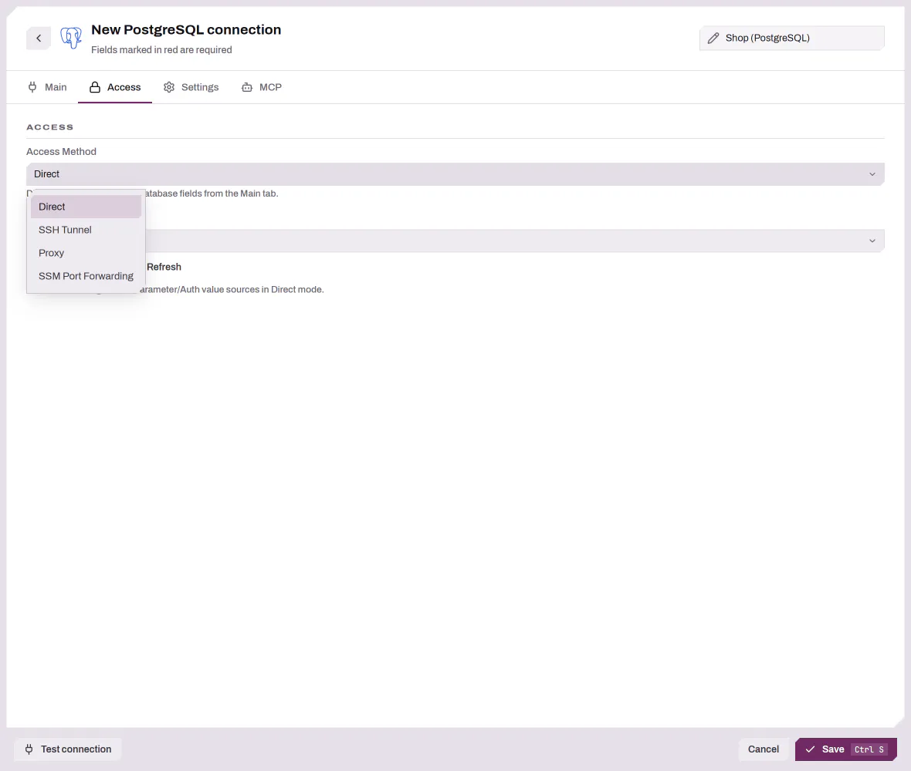

# Connecting to a Database — Advanced Setup

This guide covers everything in the Connection Manager beyond the basic "host,
port, user, password" form: reaching a database through an SSH tunnel, a proxy,
or AWS SSM; authenticating with provider-driven Auth Profiles (AWS SSO); and
pulling individual field values from a secret manager or parameter store instead
of typing them in.

For a first walk-through (creating a connection, browsing the schema, running
queries) see [Getting Started](GETTING_STARTED.md). This document starts with
opening the Connection Manager and choosing a driver, then covers the
**Access** tab and the value-source selectors.

---

## Opening the Connection Manager

Open the Connection Manager to create or edit connections:

- Press `Ctrl+Shift+N` (`Cmd+Shift+N` on macOS).
- From the sidebar, press `c`.
- Or use the command palette (`Ctrl+Shift+P` / `Cmd+Shift+P` on macOS) and run
  **Open connection manager**.

## Choosing a driver

The Connection Manager presents a driver picker. Available drivers depend on the
features the binary was built with; the standard build includes SQLite,
PostgreSQL, MySQL/MariaDB, Microsoft SQL Server, Amazon Redshift, ClickHouse,
TursoDB, DuckDB, MongoDB, DynamoDB, Redis, InfluxDB, CloudWatch Logs, Amazon S3, and
AWS Secrets. The picker groups drivers by category: Relational, Document,
Key-value, Time series and logs, Object storage, and Secret stores. Externally registered RPC drivers also appear here
when configured (see `docs/RPC_SERVICES_CONFIG.md`).

Use `/` to filter the driver list, `j`/`k` (or arrow keys) to move, and `Enter`
to select.

Each driver provides its own connection form. The form is dynamic: it shows only
the fields that driver actually needs. File-backed drivers such as SQLite use a
file-path form. Most relational drivers also accept a single connection string;
see [Form mode vs. direct URI](#form-mode-vs-direct-uri).

The **Safety** section at the end of the Main tab holds the **Read-only**
toggle. When it is on, DBFlux blocks changes made from the data grid, the visual
query builder and schema diff on that connection, refuses query editor
statements that would change data or schema, and denies MCP calls above the
`read` class (see [Read-only connections](MCP_AI_INTEGRATION.md#read-only-connections)).
Read statements still run. In the app, switching the setting on applies to an
open connection at once, while switching it off takes effect after reconnecting.
MCP picks up either change on its next call. The editor classifies a statement from its text, so a
function with side effects called from a `SELECT`, such as PostgreSQL `setval`,
still runs: read-only database credentials remain the stronger boundary.

<picture>
  <source media="(prefers-color-scheme: dark)" srcset="images/connections/driver-picker-dark.webp">
  
</picture>

---

## The Access tab: how DBFlux reaches the database

Every connection uses exactly **one** access method, chosen from the **Access
Method** dropdown. Switching methods clears the settings of the others — a
connection is either Direct, or SSH, or Proxy, or SSM, never a combination.

| Method | What it does |
|--------|--------------|
| **Direct** | Connect straight to the host/port from the Main tab. Can still resolve per-field value sources (see [Value sources](#value-sources-secret-manager-parameter-store-auth-session)). |
| **SSH Tunnel** | Open a local port-forward through an SSH host, then connect through it. |
| **Proxy** | Route the connection through a SOCKS5 or HTTP/HTTPS proxy. |
| **SSM Port Forwarding** | Use AWS Systems Manager to port-forward to an instance, then connect through the tunnel. Requires the `aws` build feature. |

<picture>
  <source media="(prefers-color-scheme: dark)" srcset="images/connections/access-tab-dark.webp">
  
</picture>

### What happens when you press Connect

DBFlux runs a fixed pre-connect pipeline before the driver ever opens a socket:

1. **Authenticating** — validate or refresh the selected Auth Profile's session
   (this is where an AWS SSO browser login can happen).
2. **Resolving values** — resolve every per-field value source (secret manager,
   parameter store, env var, auth-session field) and patch them into the config.
3. **Opening access** — establish the SSH tunnel, proxy, or SSM session (or
   nothing, for Direct).
4. **Driver connect + schema fetch** — the driver connects and DBFlux loads the
   shallow schema.

Connection **hooks** (if you have any bound) run at the PreConnect, PostConnect,
PreDisconnect, and PostDisconnect phases around this pipeline. See
[Settings & Hooks](SETTINGS.md#connection-hooks).

---

## When a connection fails

If a connection attempt fails, the error appears in a toast and the connection
row keeps a red error icon. Hover the icon to read the error. Choose **Retry**
from the row's context menu, or press `Enter` on the row, to connect again. The mark
clears when a new attempt starts, when the connection succeeds, or when you edit
the connection.

## Disconnecting while a query runs

Disconnecting a connection that still has a query running asks first: **Cancel
query** stops the query and keeps the connection open, **Keep waiting** leaves
both alone, and **Disconnect anyway** cancels the query and disconnects. `Enter`
picks **Cancel query** and `Escape` picks **Keep waiting**. Closing the DBFlux
window while a query runs on any connection asks the same question, naming the
connections, with **Quit anyway** in place of **Disconnect anyway**.

---

## SSH tunnels

You can use an SSH tunnel in two ways:

- **Reference a saved tunnel** — pick a tunnel profile you manage centrally in
  **Settings → SSH Tunnels**. Recommended when you reuse the same bastion across
  several connections.
- **Inline** — fill the SSH fields directly on the Access tab. You can later
  press **Save as tunnel** to promote it into a reusable profile.

### SSH fields

| Field | Notes |
|-------|-------|
| **Host** / **Port** | The SSH server. Port is typically `22`. |
| **Username** | SSH user. |
| **Auth method** | **Private Key** or **Password**. |
| **Key path** (Private Key) | Path to the private key. **Leave it empty to use your SSH agent or default keys** (`~/.ssh/id_rsa`, etc.). |
| **Key passphrase** (Private Key) | Optional; stored in your OS keyring when you tick **Save**. |
| **Password** (Password auth) | Stored in your OS keyring when you tick **Save**. |

There is no separate "SSH agent" option — agent-based auth is what you get when
you choose **Private Key** and leave the key path blank.

**Test SSH** verifies the tunnel without saving the connection.

### Referencing a host from your SSH config

The **SSH config host** dropdown lists every `Host` your `~/.ssh/config`
defines, with the user, host name and port each one resolves to. Picking one
stores the alias and not the values it resolves to, so a later edit to your SSH
config applies to the next connection without touching the profile. While an
alias is selected the **Host**, **Port** and **Username** fields show nothing
and are disabled — the alias is the target — and a key path left empty takes
the `IdentityFile` that host names, falling back to your SSH agent or default
keys when it names none. `Include`, `Match` and the `%h`, `%r` and `%d` tokens
inside an `IdentityFile` resolve the way OpenSSH resolves them.

A host whose config needs `ProxyJump` or `ProxyCommand` is listed and marked:
DBFlux cannot reach it, and connecting fails with that reason instead of
dialing the bastion directly. Host keys keep being verified against DBFlux's
own store in its data directory rather than your `~/.ssh/known_hosts`, so a
host you have reached from a terminal for years still asks you to confirm its
key the first time.

### Where SSH secrets live

Passphrases and passwords are stored in the **OS keyring**, never in the
database. The **Save** checkbox only appears when a keyring is available; if it
isn't, secrets aren't persisted and you'll re-enter them each session. See
[Data & Privacy → Secrets](../PRIVACY.md#secrets-and-the-os-keyring).

---

## Proxies

Proxies are managed in **Settings → Proxies**; the Access tab only *selects* a
saved proxy and shows its details. If you have none, the tab links you to
Settings.

| Field | Notes |
|-------|-------|
| **Type** | `SOCKS5`, `HTTP`, or `HTTPS`. Default port: `1080` for SOCKS5, `8080` for HTTP/HTTPS. |
| **Host** / **Port** | The proxy endpoint. |
| **Auth** | `None`, or `Basic` with a username (the password is stored in the keyring). |
| **No Proxy** | Comma-separated hosts/patterns to bypass. Supports `*` (all), exact hosts, and suffix matches (with or without a leading dot), case-insensitive. **CIDR ranges are not supported.** |
| **Enabled** | When a proxy profile is disabled, the connection falls back to a **direct** connection (with a warning) instead of failing. |

> **Heads-up:** a disabled proxy, or a remote host that matches **No Proxy**,
> results in a silent direct connection. If you expected traffic to go through
> the proxy and it didn't, check both of these first.

---

## Auth Profiles (AWS SSO and shared credentials)

Auth Profiles hold provider-driven authentication that DBFlux resolves at
connect time. They're created in **Settings → Auth Profiles** and selected per
connection. In this build the built-in providers are **AWS only**:

| Provider | Use it for |
|----------|------------|
| **AWS SSO** | IAM Identity Center (SSO) login that resolves an account + role. |
| **AWS SSO Session** | A reusable SSO session (Start URL + region + scopes) that AWS SSO profiles can inherit from. |
| **AWS Shared Credentials** | A named profile written to `~/.aws/credentials` (access key / secret / optional session token). |

Externally registered RPC auth providers can add more entries here; see
[RPC Services](RPC_SERVICES_CONFIG.md).

> AWS profiles that DBFlux reflects live from your `~/.aws/config` appear as
> **read-only** — you can select them but not edit them here; edit the AWS files
> directly.

### Creating an AWS SSO profile

The form is provider-driven. For AWS SSO you fill:

| Field | Notes |
|-------|-------|
| **Profile name** | e.g. `dev`. |
| **SSO session** | Optional reference to an **AWS SSO Session** profile. When set, Start URL and Region are inherited and their inline fields grey out. |
| **SSO Start URL** | Your Identity Center portal URL (skip if using a session). |
| **Region** | e.g. `us-east-1`. |
| **Endpoint URL** | Optional, e.g. `http://localhost:4566` for LocalStack. Applies to Secrets Manager and SSM only, through a `[services]` section in `~/.aws/config`. AWS Shared Credentials profiles have the same field. |
| **Account** | A dropdown that populates **after you log in** — it lists the accounts your SSO session can access. |
| **Role** | A dropdown that populates once an account is chosen. |

The **Account** and **Role** dropdowns are dynamic: they require a live SSO
session and refresh as their dependencies change. If they're empty, log in first
(see below).

The **SSO Wizard** offers the same flow as a guided, step-by-step creator:
enter name, Start URL, and region; it logs you in and then lists accounts and
roles for you to pick.

### The SSO login flow

When a connection (or the Account/Role dropdowns) needs an SSO session, DBFlux
opens a login modal:

- It **opens your browser automatically** to the verification URL.
- If the browser can't be opened, the modal shows the URL with a **Copy URL**
  action so you can open it manually.
- DBFlux continues automatically once you finish authenticating in the browser.
- **SSO login times out after 5 minutes.**

### Selecting an Auth Profile per connection

- **Direct mode** — the Auth Profile is *optional*. Use it only to resolve
  Secret/Parameter/Auth value sources (next section).
- **SSM mode** — the Auth Profile is **required**.
- If any field uses a Secret/Parameter value source whose provider is an auth
  provider, a matching Auth Profile is **required** or the connection is rejected
  before connecting.

Each profile row has **Manage**, **Login**, and **Refresh** buttons. **Login**
is enabled only when the selected profile actually needs a login.

---

## SSM Port Forwarding (managed access)

"Managed" access lets a provider open the path to the host for you. The shipped
implementation is **AWS SSM Port Forwarding** (`aws` feature required).

| Field | Notes |
|-------|-------|
| **Instance ID** | Target EC2 instance. Supports a value-source selector. |
| **Region** | Defaults to `us-east-1` if left blank. |
| **Remote Port** | The port on the instance to forward to. |
| **Auth Profile** | **Required** — the AWS profile used to start the SSM session. |

The **local** tunnel port is assigned automatically by DBFlux and the OS — only
the remote port is configurable.

SSM needs the AWS CLI and the Session Manager plugin on the `PATH`. On macOS
and Linux, when DBFlux is started outside a terminal (from Finder, the Dock or
a desktop entry), it reads the `PATH` from your login shell at startup, so tools
installed with Homebrew or added in your shell configuration are found. If the
shell takes longer than five seconds to start, DBFlux keeps the `PATH` it was
launched with and logs a warning.

---

## Value sources: Secret Manager, Parameter Store, Auth Session

Any individual connection field (host, password, etc.) can pull its value from
an external source instead of a literal. Click the source selector next to a
field and choose:

| Source | What it does |
|--------|--------------|
| **Literal** | The value you type (default). |
| **Environment Variable** | Read from an env var by name. |
| **Dotenv File** | Read one key from a `.env` file you own, written as `path#KEY`. |
| **Secret File** | Read a whole file you own, or one key of a JSON file, written as `path` or `path#json_key`. |
| **Secret Manager** | Fetch from a secret provider (AWS Secrets Manager). |
| **Parameter Store** | Fetch from a parameter provider (AWS SSM Parameter Store). |
| **Auth Session Field** | Pull a field from the resolved Auth Profile's session/credentials. |

Notes:

- Secret/Parameter sources can target a **JSON key** inside a JSON secret, so one
  stored JSON document can feed several fields.
- Resolved values are cached for **5 minutes** to avoid re-fetching on every
  reconnect.
- Secret/Parameter sources backed by an auth provider **require an Auth Profile**
  on the connection (enforced before connecting).
- To reach LocalStack or a VPC endpoint, set **Endpoint URL** on the AWS Auth
  Profile. The AWS SDK also honors `AWS_ENDPOINT_URL_SECRETS_MANAGER` and
  `AWS_ENDPOINT_URL_SSM`.

> **Heads-up:** DBFlux writes the endpoint to a `[services]` section that the
> profile references, so it applies only to Secrets Manager and SSM. That
> includes the AWS CLI's `secretsmanager` and `ssm` commands and SSM port
> forwarding run with that profile. DynamoDB, S3 and CloudWatch keep their
> default endpoints. A `[services]` section shared with another profile is
> never edited: DBFlux gives this profile its own copy.

### Environment variables and dotenv files

Both sources are read each time DBFlux connects, so a rotated value is used on
the next connection without restarting DBFlux. DBFlux stores only the
reference (the variable name, or the file path and key), never the value, and
neither source is cached.

| Field input | Source | Reads |
|-------------|--------|-------|
| `DB_PASSWORD` | Environment Variable | `DB_PASSWORD` from the environment DBFlux was started with |
| `~/.config/dbflux/prod.env#DB_PASSWORD` | Dotenv File | `DB_PASSWORD` from that file |

A dotenv file must meet these rules, or the connection fails with an error that
names the file and the key but never shows a value:

- The path is absolute or starts with `~/`.
- It is a regular file (a symlink to one is followed) of at most 64 KiB and
  1024 entries, encoded as UTF-8.
- On Linux and macOS, only its owner can read or write it (`chmod 600`).
- Every line is blank, a `#` comment, or `KEY=value`, optionally prefixed with
  `export`. A value can be unquoted (a trailing ` # comment` is removed), in
  single quotes (taken as written) or in double quotes (`\n`, `\t`, `\"`, `\\`
  and `\$` are unescaped). Values span one line and `${VAR}` is not expanded.
  When a key appears twice, the last definition wins.

| Problem | Error |
|---------|-------|
| Variable not set | `Environment variable 'DB_PASSWORD' not set` |
| Variable set to an empty string | `Environment variable 'DB_PASSWORD' is empty` |
| File missing | `Dotenv file '~/prod.env' does not exist` |
| File not readable | `Dotenv file '~/prod.env' cannot be read: permission denied` |
| File open to other users | `Dotenv file '~/prod.env' can be read or changed by other users (mode 644); restrict it with chmod 600` |
| Line that is not an entry | `Dotenv file '~/prod.env' has a malformed entry on line 4` |
| Key not in the file | `Key 'DB_PASSWORD' is not defined in dotenv file '~/prod.env'` |
| Key with an empty value | `Key 'DB_PASSWORD' in dotenv file '~/prod.env' is empty` |

A failed read stops the connection. DBFlux never falls back to a password saved
in the keyring for that field.

> **Heads-up:** a desktop launcher starts DBFlux with the session's
> environment, not your shell's. A variable exported only in `~/.zshrc` or
> `~/.bashrc` is not visible to DBFlux started from the application menu; use a
> dotenv file instead, or set the variable in your session environment.

### Secret files

A Secret File source reads a file that another tool writes, such as a secret
provisioned by sops-nix or systemd credentials. DBFlux reads the file each time
the value is used (on connect and when switching database), so a file rotated by
an atomic rename or a symlink swap is used on the next connection without
restarting DBFlux. DBFlux stores only the reference, never the file's content:

```json
{"source": "file", "path": "~/.config/dbflux/db.json", "json_key": "password"}
```

| Field input | Value |
|-------------|-------|
| `/run/secrets/db_password` | The whole file, with exactly one trailing newline (`\n` or `\r\n`) removed |
| `~/.config/dbflux/db.json#password` | The top-level `password` field of a JSON object, which must be a string, number or boolean |

The input is split at its last `#`, and the key part is optional.

A secret file must meet these rules, or the connection fails with an error that
names the file and the key but never shows the file's content:

- The path is absolute or starts with `~/`.
- It is a regular file (a symlink to one is followed; directories and FIFOs are
  rejected) of at most 64 KiB, encoded as UTF-8.
- On Linux and macOS, only its owner can read or write it. Any read or write
  bit for the group or other users is rejected; modes `0400` and `0600` work.

| Problem | Error |
|---------|-------|
| File missing | `Secret file '/run/secrets/db_password' does not exist` |
| File not readable | `Secret file '/run/secrets/db_password' cannot be read: permission denied` |
| Directory, FIFO or other non-regular file | `Secret file '/run/secrets/db_password' is not a regular file` |
| File too large | `Secret file '/run/secrets/db_password' is larger than 64 KiB` |
| Content not UTF-8 | `Secret file '/run/secrets/db_password' is not valid UTF-8` |
| File open to other users | `Secret file '/run/secrets/db_password' can be read or changed by other users (mode 440); restrict it with chmod 600` |
| File empty | `Secret file '/run/secrets/db_password' is empty` |
| Key given, content not a JSON object | `Secret file '~/.config/dbflux/db.json' is not a JSON object` |
| Key not in the object | `Key 'password' is not defined in secret file '~/.config/dbflux/db.json'` |
| Key holds an object, array or null | `Key 'password' in secret file '~/.config/dbflux/db.json' is not a string, number or boolean` |
| Key holds an empty string | `Key 'password' in secret file '~/.config/dbflux/db.json' is empty` |

A missing, locked or denied file stops the connection with a visible error.
DBFlux never falls back to a password saved in the keyring for that field.

#### Files from sops-nix, secretspec and systemd credentials

DBFlux only reads files. These tools own the files and decrypt them; DBFlux
never runs them.

| Tool | What to set up |
|------|----------------|
| sops-nix (NixOS module) | Secrets appear under `/run/secrets/<name>`. By default they belong to root, so set the secret's `owner` to your user. Keep the default `mode = "0400"`: a group-readable mode such as `0440` is rejected. |
| sops-nix (Home Manager module) | Secrets live under `$XDG_RUNTIME_DIR/secrets.d` and are exposed through symlinks in `~/.config/sops-nix/secrets/`; point the field at the symlink. |
| secretspec | Write the resolved secret to a file you own with mode `0600`, and point the field at it. |
| systemd credentials | See below. |

`LoadCredential=`, `LoadCredentialEncrypted=` and `SetCredential=` expose files
under `$CREDENTIALS_DIRECTORY` only to the processes of that unit. The directory
is private to the service: a desktop DBFlux started outside that unit cannot
read it and must not assume access. Only DBFlux launched inside the unit, for
example as a `systemd-run --user` transient service with `LoadCredential=`, can
use `$CREDENTIALS_DIRECTORY/<name>`. DBFlux does not expand environment
variables in paths, so enter the expanded absolute path.

---

## Form mode vs. direct URI

Most relational drivers let you supply connection details either as individual
fields or as a single connection string. A **Use URI** toggle on the Main tab
switches between them.

- URI mode is available for **PostgreSQL, MySQL/MariaDB, SQL Server, MongoDB, and
  Redis**. SQLite, DynamoDB, CloudWatch, and InfluxDB use their own field-based
  forms instead.
- With URI mode **on**, the single URI field is authoritative and the individual
  fields are ignored; with it **off**, the fields are used.
- A password embedded in a URI is extracted and stored separately (in the
  keyring when you save it), not kept in the URI text.
- When you connect through an SSH/proxy/SSM tunnel, DBFlux always uses the
  field-based config (rewritten to `127.0.0.1:<local port>`), even if you typed a
  URI.

---

## Quick reference: gotchas

- **One access method per connection.** Switching methods clears the others.
- **Secrets live in your OS keyring**, never in the DBFlux database. If the
  keyring is unavailable, "Save" checkboxes disappear and secrets aren't kept.
- **An unsaved password is asked for when you connect.** If a connection's
  password is neither saved in the keyring nor taken from a value source,
  DBFlux asks for it before connecting, and every database that connection
  opens uses it until you disconnect. Leave it empty for servers that need no
  password. **Remember until DBFlux closes** keeps it in memory, never in the
  keyring, so later connects do not ask again; Cancel leaves the connection
  closed.
- **A disabled proxy or a No-Proxy match silently connects directly.**
- **`No Proxy` does not support CIDR** — list hosts/suffixes, not IP ranges.
- **SSM and auth-backed value sources both require an Auth Profile.**
- **Only AWS auth providers are built in** (SSO, SSO Session, Shared
  Credentials). Other providers come from external RPC services.
- **SSO login auto-opens the browser and times out after 5 minutes.**

## Related

- [Getting Started](GETTING_STARTED.md) — the basic connect/query/results flow.
- [Settings & Hooks](SETTINGS.md) — managing SSH/proxy/auth profiles and hooks.
- [Data & Privacy](../PRIVACY.md#your-data-on-this-machine) — where credentials and data are stored.
- [RPC Services](RPC_SERVICES_CONFIG.md) — external drivers and auth providers.
