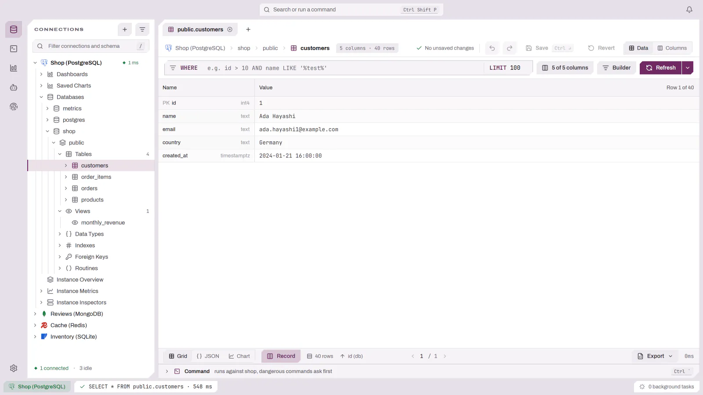
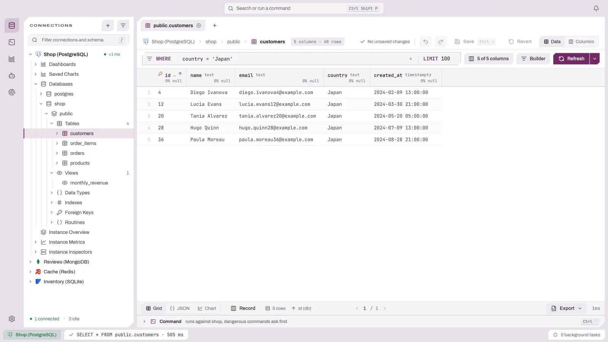
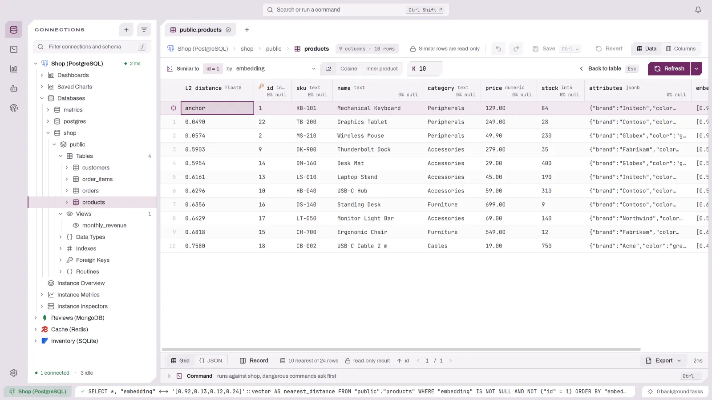
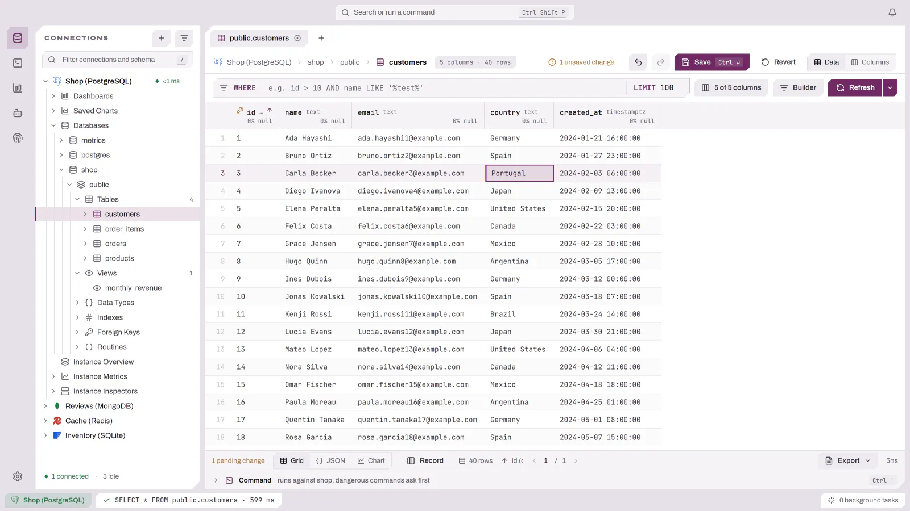

# Working with Results

Results render in result tabs inside the document. Each table or collection
opens in the view its driver declares for that object, and offers the other
views it declares:

- **Table view** for relational tables and query results.
- **Tree view** for document collections (for example MongoDB, DynamoDB), with
  **Table** and **JSON** views of the same page (see
  [Document collections](DOCUMENTS.md)).
- **Table view** with a **Tree** view of the same rows for a table with JSON
  columns (see [JSON columns in a table](DOCUMENTS.md#json-columns-in-a-table)).
- **Chart above the grid** for a time series, such as an InfluxDB measurement or
  a TimescaleDB hypertable, when its rows can be charted (see
  [Time-series tables and collections](CHARTS.md#time-series-tables-and-collections)).
- **Key-value view** for Redis (see [Key-Value Browser](KEY_VALUE.md)).

A table with a vector column also lists the rows most
[similar](#similar-rows) to the one selected.

Event-stream-style containers open as event streams when the driver declares that
presentation.

## Results beside the editor

In a query tab the results sit below the editor. On a wide screen, move them to
the right of the editor with the panel button in the results header, the
**Show results on the right** entry of the pane actions, or **Move results
beside or below the editor** in the command palette. The same control moves
them back below. Drag the divider to resize the two sides. New query tabs open
with the position you chose last.

In either position, `Ctrl+j` moves the keyboard from the editor to the results
and `Ctrl+k` moves it back.

## Navigating the data grid

When the results panel has focus:

- `j`/`k` (or `Down`/`Up`) — move between rows.
- `h`/`l` (or `Left`/`Right`) — move between columns.
- `g`/`Shift+g` (or `Home`/`End`) — first / last row.
- `Ctrl+d`/`Ctrl+u` (or `PageDown`/`PageUp`) — page through rows.
- `[` / `]` — previous / next page of results (pagination).
- `f` focuses the toolbar; `/` focuses the search/filter.
- `z` toggles collapsing the panel.
- `m` (or `Shift+F10`) opens the row/cell context menu.

## Record view

Press `i`, or use the Record toggle in the result status bar, to show
the active row as a Name / Value list that fills the result area. The header
names the row's position in the result. Fields are edited exactly like grid
cells, so unsaved changes, Save Row and revert work the same in both layouts;
`Up`/`Down` move between fields and `Left`/`Right` move between rows. Press
`i` again to return to the grid.

<picture>
  <source media="(prefers-color-scheme: dark)" srcset="images/results/record-view-dark.webp">
  
</picture>

## Column header menu

Right-click a column header for a menu scoped to that column: order ascending
or descending, clear the ordering, and every filter operator, in one flat
list. A left click on the header still cycles the sort.

## Value panel

Right-click a cell and choose **View Value**, or press `v`, to open the cell
in the inspector rail on the right. The panel shows the value as JSON, XML or
plain text — detected from the content, and only when it really parses — with
pretty-print, compact and word wrap. You can edit there: **Save** commits the
row directly, **Revert** discards the edit. The panel follows the selected cell
as you move through the grid, except while it holds an unsaved change.

## Row inspector

Press `Ctrl+Space`, or right-click a row and choose **Inspect Row**, to open
the selected row in the inspector rail on the right. It lists every column of
the row with its value and marks primary and foreign key columns. The inspector
follows the selected row as you move through the grid; the pin button in its
header keeps it on the current row instead. **Edit**, **Duplicate** and
**Delete** at its foot act on the inspected row when the result is editable.
Press `Ctrl+Space` again, or the close button, to dismiss it.

Under **References** the inspector lists the row's foreign keys in both
directions:

- **Outgoing** — a single-column foreign key of this row points at another
  table. The entry names that table and the row it points at, by its readable
  label once resolved ("María López · #8"), or by its key until then. Click it
  to open the referenced table on that row: DBFlux reuses the table's existing
  tab — opening one if none is open — and replaces its filter with a
  primary-key equality, so the referenced row is the one in view.
- **Incoming** — other tables hold foreign keys that point at this row. Each
  entry names the table and counts how many of its rows reference this one;
  counts load in the background. These entries are informational only.

Foreign-key cells in the grid can show the same referenced-row label next to
the id: turn on **Show referenced-row labels in foreign-key cells** in
[Settings](SETTINGS.md). The row inspector resolves references regardless of
that setting.

## Filtering results

The data grid toolbar has a `WHERE` filter input that re-runs the query with the
condition you type. For SQL connections it supports two styles:

- **Raw `WHERE`** — type a plain condition (for example `status = 'active'`). This
  is the default behavior.
- **Relational (ORM-style) paths** — type a dotted path that walks foreign keys,
  for example `created_by.email LIKE '%@acme.com'` or
  `created_by.organization.name = 'Acme'`. DBFlux resolves the path against the
  table's foreign-key metadata and joins through to the referenced table for you;
  there is no need to write the JOINs by hand.

When a relational filter resolves, a chip shows how many joins it added. If a
segment is ambiguous or cannot be resolved, an inline error appears with an
**Open in builder** link that opens the visual query builder seeded with the
joins resolved so far. Non-dotted input always keeps the raw-`WHERE` behavior.

The filter input also offers schema-aware autocomplete (same navigation as the
builder — see [Schema-aware autocomplete](QUERY_BUILDER.md#schema-aware-autocomplete)).

<picture>
  <source media="(prefers-color-scheme: dark)" srcset="images/results/filtering-dark.webp">
  
</picture>

## Similar rows

On a table with a vector column (today a PostgreSQL table with a pgvector
`vector` column), press `Shift+s` or choose **Find similar rows** in the row
menu to list the rows nearest to the selected row. The menu entry names the
column it reads and how many rows it lists, or why it cannot run: the row has no
value in that column, or the grid holds unsaved changes, which must be saved or
reverted first.

<picture>
  <source media="(prefers-color-scheme: dark)" srcset="images/results/similar-rows-dark.webp">
  
</picture>

The grid then shows the selected row pinned on top, marked `anchor`, and its 10
nearest rows below it, closest first. The first column holds the distance, under
a header that names it. A bar replaces the filter row:

- The column picker chooses the vector column. With the cursor on a vector
  column, the search starts on that column; otherwise on the table's first one.
- **L2**, **Cosine** and **Inner product** switch the distance. Inner product
  shows the product itself, highest first.
- **K** sets how many rows to list, from 1 to 1000.
- **Back to table**, or `Esc`, returns to the table page with its filter.

The selected row is left out of its neighbors by its primary key, rows without a
vector are not listed, and similar rows are read-only. A distance that is not a
number shows a dash. `halfvec` and `sparsevec` columns do not offer the search.

## Editing and CRUD

In the data grid:

- `o` — add a row.
- `x` — delete the selected row.
- `r` — rename / edit (context-dependent).
- `y` — copy the selected row.
- `Ctrl+c` (`Cmd+c`) — copy the selected cell(s) to the clipboard.

<picture>
  <source media="(prefers-color-scheme: dark)" srcset="images/results/editing-dark.webp">
  
</picture>

### When results are editable

Plain table browses are editable when the table has a primary key. Results
produced by the **visual query builder** (SELECT mode) are also editable, but
only when they are provably bound to a single table: the result maps 1:1 to one
underlying table and every primary-key column of that table is projected under
its original name. Edits and deletes then build their `WHERE` from the projected
primary-key values.

JOINs are allowed: columns from the source table are editable, while joined
columns are read-only.

A builder result falls back to **read-only** — with a toolbar hint explaining why
— when any of these hold:

- The query aggregates or uses `GROUP BY` / `HAVING`.
- The projection is a wildcard across a JOIN.
- A primary-key column is missing or projected under an alias.
- The table's keys have not been loaded from the schema cache yet (the grid
  upgrades itself to editable once the keys arrive).

Free-form SQL typed into the editor stays read-only; inline edit applies only to
plain table browses and builder-generated SELECTs.

### Aggregated results

When a result comes from a grouped (`GROUP BY`) query, rows show the aggregated
output and editing is disabled — add-row, delete-row, edit-cell, and inspect-row
are unavailable, with explanatory tooltips. Pagination counts the grouped rows
(not the underlying rows), so the page total is accurate. Aggregate columns keep
the correct column kind, so charting still works.

## Copy as Query

The result context menu includes **Copy as Query**, which generates a
driver-specific mutation statement (or envelope, for non-SQL drivers) from the
selected row using the driver's own query generator.

## Exporting

Press `Ctrl+e` (`Cmd+e`) in the results panel, or run **Export results** from the
command palette. The available formats depend on the result shape and include:

- **CSV**
- **JSON (pretty)** and **JSON (compact)**
- **Text**
- **Binary** (for binary-shaped results)

The menu's **Save loaded rows as file** and **Copy loaded rows to clipboard**
sections write the rows the grid holds, which for a table is the current page,
and the toast states how many rows went into the file or the clipboard.

When the grid shows a table or a collection read page by page, the menu adds
**Export all rows to file**, in CSV or in JSON with one object per line. It
reads the whole table or collection again with the grid's current filter, sort
and column selection, one page at a time, and streams it into the one file you
choose, so the data never has to fit in memory. A table shown through the query
builder or a relational filter is read through the same query, starting at its
offset and stopping at its limit when it sets one. The export runs as a task in
the Tasks panel, which shows its progress and can cancel it; the toast states
the total row count and the path.

A document collection exported as JSON writes each document whole, one object
per line, with every field it has. As CSV it is written with the columns the
grid shows for the first page, including expanded objects. Documents of one
collection need not share their fields, so in a CSV file a field that first
appears on a later page has no column, because the header is already written;
the export then names those fields in a warning.

A query result offers only the loaded rows, because exporting all of them would
mean running the query again. So does a nearest-neighbor search: it returns a
fixed number of the closest rows, and the grid already holds all of them.
