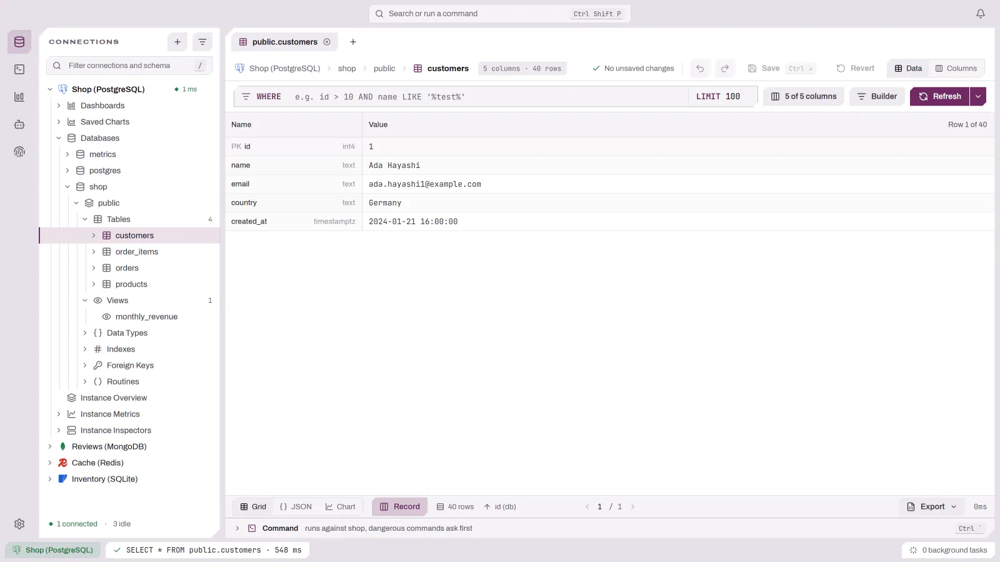
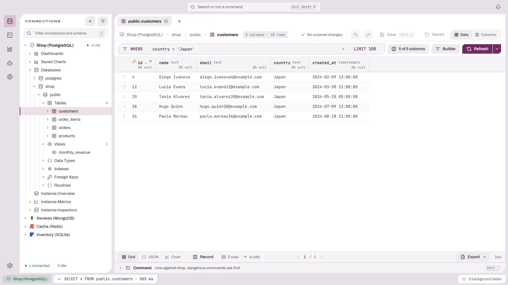
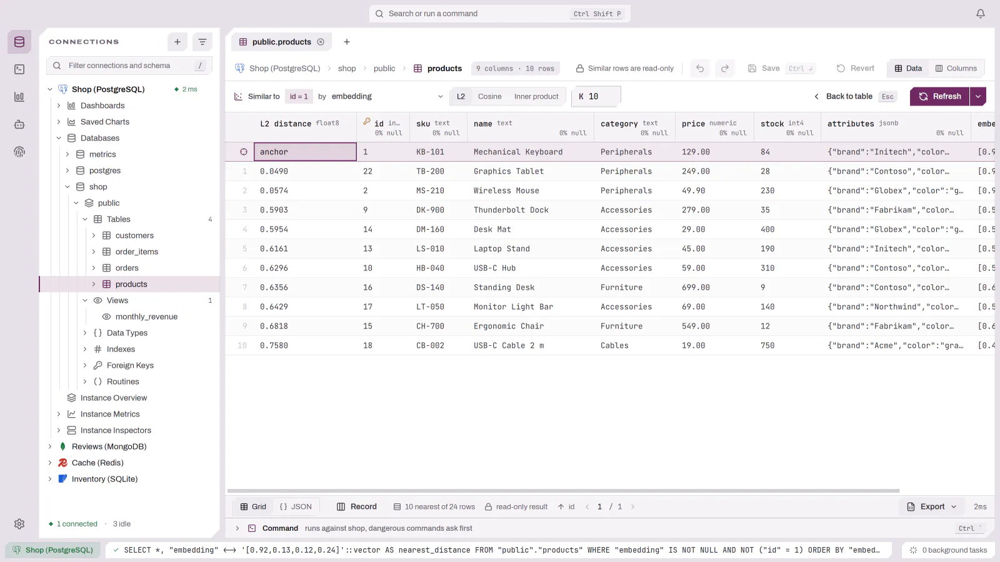
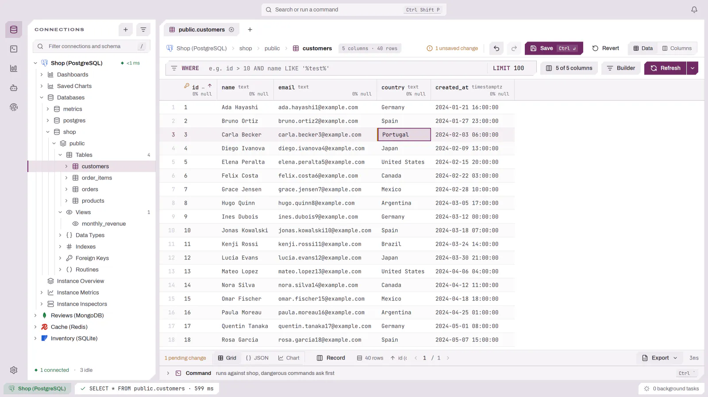

# Working with Results

Results render in result tabs inside the document. Each table or collection
opens in the view its driver declares for that object, and offers the other
views it declares:

- **Table view** for relational tables and query results.
- **Tree view** for document collections (for example MongoDB, DynamoDB), with
  **Table** and **JSON** views of the same page (see
  [Document collections](DOCUMENTS.md)).
- **Table view** with a **Tree** view of the same rows for a table with JSON
  columns (see [JSON columns in a table](DOCUMENTS.md#json-columns-in-a-table)).
- **Chart above the grid** for a time series, such as an InfluxDB measurement or
  a TimescaleDB hypertable, when its rows can be charted (see
  [Time-series tables and collections](CHARTS.md#time-series-tables-and-collections)).
- **Key-value view** for Redis (see [Key-Value Browser](KEY_VALUE.md)).

A table with a vector column also lists the rows most
[similar](#similar-rows) to the one selected.

Event-stream-style containers open as event streams when the driver declares that
presentation.

## Results beside the editor

In a query tab the results sit below the editor. On a wide screen, move them to
the right of the editor with the panel button in the results header, the
**Show results on the right** entry of the pane actions, or **Move results
beside or below the editor** in the command palette. The same control moves
them back below. Drag the divider to resize the two sides. New query tabs open
with the position you chose last.

In either position, `Ctrl+j` moves the keyboard from the editor to the results
and `Ctrl+k` moves it back.

## Navigating the data grid

When the results panel has focus:

- `j`/`k` (or `Down`/`Up`) — move between rows.
- `h`/`l` (or `Left`/`Right`) — move between columns.
- `g`/`Shift+g` (or `Home`/`End`) — first / last row.
- `Ctrl+d`/`Ctrl+u` (or `PageDown`/`PageUp`) — page through rows.
- `[` / `]` — previous / next page of results (pagination).
- `f` focuses the toolbar; `/` focuses the search/filter.
- `z` toggles collapsing the panel.
- `m` (or `Shift+F10`) opens the row/cell context menu.

## Record view

Press `i`, or use the Record toggle in the result status bar, to show
the active row as a Name / Value list that fills the result area. The header
names the row's position in the result. Fields are edited exactly like grid
cells, so unsaved changes, Save Row and revert work the same in both layouts;
`Up`/`Down` move between fields and `Left`/`Right` move between rows. Press
`i` again to return to the grid.

<picture>
  <source media="(prefers-color-scheme: dark)" srcset="images/results/record-view-dark.webp">
  
</picture>

## Column header menu

Right-click a column header for a menu scoped to that column: copy the column
name, order ascending or descending, clear the ordering, and every filter
operator, in one flat list. A left click on the header still cycles the sort.
The table menu (`m`) also offers **Copy column name** for the active cell's
column, so the keyboard reaches it too.

## Value panel

Right-click a cell and choose **View Value**, or press `v`, to open the cell
in the inspector rail on the right. The panel shows the value as JSON, XML or
plain text — detected from the content, and only when it really parses — with
pretty-print, compact and word wrap. You can edit there: **Save** commits the
row directly, **Revert** discards the edit. The panel follows the selected cell
as you move through the grid, except while it holds an unsaved change.

## Row inspector

Press `Ctrl+Space`, or right-click a row and choose **Inspect Row**, to open
the selected row in the inspector rail on the right. It lists every column of
the row with its value and marks primary and foreign key columns. The inspector
follows the selected row as you move through the grid; the pin button in its
header keeps it on the current row instead. **Edit**, **Duplicate** and
**Delete** at its foot act on the inspected row when the result is editable.
Press `Ctrl+Space` again, or the close button, to dismiss it.

Under **References** the inspector lists the row's foreign keys in both
directions:

- **Outgoing** — a single-column foreign key of this row points at another
  table. The entry names that table and the row it points at, by its readable
  label once resolved ("María López · #8"), or by its key until then. Click it
  to open the referenced table on that row: DBFlux reuses the table's existing
  tab — opening one if none is open — and replaces its filter with a
  primary-key equality, so the referenced row is the one in view.
- **Incoming** — other tables hold foreign keys that point at this row. Each
  entry names the table and counts how many of its rows reference this one;
  counts load in the background. These entries are informational only.

Foreign-key cells in the grid can show the same referenced-row label next to
the id: turn on **Show referenced-row labels in foreign-key cells** in
[Settings](SETTINGS.md). The row inspector resolves references regardless of
that setting.

## Filtering results

The data grid toolbar has a `WHERE` filter input that re-runs the query with the
condition you type. For SQL connections it supports two styles:

- **Raw `WHERE`** — type a plain condition (for example `status = 'active'`). This
  is the default behavior.
- **Relational (ORM-style) paths** — type a dotted path that walks foreign keys,
  for example `created_by.email LIKE '%@acme.com'` or
  `created_by.organization.name = 'Acme'`. DBFlux resolves the path against the
  table's foreign-key metadata and joins through to the referenced table for you;
  there is no need to write the JOINs by hand.

When a relational filter resolves, a chip shows how many joins it added. If a
segment is ambiguous or cannot be resolved, an inline error appears with an
**Open in builder** link that opens the visual query builder seeded with the
joins resolved so far. Non-dotted input always keeps the raw-`WHERE` behavior.

The filter input also offers schema-aware autocomplete (same navigation as the
builder — see [Schema-aware autocomplete](QUERY_BUILDER.md#schema-aware-autocomplete)).

<picture>
  <source media="(prefers-color-scheme: dark)" srcset="images/results/filtering-dark.webp">
  
</picture>

## Similar rows

On a table with a vector column (today a PostgreSQL table with a pgvector
`vector` column), press `Shift+s` or choose **Find similar rows** in the row
menu to list the rows nearest to the selected row. The menu entry names the
column it reads and how many rows it lists, or why it cannot run: the row has no
value in that column, or the grid holds unsaved changes, which must be saved or
reverted first.

<picture>
  <source media="(prefers-color-scheme: dark)" srcset="images/results/similar-rows-dark.webp">
  
</picture>

The grid then shows the selected row pinned on top, marked `anchor`, and its 10
nearest rows below it, closest first. The first column holds the distance, under
a header that names it. A bar replaces the filter row:

- The column picker chooses the vector column. With the cursor on a vector
  column, the search starts on that column; otherwise on the table's first one.
- **L2**, **Cosine** and **Inner product** switch the distance. Inner product
  shows the product itself, highest first.
- **K** sets how many rows to list, from 1 to 1000.
- **Back to table**, or `Esc`, returns to the table page with its filter.

The selected row is left out of its neighbors by its primary key, rows without a
vector are not listed, and similar rows are read-only. A distance that is not a
number shows a dash. `halfvec` and `sparsevec` columns do not offer the search.

## Editing and CRUD

In the data grid:

- `o` — add a row.
- `x` — delete the selected row.
- `r` — rename / edit (context-dependent).
- `y` — copy the selected row.
- `Ctrl+c` (`Cmd+c`) — copy the selected cell(s) to the clipboard.

<picture>
  <source media="(prefers-color-scheme: dark)" srcset="images/results/editing-dark.webp">
  
</picture>

### When results are editable

Plain table browses are editable when the table has a primary key. Results
produced by the **visual query builder** (SELECT mode) are also editable, but
only when they are provably bound to a single table: the result maps 1:1 to one
underlying table and every primary-key column of that table is projected under
its original name. Edits and deletes then build their `WHERE` from the projected
primary-key values.

JOINs are allowed: columns from the source table are editable, while joined
columns are read-only.

A builder result falls back to **read-only** — with a toolbar hint explaining why
— when any of these hold:

- The query aggregates or uses `GROUP BY` / `HAVING`.
- The projection is a wildcard across a JOIN.
- A primary-key column is missing or projected under an alias.
- The table's keys have not been loaded from the schema cache yet (the grid
  upgrades itself to editable once the keys arrive).

Free-form SQL typed into the editor stays read-only; inline edit applies only to
plain table browses and builder-generated SELECTs.

### Aggregated results

When a result comes from a grouped (`GROUP BY`) query, rows show the aggregated
output and editing is disabled — add-row, delete-row, edit-cell, and inspect-row
are unavailable, with explanatory tooltips. Pagination counts the grouped rows
(not the underlying rows), so the page total is accurate. Aggregate columns keep
the correct column kind, so charting still works.

## Copy as Query

The result context menu includes **Copy as Query**, which generates a
driver-specific mutation statement (or envelope, for non-SQL drivers) from the
selected row using the driver's own query generator.

## Exporting

Press `Ctrl+e` (`Cmd+e`) in the results panel, or run **Export results** from the
command palette. The available formats depend on the result shape and include:

- **CSV**
- **JSON (pretty)** and **JSON (compact)**
- **Text**
- **Binary** (for binary-shaped results)

The menu's **Save loaded rows as file** and **Copy loaded rows to clipboard**
sections write the rows the grid holds, which for a table is the current page,
and the toast states how many rows went into the file or the clipboard.

When the grid shows a table or a collection read page by page, the menu adds
**Export all rows to file**, in CSV, JSON (one array with an object per
line) or JSON Lines (one object per line, `.jsonl`), or as an HTML table, a
Markdown table or XML for reading and sharing. It
reads the whole table or collection again with the grid's current filter, sort
and column selection, one page at a time, and streams it into the one file you
choose, so the data never has to fit in memory. A table shown through the query
builder or a relational filter is read through the same query, starting at its
offset and stopping at its limit when it sets one. The export runs as a task in
the Tasks panel, which shows its progress and can cancel it; the toast states
the total row count and the path.

HTML, Markdown and XML files are for reading, not for import: importing a folder
that holds one of them stops at that table, which fails with a message that its
format cannot be imported, and the tables after it are not attempted. XML writes a `<row>` per row and a `<field name="...">` per column,
with `null="true"` for a NULL so it stays distinct from an empty value.

The export wizard (**Export Table…** in the sidebar) writes each selected table
to its own file in a new folder, next to a `manifest.json`. Its Format step
offers the options a format uses and hides the others:

- **Delimiter** (CSV only): comma, semicolon, tab or pipe.
- **Encoding** (CSV only): UTF-8, UTF-8 with BOM, UTF-16LE (with BOM) or
  Windows-1252. A character Windows-1252 cannot represent stops the export with
  an error naming it, instead of being replaced.
- **NULL text** (CSV, HTML and Markdown): the text written for NULL, empty by
  default. JSON and JSON Lines always write `null`, and XML marks a NULL with
  `null="true"`. A value whose text equals a non-empty NULL text would be read
  back as NULL, so the export stops with an error naming the value and the
  column; choose another NULL text. With the default empty NULL text, an empty
  string and NULL are written the same way, so a CSV import reads both back as
  NULL; set a non-empty NULL text such as `\N` to keep empty strings.
- **Dates** (every format except SQL): RFC 3339 (the default), `YYYY-MM-DD HH:MM:SS` in
  UTC, or epoch seconds, which JSON and JSON Lines write as a number. A date is
  written as `YYYY-MM-DD` under the first two and as its midnight (UTC) under
  epoch, and a time as `HH:MM:SS` under `YYYY-MM-DD HH:MM:SS` and as seconds
  since midnight under epoch.
- **Rows per INSERT** (SQL only): how many rows go into each `INSERT`
  statement, 500 by default and at least 1. A driver that limits rows per
  statement, such as SQL Server with 1000, caps the value.

SQL is offered in the export wizard only when the source connection's driver
can generate bulk `INSERT` statements. It writes one `<schema>.<table>.sql` file
per table of `INSERT` statements in that connection's own dialect: each
statement holds one batch of rows, names the table the way the dialect writes
it and ends with `;`. The script replays into an empty copy of the table;
running it twice fails on unique keys or duplicates the rows. A PostgreSQL
`GENERATED ALWAYS AS IDENTITY` column is written with `OVERRIDING SYSTEM VALUE`,
and a SQL Server table with an `IDENTITY` column is wrapped in
`SET IDENTITY_INSERT ... ON;` and `OFF;`, so the original ids are kept. After a
PostgreSQL table's last statement the script moves the sequence of every
identity or serial column past the exported values (`setval`): to the largest
for an ascending sequence and to the smallest for a descending one, so a default
insert after the replay does not reuse an id; SQL Server advances an identity
seed by itself when explicit values are inserted. Columns the database computes (PostgreSQL
and MySQL/MariaDB generated columns, SQL Server computed, `rowversion` and temporal
period `GENERATED ALWAYS AS ROW START/END` columns) are left out of
the statements so the database computes them again on replay. A table
with no rows writes an empty file. The dialect
decides how NULL and dates are written, so the NULL text, delimiter, encoding
and date options do not apply and are hidden. SQL files are not importable yet:
importing a folder that holds one fails that table with the message that the
format cannot be imported. **Export all rows to file** does not offer SQL.

When the source connection cannot write SQL, the Format step does not list it
and says why under the format picker: its driver can't generate `INSERT`
statements, so export as CSV or JSON instead. Every state that switches
**Continue** off says why. The footer names what to fix (**Rows per INSERT**,
**Chunk size**, the folder, or an empty table selection), and an invalid field
shows a danger frame, an alert icon and a hint. When the run ends, the dialog
lists one row per table with its outcome. A table the run never reached after a
failure says so, and a failed run says what to do next: files already written
stay in the folder, a failed run writes no `manifest.json`, so the folder cannot
be imported as a whole, and each completed CSV or JSON file can still be
imported with **Choose File…**.

The defaults write exactly what earlier versions wrote. The manifest records
the options that shaped a file, so importing the folder reads it back the same
way; a manifest without them means the defaults. **Export all rows to file**
always uses the defaults.

A document collection exported as JSON or JSON Lines writes each document
whole, one object per line, with every field it has. As CSV, HTML, Markdown or
XML it is written with the columns the grid shows for the first page, including
expanded objects. Documents of one collection need not share their fields, so in
any of these files a field that first appears on a later page has no column, because the header is already written;
the export then names those fields in a warning.

A query result offers only the loaded rows, because exporting all of them would
mean running the query again. So does a nearest-neighbor search: it returns a
fixed number of the closest rows, and the grid already holds all of them.

## Importing a file

The import wizard also reads one loose file. Choose **Choose File…** on its
first step, next to the folder picker, and pick a `.csv`, `.json`, `.jsonl`,
`.xml` or spreadsheet (`.xlsx`, `.xlsm`, `.xls` or `.ods`) file; HTML, Markdown
and SQL files are not offered. The wizard reads the
columns from the CSV header row, from the keys of the first 100 JSON records,
from the `name` of the `<field>` elements in the first 100 XML rows (all the
keys seen, in the order they first appear), or from row 1 of a spreadsheet sheet. A key that first appears after those
rows stops the import with an error naming it and its row. A nested object or array
is imported as JSON text.

The target table defaults to the file name without its extension; type another
name and choose **Use Table** (or press Enter) to point the import at an
existing table. The column mapping and the table modes (create, existing,
recreate, truncate, skip) are the same as for a folder. A file carries no column
types, so values going into an existing table are read as that table's column
types, and a new table is created with a text column for every field (`TEXT`, or the
engine's own wide text type such as `NVARCHAR(MAX)` on SQL Server or `LONGTEXT` on MySQL), so values
are stored as their text.

A CSV file offers the delimiter, the encoding and the text that stands for NULL,
the same choices as the export wizard; JSON, JSON Lines and XML have no options.
An XML file must have the shape the export writes: a `<rows>` root holding
`<row>` elements, each with a `<field name="...">text</field>` per column. A
field written as `<field name="..." null="true"/>` is NULL, an empty
`<field>` is an empty string, and character references such as `&#10;` are
decoded. Any other XML shape is rejected with a message that states the one
expected.
Changing the delimiter or encoding reads the file again. The whole file is read
once before anything is written, so a malformed row or record stops the import
with the target unchanged.

A spreadsheet is imported one sheet at a time. The Configure step adds a
**Sheet** dropdown that lists the visible worksheets of the workbook and starts
on the first; hidden sheets and chart sheets are not listed, and choosing another
sheet reads the file again at once and rebuilds the column mapping. A workbook
with one visible sheet shows it with the dropdown off and says there is nothing
to choose. Row 1 of the sheet is the header, so every column needs a unique,
non-blank name; a spreadsheet has no delimiter, encoding or NULL options. Numbers,
booleans, dates, date-times and text are read as values of those types, an
empty cell is NULL, and a formula is read as the result last saved in the file.
Workbooks on the 1904 date system read their dates correctly, but a time of day
in one arrives as a timestamp on 1904-01-01 instead of a time. The whole sheet
is read into memory, so a sheet of more than 10,000,000 cells (rows × columns,
counted from cell A1) is rejected. A sheet that cannot be imported keeps the file
picked on Configure and shows a danger block with what to do next: the sheet is
empty, row 1 has a blank or repeated name (the block lists the columns), a cell
holds an error value such as `#DIV/0!` (the block names the sheet, row and
column), or the sheet is over the limit (export it as CSV and import that, or
choose a smaller sheet). Choosing another sheet is the way out of each of them,
and the footer says why **Continue** is off.

The import dialog uses the same top stepper and footer as the export wizard:
**Cancel** on the first two steps, **Back** and **Cancel** on the confirmation,
and **Continue** as the primary button. A file or folder that cannot be read
shows one danger block with the error and what to do next. A CSV whose header
does not decode stays on Configure, where another delimiter or encoding reads it
again; broken JSON stays on the first step until another file is chosen; and a
failed look-up of the target table says so and is retried with **Use Table**.
The footer says why **Continue** is off (a file is being read, or could not be
read). JSON and JSON Lines show a line saying they have no options, and on a
connection that cannot truncate tables a line explains why Truncate is not
listed. In the text fields, `Escape` leaves the field and returns the keys to
the dialog; a second `Escape` closes the wizard. When the run ends, one row per
table lists its outcome, and a failed run says what to do next.
