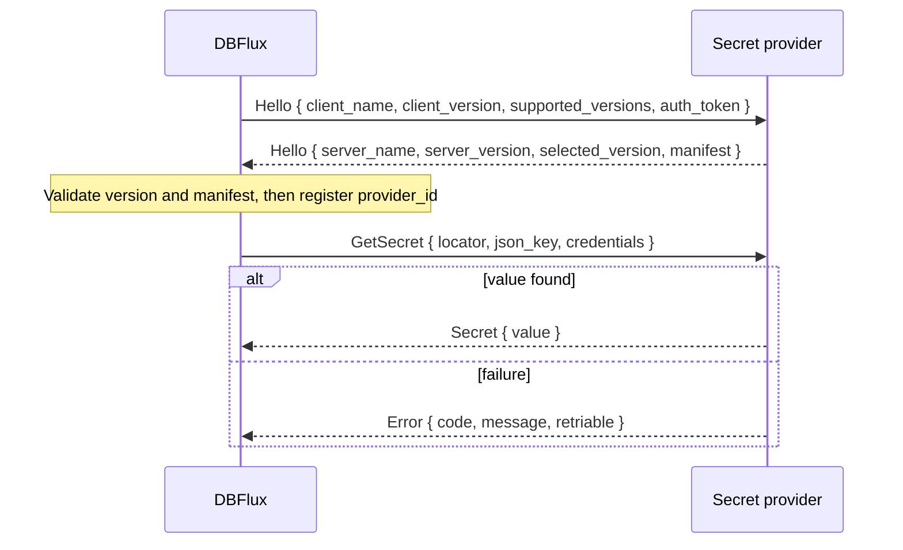

# Secret Provider RPC Protocol Specification

This document defines how DBFlux talks to an external secret provider: a local process that
returns secret values for connection, proxy, SSH tunnel and auth-profile fields, so those
values never have to be copied into the system keyring.

A secret provider is an RPC service of kind `RpcServiceKind::SecretProvider` (storage value
`secret_provider`). It is configured like any other RPC service; see
[RPC Services UI Reference](RPC_SERVICES_CONFIG.md). The transport and framing are shared
with the [Driver RPC Protocol](DRIVER_RPC_PROTOCOL.md).

## Scope

| In scope | Out of scope |
|---|---|
| A versioned manifest announced in `Hello` | Provider-specific integrations (tracked separately) |
| One read-only method, `GetSecret` | Writing secrets back to external managers |
| Timeouts, cancellation, caching and invalidation | A hosted control plane |
| Optional forwarding of auth-profile credentials | |

The contract is read-only: it has no method to create, update or delete a secret, and DBFlux
never sends a provider the value it asks for. DBFlux does send two other secrets:

- the RPC auth token, in `Hello` and, for a managed host, through
  `DBFLUX_SECRET_PROVIDER_RPC_AUTH_TOKEN`, so the provider can reject other local processes;
- the connection's resolved auth-profile credentials, only to a provider whose manifest declares
  `auth_profile_dependency` as `optional` or `required` (see
  [Credential dependency](#credential-dependency)).

## Quick path

1. Listen on the socket `dbflux-secret-provider-<socket_id>.sock` (`-debug` before `.sock`
   in debug builds of DBFlux).
2. Answer `Hello` with `selected_version: 1.0` and a valid manifest.
3. Answer each `GetSecret` with `Secret { value }` or `Error { code, message, retriable }`.
4. Add the service in **Settings → RPC Services** with kind **Secret provider**.
5. In a connection field, pick the provider as the value source and enter a locator.

## Using a provider from a field

A field that reads from an external provider stores a `ValueRef::Secret` whose `provider` is
the manifest's `provider_id`:

```json
{ "source": "secret", "provider": "<provider_id>", "locator": "prod/db/password", "json_key": "password" }
```

`json_key` is optional and omitted when unset. The built-in AWS providers use the same shape
with the reserved ids `aws-secrets-manager` and `aws-ssm`, and keep working unchanged.

## Transport

| Item | Value |
|---|---|
| Socket name | `dbflux-secret-provider-<socket_id>.sock`, or `dbflux-secret-provider-<socket_id>-debug.sock` from a debug build |
| Namespace | Platform local sockets, as for drivers (abstract Unix socket, `/tmp/` Unix socket, or named pipe) |
| Framing | 4-byte little-endian `u32` length, then a postcard payload; 16 MiB maximum |
| Connections | One connection per request: DBFlux connects, sends one envelope, reads one response, closes |
| Auth token | Sent in `Hello.auth_token`; a managed host receives it in `DBFLUX_SECRET_PROVIDER_RPC_AUTH_TOKEN` |

`socket_id` accepts ASCII letters, digits, `.`, `_` and `-`.

Every message is an envelope:

```rust
SecretProviderRequestEnvelope { protocol_version, request_id, body }
SecretProviderResponseEnvelope { protocol_version, request_id, body }
```

The response must echo the request's `request_id`; a mismatch is a protocol failure.

## Version negotiation

| Item | Value |
|---|---|
| API family | `secret_provider_rpc` (`RpcApiFamily::SecretProviderRpc`) |
| Supported versions | `1.0` |
| Default contract on a stored row | `secret_provider_rpc` `1.0` |

DBFlux sends its supported versions in `Hello`. The provider returns the version it selected;
anything other than a version DBFlux supports is rejected and the provider is not registered.
A stored row whose `api_family` or `api_major` does not match is rejected before DBFlux
launches or probes the service.

## Handshake and requests



`Hello` and each `GetSecret` travel on separate connections.

### Hello

```rust
SecretProviderRequestBody::Hello(SecretProviderHelloRequest {
    client_name: "dbflux_ipc".into(),
    client_version: "<dbflux version>".into(),
    supported_versions: vec![ProtocolVersion::new(1, 0)],
    auth_token: Some("<token>".into()),
})

SecretProviderResponseBody::Hello(SecretProviderHelloResponse {
    server_name: "my-vault-bridge".into(),
    server_version: "0.1.0".into(),
    selected_version: ProtocolVersion::new(1, 0),
    manifest: SecretProviderManifest { /* see below */ },
})
```

If the provider answers `Hello` with `Error`, the probe fails and the provider is skipped.

### Manifest

| Field | Type | Rule |
|---|---|---|
| `manifest_version` | `u16` | Must be `1` |
| `provider_id` | string | 1 to 64 characters, only `a-z`, `0-9`, `.`, `_`, `-`; must not be a reserved id (`aws-secrets-manager`, `aws-ssm`) or an id another provider already registered |
| `display_name` | string | Must not be empty after trimming; shown in the value-source selector |
| `capabilities.get_secret` | bool | Must be `true` |
| `capabilities.json_key` | bool | Whether the provider extracts `json_key` itself; defaults to `false` |
| `auth_profile_dependency` | `none` \| `optional` \| `required` | Whether DBFlux forwards auth-profile credentials; defaults to `none` |
| `cache_ttl_seconds` | `Option<u32>` | `None` uses the host default; `0` disables caching |
| `request_timeout_ms` | `Option<u32>` | `None` means `15000`; clamped to `1..=60000` |

A manifest that breaks a rule is rejected and the provider is not registered.

### GetSecret

```rust
SecretProviderRequestBody::GetSecret(GetSecretRequest {
    locator: "prod/db/password".into(),
    json_key: None,
    credentials: None, // Option<ResolvedCredentialsDto>
})

SecretProviderResponseBody::Secret { value: "<secret>".into() }
```

- `locator` is opaque to DBFlux; the provider defines its syntax.
- When a field sets `json_key` and the manifest does not declare `capabilities.json_key`,
  DBFlux fails the resolution with `InvalidRequest` without calling the provider.

## Credential dependency

`auth_profile_dependency` decides whether the connection's resolved auth-profile credentials
reach the provider in `GetSecretRequest.credentials`:

| Value | Behavior |
|---|---|
| `none` | `credentials` is always `None` |
| `optional` | DBFlux forwards the credentials when the connection has an auth profile, otherwise `None` |
| `required` | DBFlux forwards the credentials; without an auth profile the resolution fails with `MissingCredentials` before any RPC is sent |

## Errors

A provider reports a failure as:

```rust
SecretProviderResponseBody::Error(SecretProviderRpcError { code, message, retriable })
```

| Code | Meaning | Source lost |
|---|---|---|
| `NotFound` | No secret at the locator, or no such `json_key` | No |
| `AccessDenied` | The provider or its credentials may not read the secret | No |
| `Locked` | The provider's store is locked again and needs the user | Yes |
| `InvalidLocator` | The locator is malformed for this provider | No |
| `Unavailable` | The provider cannot reach its backing store | Yes |
| `Timeout` | The provider's own backend timed out | No |
| `UnsupportedMethod` | The provider does not implement the request | No |
| `VersionMismatch` | The envelope version is not the negotiated one | No |
| `InvalidRequest` | The request is malformed | No |
| `Internal` | Any other provider failure | No |

DBFlux adds its own codes for failures that never reach the provider or happen in transit:

| Host code | Meaning | Source lost |
|---|---|---|
| `Transport` | Socket connect, send or receive failed | Yes |
| `Timeout` | No answer within the request timeout | No |
| `Protocol` | Unexpected response type or `request_id` mismatch | No |
| `MissingCredentials` | `required` dependency with no auth profile on the connection | No |

Every failure becomes a typed value-resolution error naming the provider, service `rpc` and
operation `GetSecret`, with the code and a correlation id. A source-lost failure carries the
recovery hint "Unlock or restart the secret provider, then reconnect".

## Timeouts and cancellation

- The request timeout comes from `request_timeout_ms`: default `15000` ms, clamped to
  `1..=60000`.
- The exchange runs on a dedicated thread, raced by a deadline thread. The timeout does not
  depend on a tokio runtime, so it applies in both the app and the MCP server.
- When the deadline wins, the resolution fails with `Timeout`.
- Cancelling the connection attempt drops the pending resolution. DBFlux stops waiting; the
  abandoned worker finishes when the provider answers or closes the connection, and its
  result is discarded.

## Caching and invalidation

- A resolved value is cached for the current connection attempt for
  `min(cache_ttl_seconds, 300 s)`; `None` uses the 300 s host default.
- `cache_ttl_seconds: 0` disables caching for that provider.
- When a request to a provider fails, DBFlux drops every cached value from that provider, so
  a provider that was locked again or disconnected is asked again on the next resolution.

## Redaction guarantees

- Secret values are never logged, audited, stored, exported or echoed. The value is wrapped
  in a `SecretString` as soon as it is received, and every `Debug` output prints
  `[REDACTED]` for the value, the forwarded credentials and the auth token.
- Provider error messages are sanitized before display: control characters are stripped and
  the message is cut at 512 characters.
- Every failed request carries a UUID v7 correlation id in the user-facing error message,
  without exposing the value. A failed exchange with the provider also writes the id to a
  warning log line; a request rejected before the exchange carries the id in the error only.
  The RPC client does not write the id to audit events.
- A provider must never put a secret value in an error message.

## Host lifecycle

| Situation | Behavior |
|---|---|
| `command` set | Managed launch: DBFlux spawns the command with its args, env and auth token, and waits up to `startup_timeout_ms` (default `5000`) for the socket |
| No `command`, no `args` | Unmanaged: DBFlux expects the provider to be running already |
| No `command`, `args` set | Rejected; there is no default host for secret providers |
| Managed host exited | Relaunched on the next request |
| DBFlux app shutdown | Managed hosts that the app spawned are terminated; unmanaged providers are left alone |
| `dbflux mcp` exit | Managed hosts that the MCP server spawned are not terminated and keep running, as with auth-provider hosts |

## Registration

At startup DBFlux loads every enabled `secret_provider` row and, for each one:

1. Rejects an incompatible stored contract (wrong `api_family` or `api_major`) before launch.
2. Ensures the provider is running, then performs `Hello`.
3. Validates the selected version and the manifest.
4. Skips the provider if its `provider_id` is reserved or already registered.
5. Registers the provider into every connection's value resolver, in the app and the MCP
   server.

A failing provider is skipped without affecting drivers, auth providers or other secret
providers. Secret-provider services never appear as drivers or auth providers.
