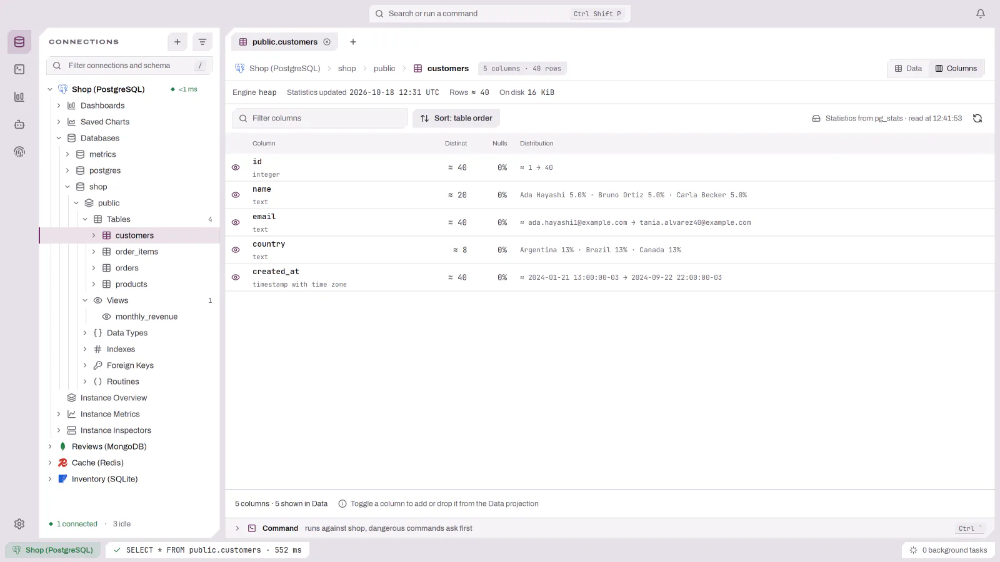

# Columns and Partitions

A table whose driver can describe its storage opens with more than its rows.
The header gets a **Data | Columns** switch, plus **Partitions** for
ClickHouse, and the Data view gains a column picker and, on ClickHouse, an
estimate of what the next read costs. Everything these views show comes from
metadata the server already keeps, so opening a table reads no more rows than
before.

| Driver | Columns from | Partitions | Read estimate | Profile the first rows | Column picker |
|--------|--------------|------------|---------------|------------------|---------------|
| ClickHouse | `system.columns`, `system.tables`, `system.parts` | Yes | Yes | Yes | Yes |
| DuckDB | `duckdb_columns()`, `pragma_storage_info` | — | — | Yes | Yes |
| Redshift | `pg_attribute`, `svv_table_info` | — | — | — | Yes |
| PostgreSQL | `pg_stats` (planner statistics) | — | — | — | Yes |

Other drivers keep the plain table view. The driver decides which of these a
table gets; DBFlux never checks which database it is talking to.

## Switching views

| Action | How |
|--------|-----|
| Next / previous view | `Alt+l` / `Alt+h`, or the **Data / Columns / Partitions** switch in the header |
| From the table menu | `m` → Toolbar → **Show Columns**, **Show Partitions**, **Show Data** |

The Columns and Partitions views replace the filter row, the grid and the
status bar; the header stays.

## The Columns view

<picture>
  <source media="(prefers-color-scheme: dark)" srcset="images/table-views/columns-dark.webp">
  
</picture>

One row per column, in table order, with the facts the source knows. A fact
the source does not know is a dash, never a zero.

| Field | What it shows |
|-------|---------------|
| **Column** | The name, the type, and badges: **Sort key N** (its place in the sort key), **Partition key**, **Distribution key**. |
| **Codec** | The compression codec or encoding (ClickHouse, DuckDB, Redshift). ClickHouse shows `default` when the table uses the server's default. |
| **On disk**, **Ratio**, **Share of table** | Compressed size, compression ratio and the column's part of the table, when the source reports sizes per column (ClickHouse). |
| **Distinct** | Distinct values. `≈` marks an estimate (planner statistics, or a sample's approximate count). |
| **Nulls** | The share of null values. |
| **Distribution** | The smallest and largest value, or the most common values with their share. `≈` marks bounds that may not be values of the column, such as string prefixes or histogram edges. |

The Codec column is left out when no column has a codec, as with PostgreSQL
planner statistics. The On disk, Ratio and Share of table columns are left out
when the source reports no size per column, as with DuckDB, Redshift and
PostgreSQL.

The Distribution field shows the most common values only when the most common
value repeats and the column has at most 50 distinct values. Otherwise it shows
the range.

Above the columns, a strip lists the table's storage facts, as far as the
source knows them:

| Driver | Facts |
|--------|-------|
| ClickHouse | Engine, sort key, primary key (when it differs from the sort key), partition key, sampling key, TTL, active parts, rows, on disk, raw, ratio |
| DuckDB | Engine, row groups, rows |
| Redshift | Engine, distribution style, sort key, unsorted share, rows, on disk (from 1 MB blocks) |
| PostgreSQL | Engine (the access method, such as `heap`), partition key (partitioned tables), when the statistics were last updated, rows (`≈`, an estimate), table size |

In the Data view, the column headers get a second line with the same badges,
the ratio and size on disk, and the share of nulls, when the profile knows
them.

### Where the numbers come from

A line in the toolbar names the source and when it was read, for example
"Sizes from system.columns · read at 14:22:05" or "Statistics from pg_stats ·
read at 09:10:41". Planner statistics are only as fresh as the last `ANALYZE`;
the facts strip says when that was, or "never".

- **Refresh statistics** (the circular arrow, or `F5`) reads the metadata again.
- **Profile the first 1 000 000 rows** (ClickHouse, DuckDB) reads up to that
  many rows to fill in nulls, approximate distinct counts and ranges that
  metadata does not hold. The limit is inside the query, so it never reads
  more. It runs only when you ask and leaves an audit event. The source line
  then gets a second line, "Distributions from the first 1 000 000 rows read ·
  read at …". Refreshing the metadata does not keep the result.

The profile reads the first rows the server returns, not a random sample. On
a ClickHouse MergeTree table these rows follow the sort key, so the range of a
leading sort key column can be much narrower than the table's.

### Keys in the Columns view

| Key | Action |
|-----|--------|
| `j` / `k` | Move between columns |
| `Space` | Add the column under the cursor to the Data view, or drop it |
| `Shift+T` | Cycle the order: table order, size, name |
| `/` | Filter columns by name or type |
| `F5` | Read the statistics again |

## Choosing columns

The **N of M columns** button in the Data filter row (or `m` → Toolbar →
**Choose columns**) picks the columns the table reads; the eye on each row of
the Columns view does the same, at once. The query then names only those
columns instead of `SELECT *`, which on a columnar engine reads only their
data. Choosing every column goes back to `SELECT *`.

- On an editable table, the primary key stays in the projection so each row
  can still be saved. A notice says when DBFlux added it back.
- A builder query or a relational filter (`orders.status = 'paid'`) chooses its
  own columns, so the picker is hidden while one of them drives the rows. The
  Columns view then hides its eyes too, and so does every Columns view on a
  connection that cannot choose columns.
- A change with unsaved edits pending is refused, as every reload is.

## The read estimate (ClickHouse)

A strip under the filter row says what the table read costs, for example
"Reads up to ≈ 96 MiB · 1 of 13 parts, 512 of 224 600 granules, 4 194 304
rows", with the columns that take most of it. It comes from `EXPLAIN
ESTIMATE` over the query the grid last ran, so a filter on the sort or
partition key shows its effect once you run it. A filter still being typed
does not change the estimate.

A filter with a subquery (`id IN (SELECT …)`) or with `IN` followed by a
table name (`id IN other_table`) gets no estimate: ClickHouse reads the
subquery or table while it plans the read, so the estimate would cost as much
as that read.

The figure is an upper bound. A `LIMIT` can stop the read sooner than the
estimate says. The bytes are also an approximation: each read column's size
on disk scaled by the share of granules the read touches.

## The Partitions view (ClickHouse)

One row per partition, newest first, from the table's active parts:

| Field | What it shows |
|-------|---------------|
| **Partition** | The partition value. |
| **Parts** | Active parts in the partition. |
| **Rows**, **On disk**, **Raw**, **Ratio** | Rows, compressed and uncompressed size, compression ratio. |
| **Key range** | The smallest and largest time or date of the partition key, when it is one. |
| **Last change** | When a part of the partition last changed. |

The list is read the first time the tab opens; the refresh button (or `F5`)
reads it again.

## Limitations

- DuckDB reports no size per column, so its Columns view has codecs, ranges and
  nulls but no sizes. String bounds come from segment statistics and are
  prefixes, marked `≈`. Nulls show 0% when no segment saw a null and are
  unknown otherwise. A DuckLake catalog has no storage information and shows
  only names and types until a profile runs.
- Redshift support is covered by unit tests only. It has not been checked
  against a live Redshift cluster.
- Redshift column sizes need access to `stv_blocklist`, which DBFlux does not
  ask for; the table's total size comes from `svv_table_info`.
- A profile reads the first rows the server returns, not a random sample.
- PostgreSQL statistics come from the planner, so they are estimates and are
  only as fresh as the last `ANALYZE`.
- The chosen columns are not restored with the session.
