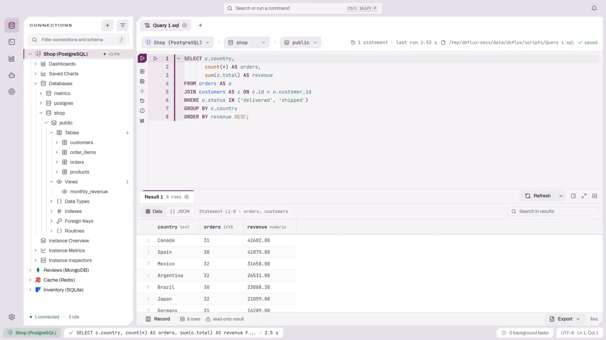
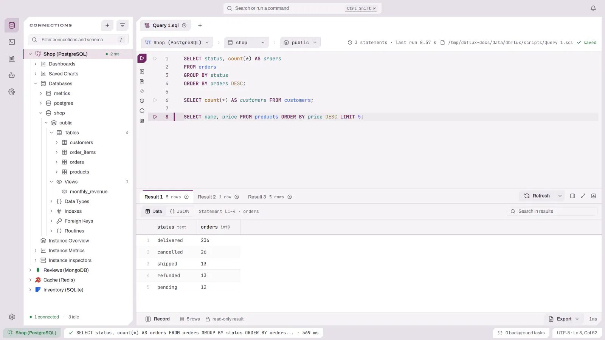
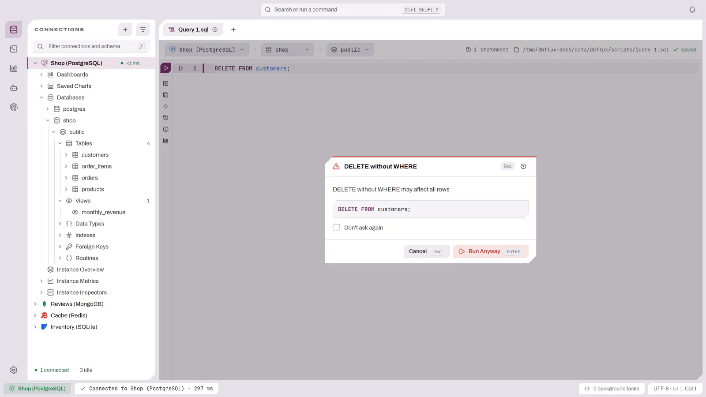

# Ejecutar queries

Abre una nueva pestaña de query con `Ctrl+n` (`Cmd+n` en macOS), o abre un
archivo de script con `Ctrl+o`. El lenguaje de query del editor (SQL, sintaxis
de queries de MongoDB, comandos de Redis, etc.) lo determina el driver de la
conexión activa, que también controla el resaltado de sintaxis y el texto de
placeholder. Un archivo `.csv` o `.tsv` se abre como tabla; ver
[Archivos CSV y TSV](CSV_FILES.md).

Para conexiones SQL, el [Constructor visual de queries](QUERY_BUILDER.md)
compone queries sin escribir SQL.

<picture>
  <source media="(prefers-color-scheme: dark)" srcset="../images/editor/query-result-dark.webp">
  
</picture>

## Guardar y cerrar pestañas

Una pestaña de query nueva (`Ctrl+n`) queda respaldada por un archivo real en tu
carpeta de scripts, igual que un script abierto con `Ctrl+o`. Los editores
abiertos se auto-guardan en ese archivo según el intervalo configurado, y
`Ctrl+s` / **Save file as…** usan la misma cola. El auto-guardado y el cierre
nunca sobrescriben un archivo que cambió fuera de DBFlux: tu versión sigue en
el editor y DBFlux informa de la escritura rechazada. `Ctrl+s` y **Save file as…**
son deliberados y escriben el archivo incluso entonces.

Cerrar una pestaña con ediciones pendientes las guarda primero y después la
cierra; si la escritura no puede aterrizar (por ejemplo, el archivo cambió
fuera de DBFlux o es read-only), la pestaña queda abierta con tus cambios y
DBFlux te indica `Ctrl+s` / **Save file as…** como la escritura deliberada. Un
buffer que todavía no tiene archivo es la excepción: al cerrarlo se te pregunta
primero, así que puedes guardarlo, cerrarlo sin guardar o cancelar. Al salir,
DBFlux guarda las ediciones pendientes de la misma forma antes de apagarse. Si
la carpeta de scripts no pudo crearse al arrancar, las queries
nuevas se conservan en el session store y **Save file as…** se ofrece al
cerrarlas.

## Ejecutar

- `Ctrl+Enter` (`Cmd+Enter`) — **Run query**.
- `Ctrl+Shift+Enter` (`Cmd+Shift+Enter`) — **Run query in new tab**.

Si existe una selección de texto no vacía, solo se ejecuta el texto
seleccionado. Sin selección y con varias sentencias separadas por `;` en el
buffer, solo se ejecuta la sentencia bajo el cursor: un cursor después del `;`
de una sentencia o en las líneas en blanco debajo de ella ejecuta esa sentencia,
y un cursor por encima de todas las sentencias ejecuta la primera. Para ejecutar
el buffer completo, selecciona todo (`Ctrl+A`) primero. Un buffer con una sola
sentencia, o en un lenguaje sin división en sentencias, se ejecuta completo.
También un buffer con un bloque compuesto, como el cuerpo `BEGIN ... END` de un
procedimiento o trigger, ya que el `;` dentro de él no termina una sentencia; un
`BEGIN` que abre una transacción no es un bloque.

Sin selección, cuando la sentencia bajo el cursor solo abre o cierra una
transacción (`BEGIN`,
`START TRANSACTION`, `COMMIT`, `END`, `ROLLBACK` o `ABORT`) y el buffer contiene
otras sentencias, el editor pregunta primero: ejecutar todo el script, que es la
opción predeterminada, o solo esa sentencia. Una conexión cuyo driver no puede
ejecutar un script completo de una vez ofrece solo esa sentencia. Ejecutado solo, un `BEGIN` deja
abierta una transacción a la que se suman en silencio las ejecuciones
posteriores de la misma pestaña, y un `COMMIT` o `ROLLBACK` omite el resto del script
y como mucho cierra una transacción que dejó abierta una ejecución anterior.

Cada resultado lleva como título las líneas de la sentencia que lo produjo. Una
sentencia que no devuelve un conjunto de resultados, como `UPDATE` o `COMMIT`,
muestra **Sentencia ejecutada** y, cuando el driver lo informa, cuántas filas
afectó, que el pie repite en lugar del recuento de filas. Los avisos y
advertencias que envía el servidor mientras se ejecuta la sentencia, como el
`WARNING: there is no transaction in progress` de PostgreSQL tras un `COMMIT`
fuera de una transacción, se listan debajo de esa línea, o en el pie de un
resultado con filas. Solo los muestran los drivers que los informan; PostgreSQL
lo hace.

Cuando la ejecución omite filas efectivamente, el editor muestra una advertencia por consulta y la cuadrícula señala el conjunto de resultados afectado, aunque no se haya conservado ninguna fila. Un resultado que alcanza exactamente el límite sin omitir filas no genera la advertencia. Un límite de filas conservadas solo restringe las filas almacenadas; los límites de bytes y tiempo son controles de ejecución independientes. Esto no implica que el editor tenga un límite de filas predeterminado.

## Scripts multi-statement

Para ejecutar varias sentencias como script, selecciónalas (`Ctrl+A`
selecciona todo el buffer) y pulsa `Ctrl+Enter`. Cuando el driver activo declara
soporte de batch, el conjunto de resultados de cada sentencia se renderiza en su
propia pestaña de resultado.

La división en sentencias es consciente del lenguaje para los lenguajes de la
familia SQL: los separadores dentro de strings, identificadores, comentarios de
línea/bloque y los cuerpos dollar-quoted de PostgreSQL no se tratan como límites
de sentencia. Los lenguajes no SQL siguen siendo de sentencia única. El soporte
de batch es por driver — entre los drivers SQL integrados, PostgreSQL,
MySQL/MariaDB, SQLite y Microsoft SQL Server lo soportan. Una selección siempre
se ejecuta tal cual.

<picture>
  <source media="(prefers-color-scheme: dark)" srcset="../images/editor/multi-statement-dark.webp">
  
</picture>

## Autocompletado

En un editor SQL cada sugerencia dice qué es: una palabra a la derecha de la
fila indica **tabla**, **vista**, **esquema**, **columna**, **alias**,
**palabra clave** o **cte**. Un nombre de la cláusula `WITH` de la propia query
dice **cte**, aunque una tabla o vista tenga el mismo nombre. La etiqueta se
dibuja con el color que tiene el mismo token en el editor: tablas, vistas y CTE
con el color de tipo, esquemas con el de espacio de nombres, columnas con el de
campo, y alias y palabras clave con los suyos. La fila resaltada conserva sus
colores de acento.

El menú crece hasta caber su fila más larga, palabra incluida, hasta un ancho
que sigue el tamaño de fuente de la interfaz, también en los editores que ya
estaban abiertos. Los editores de MongoDB, Redis y Lua colorean sus sugerencias
igual (métodos, funciones, clases y operadores con el color del mismo token en
su editor), sin palabra de tipo. Una sugerencia de cualquier otro tipo conserva
el estilo plano.

## Snippets

Un snippet es una plantilla de texto que insertas en el editor de queries. Tiene
un nombre, un prefijo, un cuerpo y el lenguaje de query al que pertenece, y solo
aparece en los editores de ese lenguaje. DBFlux incluye seis snippets de SQL;
puedes editarlos o borrarlos, y añadir los tuyos en
[Settings → Snippets](SETTINGS.md#snippets).

### Insertar un snippet

- **Por prefijo.** Escribe el prefijo (por ejemplo `sel`) y el snippet aparece en
  el menú de autocompletado con la palabra de tipo **snippet**. Al elegirlo, como
  con cualquier sugerencia, el prefijo se sustituye por el texto del snippet.
- **Desde el selector.** `Ctrl+Alt+J` (`Cmd+J` en macOS), o **Insert snippet** en
  la paleta de comandos, abre una lista filtrable con los snippets del lenguaje
  del editor. Escribe para filtrar, muévete con las flechas y pulsa `Enter` para
  insertar el snippet resaltado o `Escape` para cerrar la lista. El snippet
  sustituye la selección, o se inserta en el cursor.

### Marcadores

| Sintaxis | Significado |
|---|---|
| `$1`, `$2`… | Un campo que visita el cursor, en orden numérico. |
| `${1:default}` | Un campo que empieza con `default` seleccionado, así que escribir lo sustituye. |
| `$0` | Dónde termina el cursor. Si el cuerpo no tiene `$0`, el final del texto. |

Repetir un número refleja el campo: cada `$1` (o `${1:…}`) muestra lo que
escribes en el primero. `\$`, `\}` y `\\` insertan un `$`, un `}` y un `\`
literales. Los marcadores anidados, las variables (`$NAME`) y las opciones
(`${1|a,b|}`) no están soportados; Settings rechaza un cuerpo que los use y
señala la línea y la columna.

Tras la inserción, el cursor va al primer campo, con su texto por defecto
seleccionado. `Tab` pasa al campo siguiente y `Shift+Tab` al anterior. Mientras
el menú de autocompletado está abierto, `Tab` sigue recorriendo las sugerencias
(ver [Autocompletado](#autocompletado)); sin menú abierto, `Tab` y `Shift+Tab`
se mueven entre campos. Los campos empiezan a funcionar cuando se confirma una
sugerencia, no durante la vista previa de `Tab`.

La sesión termina cuando llegas al último campo (`$0`), pulsas `Escape`, mueves
el cursor fuera de los campos, editas el texto fuera de ellos, deshaces la
inserción o sales del modo Insert de Vim.

### Snippets integrados

| Prefijo | Nombre |
|---|---|
| `sel` | Select rows |
| `ins` | Insert a row |
| `upd` | Update rows |
| `del` | Delete rows |
| `cte` | Common table expression |
| `cnt` | Count rows |

Son snippets normales: edítalos o bórralos en Settings. Un snippet integrado que
borras sigue borrado.

## Formatear

- `Ctrl+Shift+F` (`Cmd+Option+L` en macOS) — **Formatear consulta**.

Formatear también es el botón Formatear de la barra de herramientas, una entrada
del menú de acciones del panel y un comando de la paleta de comandos. Con una
selección, reformatea el texto seleccionado. Sin selección, reformatea el
statement bajo el cursor, con los mismos límites que **Ejecutar query**, así que
un buffer con un solo statement se formatea entero. Para formatear todos los
statements, selecciona todo (`Ctrl+A`, o `Cmd+A` en macOS) primero. Las palabras clave pasan a
mayúsculas y cada cláusula se sangra con dos espacios.

Formatear está disponible en conexiones SQL cuyo servicio de lenguaje puede
formatear: PostgreSQL, MySQL/MariaDB, SQLite, SQL Server y los demás drivers SQL
incluidos. Los documentos de script y los demás lenguajes de consulta mantienen
el botón deshabilitado. En las conexiones que la ofrecen, la code action **Format statement** (`Ctrl+.` /
`Cmd+.`) sigue haciendo el mismo cambio para el statement bajo el cursor.

## Errores de query

Cuando una query falla y la base de datos indica dónde, el editor subraya como
error el token que rechazó, y la notificación del error ofrece **Ir al error**
junto a **Copiar error**. La misma acción es **Ir al error de la consulta** en
el menú de acciones del panel y en la paleta de comandos, y solo está habilitada
mientras exista una marca. No tiene atajo de teclado por defecto. Nada se mueve
solo: el cursor y el foco se quedan donde estaban hasta que la invocas, y
entonces el cursor aterriza en el token marcado del editor.

La marca se coloca en el statement que se ejecutó, ya sea el statement bajo el
cursor, todo el buffer o la selección, y en un script está en el statement que
falló. Desaparece con tu primera edición y cuando vuelves a ejecutar. No hay
marca cuando la base de datos no da una posición, cuando el texto enviado difiere
del texto del editor (las macros de tiempo se sustituyen antes de enviar la
query) o cuando cambiaste el editor mientras la query se ejecutaba. PostgreSQL,
Redshift y SQLite informan posiciones; los demás drivers muestran el error sin
marca. La marca aparece solo mientras el texto enviado siga coincidiendo con el del editor, así que una edición antes de que vuelva el error, o un cambio del texto antes de enviarlo, no deja marca. La posición nunca forma parte del texto de la notificación.

## Confirmación de queries peligrosas

DBFlux detecta operaciones peligrosas entre lenguajes — `DELETE`/`DROP`/
`TRUNCATE` de SQL y `DELETE`/`UPDATE` sin `WHERE`, `deleteMany`/`drop` de
MongoDB, `FLUSHALL`/`FLUSHDB`/`KEYS` de Redis — y pide confirmación antes de
ejecutar. Este comportamiento se controla desde settings: la confirmación de
queries peligrosas se puede desactivar, se puede requerir una cláusula `WHERE`
para `DELETE`/`UPDATE`, y `FLUSHALL`/`FLUSHDB` de Redis se puede deshabilitar
por completo (en cuyo caso esos comandos quedan bloqueados en lugar de
confirmados).

<picture>
  <source media="(prefers-color-scheme: dark)" srcset="../images/editor/dangerous-query-dark.webp">
  
</picture>

## Scripts (Lua / Python / Bash)

Los documentos Lua, Python y Bash se ejecutan como scripts en lugar de queries
de base de datos. Su salida se transmite en vivo al área de salida del documento
mientras se ejecutan, y la salida final se conserva como un resultado de texto.
Ver `docs/LUA.md` para el runtime de Lua embebido.

## Queries guardadas e historial

DBFlux mantiene un historial de las queries completadas y te permite guardar
queries con nombre.

- `Alt+h` (en el editor), o el botón History de la barra de acciones en el borde
  izquierdo del editor, abre y cierra el panel de historial de queries junto al
  editor.
- `Ctrl+s` (`Cmd+s`) — **Save** la query actual.
- `Ctrl+Shift+s` (`Cmd+Shift+s`) — **Save file as…**.
- `Ctrl+p` (`Cmd+p`, en el editor) — abre el explorador de queries guardadas.

El panel de historial lista las queries recientes y guardadas y queda abierto
mientras editas. Hacer clic en una entrada o pulsar `Enter` la carga en el
editor. Con el foco en el panel puedes navegar con `Ctrl+j`/`Ctrl+k` (o las
flechas), guardar una query reciente con `Ctrl+s`, y usar los mnemónicos locales
`Ctrl+f` (marcar como favorito), `Ctrl+r` (renombrar) y `Ctrl+d` (eliminar). `/`
o el botón de búsqueda del encabezado del panel abre el campo de búsqueda, y
`Esc` cierra el panel.
