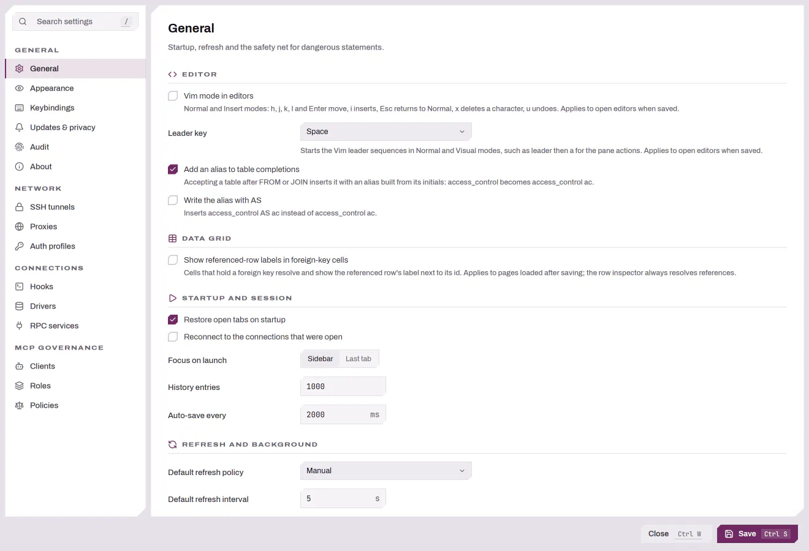
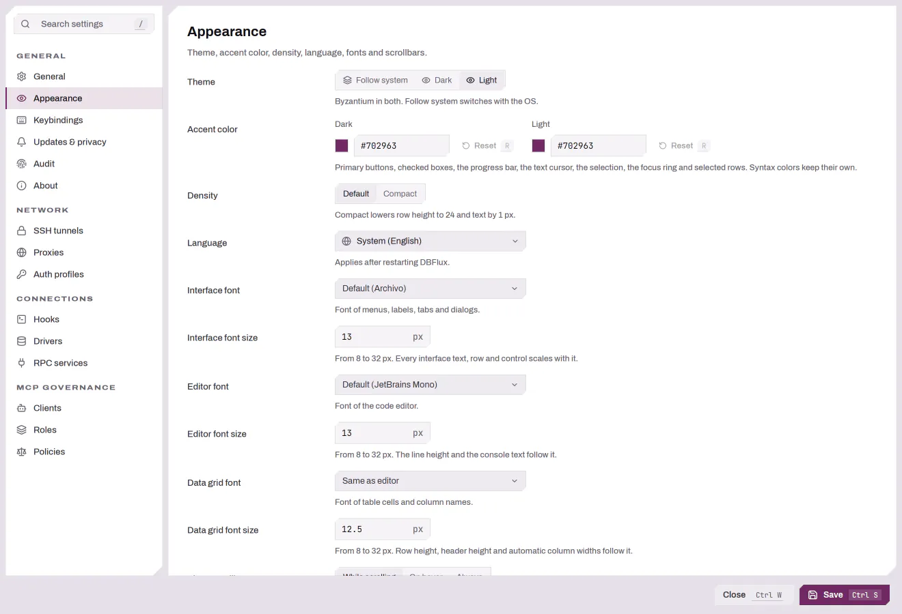
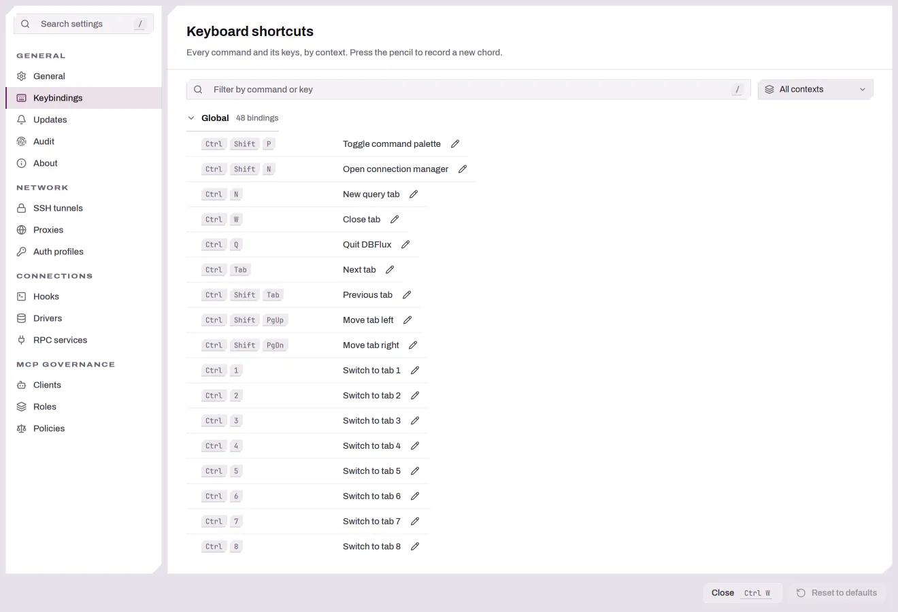

# Settings y Hooks de Conexión

Una referencia para cada sección de Settings y para los connection hooks — los
comandos, scripts o snippets de Lua que DBFlux ejecuta alrededor del ciclo de
vida de una conexión.

Abre Settings desde la command palette (**Open settings**) o desde la barra
lateral. La ventana está organizada en secciones a lo largo del lado izquierdo.

| Sección                                             | Cubre                                                                        |
| --------------------------------------------------- | ---------------------------------------------------------------------------- |
| [General](#general)                                 | Comportamiento a nivel de app: inicio, refresh, seguridad de queries. |
| [Apariencia](#apariencia) | Theme, color de acento, densidad, idioma, fuentes y barras de desplazamiento. |
| [Actualizaciones y privacidad](#actualizaciones-y-privacidad) | Comprobaciones de actualizaciones, el changelog y los niveles de telemetría opcionales. |
| [Audit](#audit)                                     | Qué captura el audit log y cuánto tiempo se conserva.                        |
| [Keybindings](#keybindings)                         | Explora y cambia el keymap.                                                  |
| [Snippets](#snippets) | Plantillas que se insertan en el editor de queries por prefijo o desde el selector. |
| [Auth Profiles](#auth-profiles-proxies-ssh-tunnels) | Perfiles AWS SSO / shared-credentials.                                       |
| [Proxies](#auth-profiles-proxies-ssh-tunnels)       | Perfiles de proxy SOCKS5 / HTTP.                                             |
| [SSH Tunnels](#auth-profiles-proxies-ssh-tunnels)   | Perfiles reutilizables de túnel SSH.                                         |
| [Services](#services-rpc)                           | Drivers RPC externos y auth providers.                                       |
| [Hooks](#connection-hooks)                          | Definiciones reutilizables de connection hooks.                              |
| [Drivers](#drivers)                                 | Overrides y ajustes por driver.                                              |
| About                                               | Información de versión y build.                                              |

Las secciones relacionadas con MCP (Clients, Roles, Policies) aparecen solo
cuando el binario se construye con el feature `mcp`, que es el valor por
defecto; ver [AI + MCP
Integration](MCP_AI_INTEGRATION.md).

---

## General

<picture>
  <source media="(prefers-color-scheme: dark)" srcset="../images/settings/general-dark.webp">
  
</picture>

Guardar aplica los cambios al instante y los escribe en la base de datos de
DBFlux (`dbflux.db`, o `dbflux-nightly.db` en un build Nightly sin
**Use the stable database**) en segundo
plano, así que una base de datos lenta u ocupada nunca congela la ventana. El
mensaje de éxito aparece cuando ya están en disco. Si la escritura falla, un
error lo indica y los cambios siguen aplicados hasta que DBFlux se cierre;
guarda de nuevo para conservarlos.

### Editor

| Setting                      | Default | Qué hace |
| ---------------------------- | ------- | -------- |
| **Vim mode in editors**      | Off     | Edición modal en todos los editores de varias líneas (editor de código, editor de objetos, diálogos JSON, panel de valor, vista JSON y pipeline de colecciones; solo movimientos en los visores de solo lectura): modos Normal e Insertar con `h`, `j`, `k`, `l`, `i`, `Escape`, `x` y `u`. Se aplica a los editores abiertos al guardar. Ver la sección de [modo Vim](KEYBOARD.md#modo-vim-opcional) en la referencia de teclado. |
| **Leader key**               | Space   | La tecla que inicia las secuencias de líder de Vim en los modos Normal y Visual, como la líder y luego `a` para las acciones del panel: espacio, coma o barra invertida. Se aplica a los editores abiertos al guardar, y los atajos de líder que cambiaste en **Keybindings** la siguen. |
| **Add an alias to table completions** | On | Al aceptar una tabla, vista o CTE del autocompletado SQL después de `FROM` o `JOIN` se inserta con un alias formado por las iniciales de su nombre: `access_control` pasa a ser `access_control ac` y `public.order_items` pasa a ser `public.order_items oi`. Un alias ya usado en la sentencia, una palabra reservada o el nombre de una tabla conocida recibe un número (`ac2`). No se añade alias cuando ya hay uno después del cursor, ni después de `INSERT INTO`. La tabla destino de `UPDATE` y `DELETE FROM` solo recibe alias en las bases de datos que lo aceptan ahí: PostgreSQL y DuckDB, y SQLite y Turso con `AS`. |
| **Write the alias with AS** | Off | Inserta `access_control AS ac` en lugar de `access_control ac`. |

### Cuadrícula de datos

| Setting                      | Default | Qué hace |
| ---------------------------- | ------- | -------- |
| **Mostrar el valor del registro referenciado en celdas de clave foránea** | Off | Las celdas que contienen una clave foránea resuelven y muestran el valor del registro referenciado junto a su id. Se aplica a las páginas cargadas después de guardar; el inspector de filas siempre resuelve las referencias. |

### Inicio y sesión

| Setting                        | Default | Qué hace                                                         |
| ------------------------------ | ------- | ---------------------------------------------------------------- |
| **Restore session on startup** | On      | Reabre las tabs que tenías abiertas la última vez.               |
| **Reopen last connections**    | Off     | Al iniciar, reconecta las conexiones que estaban abiertas al salir la última vez y las que usan las tabs restauradas. Funciona aunque la sesión no se restaure. |
| **Default focus**              | Sidebar | Dónde cae el focus al iniciar (Sidebar o la última tab).         |
| **Max history entries**        | 1000    | Tope del historial de queries (mínimo 10).                       |
| **Auto-save interval (ms)**    | 2000    | Cada cuánto se auto-guarda el contenido del editor (mínimo 500). Un script respaldado por un archivo se escribe en ese archivo; el contenido sin título se conserva en la carpeta `sessions/`. |

### Actualización y segundo plano

| Setting                                 | Default | Qué hace                                                  |
| --------------------------------------- | ------- | --------------------------------------------------------- |
| **Default refresh policy**              | Manual  | Manual o Interval auto-refresh para las data views.       |
| **Default refresh interval (seconds)**  | 5       | Intervalo usado cuando la policy es Interval (mínimo 1).  |
| **Max concurrent background tasks**     | 8       | Tope de las tareas de conexión y de esquema (mínimo 1). Cuentan las conexiones, desconexiones, hooks de conexión, cambios de base de datos, cargas, actualizaciones y eliminaciones de esquema, y los escaneos key-value en curso. Al llegar al tope, una nueva conexión, cambio de base de datos, carga de esquema o de detalles de tabla, o página key-value se rechaza con un aviso hasta que termine una tarea en curso; no se encola. Las queries, las cargas del data grid, los exports, los dashboards, las mutaciones y las pruebas de conexión (**Probar conexión**) no cuentan ni tienen límite. Una tarea que se está cancelando sigue contando hasta que se detiene. |
| **Pause auto-refresh on error**         | On      | Detiene el auto-refresh de una view después de que falla. |
| **Auto-refresh only if tab is visible** | Off     | Se salta el refresh de las tabs que no estás mirando.     |

### Notificaciones

| Ajuste | Opciones | Predeterminado |
|---------|---------|---------|
| **Duración de los avisos** | 4 segundos, 8 segundos, 15 segundos, Mantener hasta descartarlos | 8 segundos |

**Duración de los avisos** define cuánto permanece un aviso antes de cerrarse
solo. Los avisos de éxito y de información se cierran al cabo de ese tiempo, y
los de advertencia al doble. Un error, y un aviso con un botón de acción o una
barra de progreso, permanece hasta que lo descartes. **Mantener hasta
descartarlos** desactiva el cierre automático para todos los avisos. Pasar el
puntero por encima de un aviso detiene su temporizador, que se reanuda cuando el
puntero se va.

Los avisos se apilan en la esquina superior derecha del área de documentos. Se
muestran como máximo cuatro a la vez; los más antiguos se pliegan en una entrada
*N más* que los expande o los descarta todos juntos.

**Avisar cuando un agente MCP solicita aprobación** (activado de forma
predeterminada, solo en builds con soporte MCP) muestra una notificación de
escritorio cuando un agente MCP crea una aprobación pendiente, o un aviso dentro
de la app cuando DBFlux tiene el foco.

### Seguridad de ejecución (confirmación de queries peligrosas)

Estos tres settings gobiernan cómo DBFlux trata las queries riesgosas en
**todos** los drivers y query languages. No hay un toggle por base de datos —
las mismas reglas aplican a `DELETE`/`DROP`/`TRUNCATE` de SQL,
`deleteMany`/`drop` de MongoDB, `FLUSHALL`/`FLUSHDB` de Redis, etc.

| Setting                                          | Default | Qué hace                                                                                                    |
| ------------------------------------------------ | ------- | ----------------------------------------------------------------------------------------------------------- |
| **Confirm dangerous queries**                    | On      | Muestra una confirmación antes de ejecutar una query peligrosa. Desactívalo para permitirlas sin preguntar. |
| **Require WHERE for DELETE/UPDATE**              | On      | Trata un `DELETE`/`UPDATE` sin `WHERE` como peligroso.                                                      |
| **Always require preview (ignore suppressions)** | Off     | Fuerza el modal de confirmación/preview incluso para queries que anteriormente elegiste dejar de confirmar. |

**Editor row limit** (límite de filas del editor, 10.000 por defecto) limita
cuántas filas devuelve una query ejecutada desde el editor. Es una opción de
seguridad independiente de los tres controles de queries peligrosas de arriba.
Acepta cualquier número entero desde 1 y no se puede poner en cero ni
desactivar: al guardar cualquier otro valor se muestra un error y se conserva
el límite anterior. DBFlux envía el límite al driver
en lugar de agregar un `LIMIT` al texto de la query. Cuando un resultado omitió
filas, su pie dice "Primeras 10,000 filas cargadas" en lugar del número de
filas. Para una sola sentencia que solo lee, el pie ofrece entonces **Contar
filas**, que ejecuta la sentencia dentro de `SELECT COUNT(*)` sin traer sus
filas y muestra "10,000/52,310 filas cargadas" (solo conexiones SQL), y
**Cargar todas las filas**, que vuelve a ejecutar la sentencia sin el límite en
la misma pestaña de resultados. Ambas están también en el menú de la tabla
(`m`). En un script con varias sentencias, el límite es un único presupuesto
compartido por todos sus resultados, y todas las sentencias se ejecutan igual.

El límite solo llega a un driver cuyo `execute` lo aplica: PostgreSQL,
MySQL/MariaDB, SQL Server, SQLite, DuckDB, MongoDB, Redis, Turso, InfluxDB,
ClickHouse, Redshift, CloudWatch y DynamoDB. Algunos todavía leen la respuesta
completa antes de recortarla, y Redis solo limita las respuestas que se muestran
como tabla; la página de cada driver detalla sus límites. Los drivers RPC
externos reciben el límite cuando DBFlux y el driver hablan driver RPC 1.6 o
posterior y el driver declara `REQUEST_ROW_LIMIT`; cualquier otro driver externo
no recibe ninguno y la query se ejecuta sin límite. Un resultado sin límite muestra su recuento de filas
completo, porque no se omitió ninguna, y su pie no ofrece ni Contar filas ni
Cargar todas las filas; agrega un `LIMIT` o un `.limit()` a la sentencia cuando
el resultado pueda ser grande. El límite no agrega un timeout y no se aplica a
scripts Lua, Python o Bash, hooks de conexión ni métricas. La
[consola](CONSOLE.md) envía el mismo límite a los drivers que pueden aplicarlo y
ejecuta sus comandos sin él en los demás.

### Almacenamiento (solo builds Nightly)

| Setting                     | Default | Qué hace                                                                                                               |
| --------------------------- | ------- | ---------------------------------------------------------------------------------------------------------------------- |
| **Use the stable database** | Off     | Hace que un build Nightly comparta el `dbflux.db` stable en lugar de `dbflux-nightly.db`. Aplica en el próximo inicio. |

Ver [Data & Privacy](PRIVACY.md#ubicaciones-de-datos) para cómo se separan
las bases de datos Nightly y stable.

## Apariencia

<picture>
  <source media="(prefers-color-scheme: dark)" srcset="../images/settings/appearance-dark.webp">
  
</picture>

Theme, color de acento, densidad, idioma, fuentes y barras de desplazamiento. Guardar funciona como se describe en [General](#general): aplica los cambios al instante y los escribe en segundo plano.

| Setting      | Opciones                 | Default |
| ------------ | ------------------------ | ------- |
| **Theme**    | Follow system, Dark, Light | Dark  |
| **Color de acento** | Un color `#RRGGBB` para Dark y otro para Light | El de la paleta (`#702963`) |
| **Density**  | Default, Compact         | Default |
| **Language** | System y todos los idiomas con un catálogo de traducción incluido | System  |
| **Fuente de la interfaz** | Predeterminada (Archivo) o cualquier fuente instalada | Predeterminada |
| **Tamaño de fuente de la interfaz** | De 8 a 32 px, admite decimales | 13 |
| **Fuente del editor** | Predeterminada (JetBrains Mono) o cualquier fuente instalada | Predeterminada |
| **Tamaño de fuente del editor** | De 8 a 32 px, admite decimales | 13 |
| **Fuente de la tabla de datos** | Igual que el editor o cualquier fuente instalada | Igual que el editor |
| **Tamaño de fuente de la tabla de datos** | De 8 a 32 px, admite decimales | 12.5 |
| **Show scrollbars** | While scrolling, On hover, Always | While scrolling |

**Color de acento** controla los botones primarios, las casillas marcadas, la
barra de progreso, el cursor de texto, la selección, el anillo de foco y las
filas seleccionadas (en la barra lateral y en la cuadrícula de datos), con sus
tonos de hover, pressed y de texto. Cada paleta tiene su propio campo, con una
muestra del color que aplica y un botón **Restablecer** (`R` sobre el campo) que
devuelve el acento de la paleta; está deshabilitado mientras el campo ya lo
contiene. Escribir el acento propio de la paleta cuenta como sin override. Lo que
no sea `#RRGGBB` muestra «Usa un color como #RRGGBB.» bajo el campo, no se
guarda y deja aplicado el acento que ya lo estaba (el personalizado guardado, o
el de la paleta si no hay ninguno) hasta que el valor sea válido. El
acento se aplica a todas las ventanas abiertas al guardar.

Tu color es un punto de partida: DBFlux lo mueve hasta que se lee sobre el
panel. Los rellenos (botones, casillas marcadas, barra de progreso, anillo de
foco, cursor de texto y selección) se aclaran en Dark y se oscurecen en Light
hasta alcanzar 3:1 contra el panel; el tono del texto hasta 4.5:1; y el texto de
un botón primario pasa a casi negro cuando el blanco quedaría por debajo de 4.5:1
sobre el relleno. El acento propio de la paleta se usa tal cual. Los colores de
sintaxis, incluidas las keywords del editor y el árbol de esquemas, nunca siguen
al acento.

**Show scrollbars** decide cuándo aparecen las barras de desplazamiento de
todas las ventanas: solo mientras el contenido se desplaza, mientras el puntero
está sobre un área desplazable, o siempre. Se aplica a todas las ventanas
abiertas en cuanto guardas.

La barra horizontal de la cuadrícula de datos es la excepción: se muestra
siempre, porque la mueve un desplazador aparte que nunca recibe eventos de la
rueda y, de otro modo, quedaría oculta.

Los cambios de fuente se aplican a todas las ventanas abiertas en cuanto
guardas; no hace falta reiniciar. La fuente del editor también define el texto
monoespaciado de la interfaz (metadatos, atajos de teclado, consola), y una
fuente de interfaz personalizada también reemplaza la fuente expandida de las
etiquetas de sección. Qué controla cada tamaño:

- **Tamaño de fuente de la interfaz** escala todo el texto, las filas, los
  controles y los íconos de la interfaz.
- **Tamaño de fuente del editor** define el texto y la altura de línea del
  editor de código, y el texto de la consola.
- **Tamaño de fuente de la tabla de datos** define el texto de las celdas, la
  altura de filas y encabezados, y el ancho automático de las columnas. Las
  columnas que redimensionaste a mano conservan su ancho.

`Ctrl+=` / `Cmd+=` y `Ctrl+-` / `Cmd+-` cambian los tres tamaños a la vez, 1 px
cada uno, manteniendo sus proporciones, y `Ctrl+0` / `Cmd+0` restablece los
valores predeterminados. Funcionan desde la ventana del espacio de trabajo,
también están en la paleta de comandos y se pueden reasignar en
[Keybindings](#keybindings). Un tamaño que ya está en 8 o 32 px se
queda ahí mientras los demás siguen cambiando. Los nuevos tamaños se guardan
como cualquier otra configuración, así que estos campos los muestran y se
conservan al reiniciar.

Las listas de fuentes tienen un campo de búsqueda, porque un sistema puede tener
cientos de fuentes. Una fuente guardada que ya no está instalada sigue
seleccionada, marcada como "(no instalada)", y DBFlux dibuja con la fuente
predeterminada hasta que se vuelva a instalar; la tabla de datos recurre a la
fuente del editor.

La lista de idiomas se deriva de los catálogos de traducción incluidos con
DBFlux: English aparece primero, seguido de los demás idiomas en un orden
determinista y con sus nombres nativos. System sigue el locale del sistema
operativo y recurre a English cuando ningún locale incluido coincide de forma no
ambigua. Un cambio de idioma tiene efecto después de reiniciar DBFlux, por lo que
el control muestra una nota permanente al respecto. Los catálogos parciales
recurren a English para el texto general aún no traducido. Este release traduce,
entre otras, las secciones General y Actualizaciones y privacidad; el resto de la
UI se está convirtiendo crate por crate y permanece en English por ahora.

---

## Actualizaciones y privacidad

Las preferencias de comprobación de actualizaciones y changelog, más los
niveles de telemetría opcionales. Los cambios quedan en stages hasta que
pulsas **Save** (Ctrl+S); **Reset to defaults** deja los valores por defecto
en stages sin guardar.

### Updates

| Ajuste | Efecto |
|--------|--------|
| Check GitHub for a new release at startup | Ejecuta la comprobación de actualizaciones al iniciar la app. |
| Show what is new after each update | Abre el changelog una vez, la primera vez que arranca una versión nueva. |
| Check now | Ejecuta una comprobación inmediata. |
| Open what is new / Show welcome again | Reabre los dos diálogos. |

### Estadísticas de uso

DBFlux tiene un módulo de telemetría opcional con tres niveles:

- **Apagado** — no se envía nada: ni aviso, ni evento de actividad, ni informe
  de uso. No se pone nada en cola.
- **Mínimo** — un aviso por cada compilación publicada, más un evento de
  actividad por semana: identificador aleatorio de instalación, versión, canal,
  sistema operativo y arquitectura. Sin idioma del sistema, país ni recuentos
  de uso.
- **Básico** (preseleccionado en el diálogo de bienvenida) — el aviso de Mínimo,
  más un informe semanal en lugar del evento de actividad. El informe añade
  idioma del sistema (no el de la interfaz), país y recuentos acotados de
  ejecuciones exitosas compatibles de
  consultas, visual builder, aperturas de dashboards, scripts, operaciones MCP
  e inspecciones de schema. Son recuentos de operaciones completas, incluidos
  resultados exitosos con cero filas, no de filas ni de tiempos.

No se pone nada en cola, no se envía nada y no se cuenta ningún uso hasta que
confirmas el aviso de bienvenida con **Empezar**. Si habías desactivado el
diálogo de bienvenida, se abre en cada arranque tras actualizar, siempre que las
estadísticas de uso arranquen, hasta que confirmes; cerrarlo de otra forma, por
ejemplo con Escape, no lo confirma.

La app no envía país; envía el valor de relleno `ZZ`. Solo en los informes de
Básico, el colector guarda el país aproximado que Cloudflare resuelve en su
borde. El colector nunca guarda la dirección IP; Cloudflare y Fly.io conservan
sus propios registros de peticiones.

Las actualizaciones en segundo plano, fallos parciales, errores y cancelaciones
no cuentan. Las aprobaciones del builder sin ejecución no cuentan, ni la
creación, importación o restauración implícitas de dashboards. Los scripts
requieren código de salida canónico 0 sin timeout ni ejecución detached; la
inspección de schema requiere una carga nueva de metadatos completos, no
reenfocar una pestaña existente.

**MCP solo cuenta operaciones principales revisadas, compatibles y exitosas con
un propietario de primer plano de una GUI existente, autenticada y en ejecución**,
no todas las llamadas ni un servidor independiente sin ese propietario.
`count_records`, `insert_record` y `list_scripts` se excluyen incluso si tienen
éxito. `update_records` y `delete_records` requieren la finalización de la
mutación principal con `QueryResult` tipado, no un `DocumentCrudResult` opaco
exitoso; update/upsert/delete SQL tipados comprobados pueden contar con cero filas
afectadas. Ayuda/protocolo, herramientas desconocidas, controles de aprobación y
aprobaciones pendientes no cuentan. El permiso se adquiere después de Allow y
antes del trabajo; el recuento llega tras completar el trabajo principal y
registrar con éxito Audit de ejecución. Ver los límites completos en la política
siguiente.

Los eventos van a `https://telemetry.dbflux.dev`. Nunca se envían
consultas, resultados, credenciales, rutas de archivos ni metadatos de
conexión. Ver [Datos y privacidad](PRIVACY.md#telemetría-opcional) para la
lista completa de lo que contiene un informe y los límites de cobertura.
Básico debe estar activo y el aviso visible de bienvenida debe haberse confirmado
antes de comenzar; fuentes no disponibles o Audit desactivado o
degradado impiden contabilizar. Guardar Básico no garantiza un envío inmediato.
Salir de Básico borra el informe Básico pendiente y los contadores, y Apagado
también borra un aviso pendiente; un envío ya entregado a la red aún puede
completarse. Confirmar la entrega conserva incrementos posteriores. Los UUID de instalación y entrega son
seudónimos; no se envían identificadores de operaciones, consultas, clientes o
personas, nombres de herramientas ni estadísticas por motor. El ID de instalación
nunca rota por calendario; un reinicio conserva las compilaciones
confirmadas y no envía vínculos entre IDs viejos y nuevos ni avisos de retirada.
Las etiquetas legibles no alteran el almacenamiento, la copia, la exportación
ni el envío del contenido sin procesar.

| Control | Efecto |
|---------|--------|
| Nivel (Apagado / Mínimo / Básico) | El nivel en stages; Left y Right o un clic lo cambian, Save lo aplica. |
| Id de instalación | Vista enmascarada del identificador seudónimo. **Reiniciar id** lo reemplaza de inmediato, cancela los envíos pendientes y conserva las compilaciones confirmadas. |
| Informes | El último informe confirmado, leído del audit log duradero. **Ver el último informe** abre un visor de solo lectura sobre el contenido almacenado; **Abrir en auditoría** abre el visor de auditoría con la correlación del informe. |

---

## Audit

La sección Audit controla el audit log unificado. El control principal orientado
al usuario es **Log Capture → Minimum Level** (trace / debug / info / warn /
error), que determina cuánto del logging interno de DBFlux se pliega en el audit
trail. Guardar tiene efecto sin reiniciar.

La retention (cuánto tiempo se conservan los eventos) impulsa un purge periódico
en segundo plano cuando está configurada. Para la experiencia diaria de audit —
abrir el viewer, filtrar, exportar — ver [Audit → Visor de audit](AUDIT.md#visor-de-audit). Para el schema completo de eventos
y el comportamiento de redaction ver [Audit](AUDIT.md) y [Data &
Privacy](PRIVACY.md#auditoría-y-privacidad).

---

## Keybindings

Esta sección lista el keymap activo agrupado por contexto. Fíltralo por comando,
tecla o predicado de contexto con el campo de texto, o muestra un solo contexto
con el filtro de contexto. Un contexto que hereda de otro (el Editor hereda de
Global) también lista los bindings heredados que no sombrea. El keymap por
defecto completo está documentado en [Referencia de teclado](KEYBOARD.md).

<picture>
  <source media="(prefers-color-scheme: dark)" srcset="../images/settings/keybindings-dark.webp">
  
</picture>

**Cambiar un atajo.** Pulsa el lápiz de un binding, o selecciónalo y pulsa
`Enter`, y luego pulsa las teclas nuevas. Un atajo puede ser una tecla con sus
modificadores o una secuencia de hasta cuatro, como `g g` o `Ctrl+K Ctrl+S`:
púlsalas una tras otra, y la grabación se guarda tras una pausa de un segundo.
`Esc` cancela. Mientras grabas, **Quitar atajo** deja el binding sin tecla.
También se pueden grabar teclas que usa la propia ventana de Settings, como
`Ctrl+S` o `Tab`. Un `Esc` solo no se puede grabar porque cancela.

**Contextos.** Cada binding se aplica en un contexto, escrito como un predicado
en el mismo lenguaje que usa Zed. Pulsa el botón de capas de un binding, o
selecciónalo y pulsa `p`, para editarlo; `Enter` guarda y `Esc` cancela. Un
predicado combina nombres con `&&`, `||` y `!`, compara un valor con `==` o
`!=`, y usa `A > B` para "B dentro de A", con paréntesis para agrupar:

| Predicado | Se aplica |
|-----------|-----------|
| `Editor && !Modal` | en un editor de código, no con un diálogo abierto |
| `Editor && vim_mode == normal` | en un editor de código en el modo Normal de Vim |
| `Editor && language == mongo` | en un editor de código de una consulta MongoDB |
| `Results \|\| Audit` | en una grilla de resultados o en el visor de auditoría |
| `SidebarPanel && tab == scripts` | en la pestaña Scripts de la barra lateral |
| `CodeEditor > Input` | en el buffer de texto del editor de código |

Los nombres son los de los contextos que muestra el filtro de contexto
(`Global`, `Sidebar`, `Editor`, `Results`, `DataTable`, `Input`, `Modal`, …),
los nombres de ventana `Workspace`, `SettingsWindow` y
`ConnectionManagerWindow`, y los nombres de panel `ActivityRail`,
`CommandSearch`, `SidebarPanel`, `CodeEditor`, `ResultPanel`, `RowInspector`,
`KeyValueConsole`, `NativeConsole`, `DocumentQueryBar`, `DocumentSchema`, `DocumentAggregate`,
`DashboardsPanel` y
`SettingsSection`. Los valores son `vim_mode` (`normal`, `insert`, `replace`,
`visual`, `visual_line`, `visual_block`, presente solo con la edición Vim
activa), `language` (`sql`, `mongo`, `redis`, `lua`, `python`, `bash`, …),
`tab`, `section` y `focus`. Un predicado que no se puede analizar no se guarda;
uno que nombra algo que DBFlux nunca fija se guarda con un aviso, porque nunca
coincide.

**Qué binding gana.** Un binding de un elemento con foco (un campo de texto, una
data table, un diálogo, el árbol de documentos) gana sobre un binding del panel
que lo rodea, y un binding que cambiaste gana sobre uno por defecto asignado a
las mismas teclas en el mismo lugar. Con la edición Vim activa, un binding que
creaste para un modo de Vim, como `space r` en `Editor && vim_mode == normal`,
se ejecuta antes de que Vim lea la tecla; los bindings por defecto dejan a Vim
sus propias teclas. Un botón, casilla o fila de lista con foco siempre toma
`Enter` y `Space` para sí.

**Avisos y conflictos.** Si las teclas nuevas ya las usa otro comando en un
contexto que puede estar activo al mismo tiempo, todavía no se guarda nada: un
aviso nombra el otro comando y su contexto. **Cancelar** deja todo como estaba.
**Reemplazar** asigna las teclas al binding que estás editando y se las quita al
otro, que queda sin atajo hasta que lo restablezcas. Un binding que choca con
otro muestra una etiqueta "en conflicto con", y el pie cuenta los conflictos.
Dos etiquetas avisan sin bloquear: "comparte una secuencia de teclas" cuando las
teclas de un binding empiezan las de otro (DBFlux espera entonces un segundo
tras el más corto para ver si sigue el más largo), y "captura texto escrito"
cuando una letra sola se asigna donde se escribe texto, como un campo de texto o
el editor de código fuera de los modos Normal y Visual de Vim.

**Comandos sin atajo por defecto.** Settings lista los comandos que declaran un
contexto propio y se distribuyen sin tecla en él, como **Copiar como Markdown**
en Results, en ese contexto con **Sin atajo**. Un comando sin contexto propio,
como **Ir al error de la consulta**, no aparece. Pulsa el lápiz para asignarle teclas, como en
cualquier otra fila: el atajo funciona al instante, se comprueban sus conflictos
y cuenta como modificado. Su flecha de restablecer, o **Quitar atajo**, lo
devuelve a sin binding. Las versiones de DBFlux anteriores a esta función
ignoran la fila guardada.

Una tecla imprimible sola (letra, dígito, símbolo o Espacio) que asignes a un
comando así, o a la que muevas un binding por defecto, se aplica en Results,
Audit e Inspector solo mientras ningún campo de texto tiene el foco, así que la
letra se sigue escribiendo en un filtro o un campo de búsqueda. Los acordes con
Ctrl, Alt o Cmd, las teclas de función y las flechas mantienen la condición propia del atajo, y una condición de
contexto que fijes tú se usa tal cual.

**Restablecer.** Un binding modificado muestra una flecha que restablece sus
teclas y su contexto por defecto (`r` sobre un binding seleccionado hace lo
mismo, y `Delete` quita su atajo). **Restablecer predeterminados** en el pie
descarta todas las modificaciones, como `Shift+R` desde la lista. `c` abre el
filtro de contexto. El pie también muestra cuántos bindings están
modificados.

Los cambios se aplican al instante en todas las ventanas, sin reiniciar. Solo se
guardan tus modificaciones, en la tabla `cfg_keybinding_overrides` de
`dbflux.db`, así que los bindings que no cambiaste siguen los valores por defecto
de futuras versiones. Una modificación cuyo binding por defecto elimina una
versión posterior se ignora.

---

## Snippets

Esta sección gestiona las plantillas que insertas en el editor de queries, por
prefijo o desde el selector de snippets (ver [Editor → Snippets](EDITOR.md#snippets)).
Está en el grupo General, justo después de Keybindings (**Fragmentos** en la
interfaz en español).

La lista de la izquierda muestra cada snippet con su nombre, su prefijo, su
lenguaje y una etiqueta **Integrado** en los que incluye DBFlux. **Nuevo
fragmento** abre un formulario en blanco; al seleccionar una fila se abre ese
snippet. Con el teclado, `j` / `k` recorren la lista, `n` empieza un snippet
nuevo y `d` borra el abierto.

| Campo | Descripción |
|---|---|
| **Nombre** | Cómo se llama el snippet en la lista y en el selector. Los nombres no tienen que ser únicos. |
| **Prefijo** | Lo que escribes en el editor para ver el snippet en el menú de autocompletado. Único por lenguaje: dos snippets de SQL no pueden compartir prefijo. |
| **Lenguaje** | El lenguaje de query de los editores donde aparece el snippet. Por ahora SQL es la única opción. |
| **Cuerpo** | El texto que se inserta, con los marcadores `$1`, `${1:default}` y `$0`. Repetir un número refleja el campo. |

**Guardar** (`Ctrl+S`; el botón dice **Actualizar** en un snippet existente)
comprueba el formulario y muestra bajo el campo lo que falla: *El nombre es
obligatorio*, *El prefijo es obligatorio*, *El cuerpo es obligatorio*, *Otro
fragmento de SQL ya usa el prefijo sel*, o el error del marcador con su línea,
su columna y el texto afectado (*Marcador sin cerrar en la línea 2, columna 6:
${1:table*). No se guarda nada hasta que todos los campos son válidos.
**Eliminar** pide confirmación antes.

Los seis snippets de SQL integrados son filas normales: edítalos o bórralos como
los tuyos. Un snippet integrado que borras sigue borrado.

---

## Auth Profiles, Proxies, Túneles SSH

Estas tres secciones gestionan los perfiles reutilizables que luego seleccionas
por conexión en la pestaña Access. Están documentadas en detalle — campos, flujo
AWS SSO, reglas de no-proxy, métodos de auth SSH — en [Connecting to a Database
→ Advanced Setup](CONNECTIONS.md):

- [Auth Profiles](CONNECTIONS.md#auth-profiles-aws-sso-and-shared-credentials)
- [Proxies](CONNECTIONS.md#proxies)
- [SSH Tunnels](CONNECTIONS.md#ssh-tunnels)

Las credenciales que ingresas aquí se guardan en el keyring de tu sistema
operativo, no en la base de datos. Ver [Data & Privacy →
Secrets](PRIVACY.md#secretos-y-el-keyring-del-sistema-operativo).

---

## Servicios (RPC)

Los drivers externos y los auth providers corren como procesos separados con los
que DBFlux se comunica a través de un socket local. Cada service que agregas
aquí tiene:

| Campo                     | Notas                                                                                                     |
| ------------------------- | --------------------------------------------------------------------------------------------------------- |
| **Socket ID**             | Identificador único, usado como nombre del archivo del socket. Solo letras ASCII, dígitos, `.`, `_`, `-`. |
| **Command**               | El ejecutable a lanzar (opcional para algunas configuraciones).                                           |
| **Startup Timeout (ms)**  | Cuánto esperar a que el proceso arranque. Default 5000.                                                   |
| **Service Type**          | **Driver** o **Auth Provider**.                                                                           |
| **Enable this service**   | Si el service arranca. Default on.                                                                        |
| **Arguments**             | Argumentos ordenados del proceso.                                                                         |
| **Environment Variables** | Pares `KEY=value` pasados al proceso.                                                                     |

Los cambios aquí **tienen efecto en el próximo inicio**. Referencia completa:
[RPC Services Config](RPC_SERVICES_CONFIG.md) y el [Driver RPC
Protocol](DRIVER_RPC_PROTOCOL.md).

---

## Drivers

Elige un driver para ver y sobrescribir su comportamiento. Dos grupos son
editables:

**Global overrides** — versiones por driver de los settings de General. Cada uno
es un tri-state (Inherit / On / Off, o un valor explícito); dejarlo en *Inherit*
usa el default de General mostrado junto al control:

- Refresh policy e interval
- Confirm dangerous queries
- Require WHERE
- Require preview

**Driver settings** — opciones definidas por el propio driver (renderizadas de
forma genérica a partir del schema del driver, así que los campos disponibles
dependen del driver).

La sección también muestra, en solo lectura, la **capability matrix**, la
category, y el query language del driver.

---

## Connection Hooks

Los hooks son comandos, scripts o snippets de Lua reutilizables que corren
alrededor del ciclo de vida de una conexión. Los **defines** globalmente en
**Settings → Hooks**, y luego los **vinculas** a fases en conexiones
individuales en la pestaña **Hooks** del Connection Manager.

### Camino rápido

1. **Settings → Hooks → agrega un hook.** Dale un **Hook ID**, elige un
   **Type**, y completa el command/script.
2. Abre una conexión en **Connection Manager → Hooks tab**.
3. Selecciona tu hook en uno de los cuatro dropdowns de fase (Pre-connect,
   Post-connect, Pre-disconnect, Post-disconnect).
4. Conecta. La salida del hook se transmite al panel de **Tasks**.

### Tipos de Hook

| Type        | Qué ejecuta              | Qué proporcionas                                                                                                                         |
| ----------- | ------------------------ | ---------------------------------------------------------------------------------------------------------------------------------------- |
| **Command** | Un ejecutable            | Un comando y argumentos separados por espacios.                                                                                          |
| **Script**  | Un archivo Bash o Python | Un lenguaje, una ruta de archivo, y un override opcional del interpreter (en blanco = `bash` / `python3`, ajustado según la plataforma). |
| **Lua**     | Un script Lua in-process | Una ruta de archivo y un conjunto de capabilities (ver abajo). Lua corre dentro de DBFlux — sin interpreter externo.                     |

Los scripts se editan en el editor de DBFlux y se guardan por defecto bajo una
carpeta `hooks/`.

#### Capacidades de Lua

Un hook de Lua solo obtiene las habilidades que habilitas:

| Capability                 | Default | Otorga                                                            |
| -------------------------- | ------- | ----------------------------------------------------------------- |
| **Logging**                | On      | Escribir en la salida del hook.                                   |
| **Environment read**       | On      | Leer variables de entorno.                                        |
| **Connection metadata**    | On      | Leer la metadata del perfil que se está conectando.               |
| **Controlled process run** | Off     | Llamar a `dbflux.process.run(...)` para lanzar procesos externos. |

> Habilitar **Controlled process run** permite que el hook ejecute comandos
> externos arbitrarios. DBFlux muestra una advertencia de seguridad cuando está
> activado, tanto en la definición del hook como en el binding por conexión.
> Habilítalo solo para hooks en los que confíes.

El runtime de Lua embebido (APIs disponibles, sandboxing) está documentado en
[Lua Scripting](LUA.md).

### Opciones de Hook

| Option                         | Notas                                                                                                       |
| ------------------------------ | ----------------------------------------------------------------------------------------------------------- |
| **Enabled**                    | Los hooks deshabilitados se omiten.                                                                         |
| **Working Directory**          | El cwd del process/script (no usado por Lua).                                                               |
| **Environment**                | Pares extra `KEY=value`.                                                                                    |
| **Inherit parent environment** | On por defecto; pasa el env de DBFlux al hook.                                                              |
| **Env Denylist**               | Nombres de variables a quitar del env heredado.                                                             |
| **Timeout (ms)**               | En blanco = sin timeout. Al hacer timeout se mata el process group.                                         |
| **Execution mode**             | **Blocking** (default) espera al hook; **Detached** corre en segundo plano y no bloquea connect/disconnect. |
| **Ready signal** (Detached)    | Texto que DBFlux espera en la salida del hook antes de continuar.                                           |
| **On Failure**                 | La failure policy — ver abajo.                                                                              |

DBFlux siempre inyecta variables de entorno de contexto en los hooks de proceso:
`DBFLUX_PROFILE_ID`, `DBFLUX_PROFILE_NAME`, `DBFLUX_DB_KIND`, y, cuando se
conocen, `DBFLUX_HOST`, `DBFLUX_PORT`, `DBFLUX_DATABASE`.

> **Los secrets nunca se filtran accidentalmente a los hooks.** Además de tu Env
> Denylist, DBFlux siempre quita las variables heredadas cuyo nombre contiene
> `SECRET`, `TOKEN`, `PASSWORD`, o `_KEY`, y cualquier variable `AWS_*`.

### Políticas de fallo

Qué pasa cuando un hook falla (exit distinto de cero, timeout, o error):

| Policy                   | Efecto                                                        |
| ------------------------ | ------------------------------------------------------------- |
| **Disconnect** (default) | Aborta la fase — el flujo de connect o disconnect se detiene. |
| **Warn**                 | Continúa, pero muestra una advertencia.                       |
| **Ignore**               | Continúa; el fallo solo se registra en el log.                |

### Fases

| Phase               | Corre                             |
| ------------------- | --------------------------------- |
| **Pre-connect**     | Antes de que la conexión se abra. |
| **Post-connect**    | Después de un connect exitoso.    |
| **Pre-disconnect**  | Antes de desconectar.             |
| **Post-disconnect** | Después de desconectar.           |

La pestaña Hooks de una conexión tiene un dropdown por fase (más un input
"Extra" para vincular hook IDs adicionales). Los dropdowns listan los hooks
reutilizables que definiste en Settings → Hooks. Cada hook corre como su propia
background task con stdout/stderr en vivo en el panel Tasks; la salida tiene un
tope de 4 MiB por hook.

---

## Relacionado

- [Primeros pasos](GETTING_STARTED.md) — flujo principal.
- [Referencia de teclado](KEYBOARD.md) — el keymap por defecto completo.
- [Connecting → Advanced Setup](CONNECTIONS.md) — SSH, proxy, auth, fuentes de
  valores.
- [Data & Privacy](PRIVACY.md#tus-datos-en-este-equipo) — dónde se almacenan los settings y
  secrets.
- [Lua Scripting](LUA.md) — el runtime de Lua embebido para hooks.
