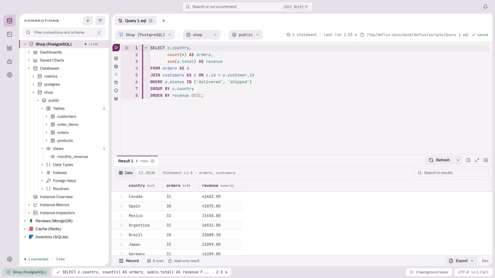
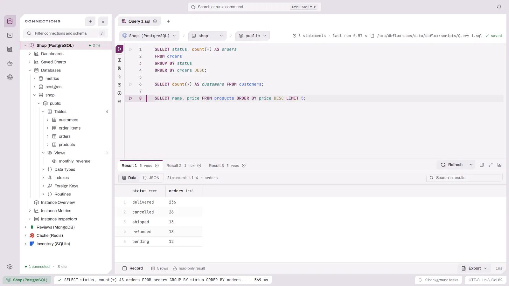
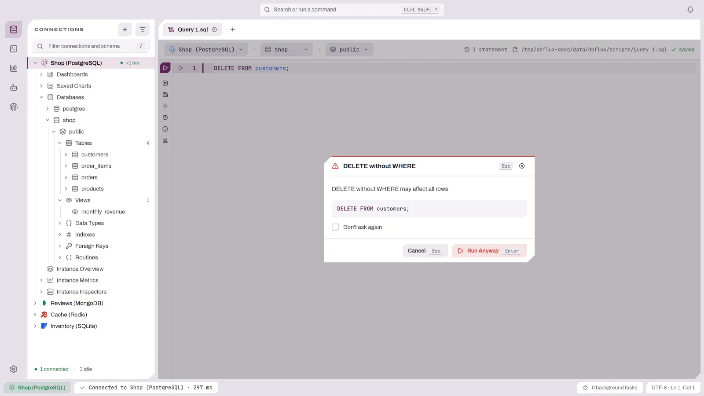

# 쿼리 실행

`Ctrl+n` (macOS에서는 `Cmd+n`)으로 새 쿼리 탭을 열거나 `Ctrl+o`로 스크립트 파일을 엽니다. 편집기의 쿼리 언어(SQL, MongoDB 쿼리 구문, Redis 명령 등)는 활성 연결의 드라이버가 결정하며, 이 드라이버가 구문 강조와 자리 표시자 텍스트도 결정합니다. `.csv` 또는 `.tsv` 파일은 대신 테이블로 열립니다. [CSV 및 TSV 파일](CSV_FILES.md)을 참고하세요.

SQL 연결에서는 [시각적 쿼리 빌더](QUERY_BUILDER.md)로 SQL을 작성하지 않고
쿼리를 만들 수 있습니다.

<picture>
  <source media="(prefers-color-scheme: dark)" srcset="../images/editor/query-result-dark.webp">
  
</picture>

## 탭 저장 및 닫기

새 쿼리 탭(`Ctrl+n`)은 `Ctrl+o`로 연 스크립트와 마찬가지로 스크립트 폴더에 있는 실제 파일을 기반으로 합니다. 열려 있는 편집기는 설정된 간격으로 그 파일에 자동 저장하며, `Ctrl+s`와 **다른 이름으로 저장**도 같은 대기열을 거칩니다. 자동 저장과 탭 닫기는 DBFlux 밖에서 변경된 파일을 덮어쓰지 않습니다. 편집 중인 내용은 편집기에 그대로 남고 DBFlux는 거부된 쓰기를 보고합니다. `Ctrl+s`와 **다른 이름으로 저장**은 의도적인 동작이므로 이 경우에도 파일을 씁니다.

저장하지 않은 변경 사항이 있는 탭을 닫으면 먼저 저장한 뒤 닫습니다. 쓰기를 완료할 수 없으면(예: 파일이 DBFlux 밖에서 변경되었거나 읽기 전용인 경우) 변경 사항이 남은 채 탭이 열려 있고, DBFlux는 `Ctrl+s` / **다른 이름으로 저장**을 의도적인 덮어쓰기 수단으로 안내합니다. 아직 파일이 없는 버퍼는 예외입니다. 닫을 때 먼저 묻기 때문에 저장하거나, 저장하지 않고 닫거나, 취소할 수 있습니다. DBFlux를 종료할 때도 같은 방식으로 저장되지 않은 변경 사항을 먼저 저장합니다. 시작 시 스크립트 폴더를 만들지 못했다면 새 쿼리는 세션 저장소에 보관되고, 탭을 닫을 때 **다른 이름으로 저장**을 제안합니다.

## 실행

- `Ctrl+Enter` (`Cmd+Enter`) — **쿼리 실행**.
- `Ctrl+Shift+Enter` (`Cmd+Shift+Enter`) — **새 탭에서 쿼리 실행**.

비어 있지 않은 텍스트 선택이 있으면 선택한 텍스트만 실행합니다. 선택이 없고 버퍼에 `;`로 구분된 문이 여러 개 있으면 커서 위치의 문만 실행합니다. 커서가 문의 `;` 뒤나 그 아래 빈 줄에 있으면 그 문을 실행하고, 모든 문보다 위에 있으면 첫 번째 문을 실행합니다. 버퍼 전체를 실행하려면 먼저 모두 선택(`Ctrl+A`)하세요. 문이 하나뿐인 버퍼나 문 분할을 지원하지 않는 언어는 전체를 실행합니다. 프로시저나 트리거의 `BEGIN ... END` 본문 같은 복합 블록이 있는 버퍼도 그 안의 `;`가 문을 끝내지 않으므로 전체를 실행합니다. 트랜잭션을 여는 `BEGIN`은 블록이 아닙니다.

선택 영역 없이 실행할 때 커서 위치의 문이 트랜잭션을 시작하거나 끝내기만 하고(`BEGIN`, `START TRANSACTION`, `COMMIT`, `END`, `ROLLBACK`, `ABORT`) 버퍼에 다른 문이 있으면, 편집기가 먼저 묻습니다. 전체 스크립트를 실행하거나(기본값) 그 문만 실행할 수 있습니다. 드라이버가 전체 스크립트를 한 번에 실행할 수 없는 연결에서는 그 문만 실행하도록 제안합니다. `BEGIN`만 실행하면 같은 탭의 이후 실행이 모르는 사이에 참여하는 트랜잭션이 열린 채로 남고, `COMMIT`이나 `ROLLBACK`만 실행하면 스크립트의 나머지 부분을 건너뛰고, 기껏해야 이전 실행이 열어 둔 트랜잭션만 끝냅니다.

각 결과에는 그 결과를 만든 문의 줄 번호가 제목으로 붙습니다. `UPDATE`나 `COMMIT`처럼 결과 집합을 반환하지 않는 문은 **문이 실행되었습니다**와 함께, 드라이버가 알려 주는 경우 영향을 받은 행 수를 표시하며, 바닥글도 행 수 대신 이를 표시합니다. 문이 실행되는 동안 서버가 보낸 알림과 경고(예: 트랜잭션 밖에서 `COMMIT`을 실행한 뒤 PostgreSQL이 보내는 `WARNING: there is no transaction in progress`)는 그 줄 아래에, 행이 있는 결과에서는 바닥글에 표시됩니다. 이를 알려 주는 드라이버에서만 표시되며, PostgreSQL은 알려 줍니다.

실행 중 실제로 행이 생략되면 편집기는 쿼리당 경고 하나를 표시하고 그리드는 해당 결과 집합을 표시합니다. 보존된 행이 없어도 표시됩니다. 행이 생략되지 않고 제한에 정확히 도달한 결과에는 경고가 표시되지 않습니다. 보존 행 수 제한은 저장할 행만 제한하며 바이트 및 시간 제한은 별도의 실행 제어입니다. 이 기능은 편집기에 기본 행 수 제한이 설정되어 있음을 의미하지 않습니다.

## 다중 문 스크립트

여러 문을 스크립트로 실행하려면 문을 선택하고(`Ctrl+A`로 버퍼 전체 선택) `Ctrl+Enter`를 누르세요. 활성 드라이버가 일괄 처리를 지원한다고 알리면 각 문의 결과 집합이 자체 결과 탭에 렌더링됩니다.

문 분할은 SQL 계열 언어에서 언어를 인식합니다. 문자열, 식별자, 행/블록 주석, PostgreSQL 달러 인용 본문 안의 구분자는 문 경계로 취급하지 않습니다. 비 SQL 언어는 단일 문으로 유지됩니다. 일괄 처리 지원은 드라이버별입니다. 내장 SQL 드라이버 중에서는 PostgreSQL, MySQL/MariaDB, SQLite, Microsoft SQL Server가 지원합니다. 선택 영역은 항상 그대로 실행되며 확인 대화 상자를 띄우지 않습니다.

<picture>
  <source media="(prefers-color-scheme: dark)" srcset="../images/editor/multi-statement-dark.webp">
  
</picture>

## 서식 지정

- `Ctrl+Shift+F` (macOS에서는 `Cmd+Option+L`) — **쿼리 서식 지정**.

서식 지정은 도구 모음의 서식 지정 버튼, 창 작업 메뉴의 항목, 명령 팔레트의
명령으로도 실행할 수 있습니다. 선택 영역이 있으면 선택한 텍스트의 서식을
다시 지정합니다. 선택 영역이 없으면 **쿼리 실행**과 같은 경계로 커서 아래의
문의 서식을 지정하므로, 문이 하나뿐인 버퍼는 전체 서식이 지정됩니다. 모든 문의
서식을 지정하려면 먼저 전체를 선택(`Ctrl+A`, macOS에서는 `Cmd+A`)하세요. 키워드는 대문자가 되고 각
절은 공백 두 칸으로 들여쓰기됩니다.

서식 지정은 언어 서비스가 서식을 지정할 수 있는 SQL 연결에서 사용할 수
있습니다: PostgreSQL, MySQL/MariaDB, SQLite, SQL Server 및 기타 기본 제공 SQL
드라이버. 스크립트 문서와 다른 쿼리 언어에서는 버튼이 비활성화된 상태로
남습니다. 이를 제공하는 연결에서는 **Format statement** 코드 작업(`Ctrl+.` / `Cmd+.`)이
커서 아래의 문에 대해 계속 같은 변경을 수행합니다.

## 쿼리 오류

쿼리가 실패하고 데이터베이스가 위치를 알려 주면, 편집기는 거부된 토큰에 오류
밑줄을 표시하고 오류 알림에 **오류 복사** 옆에 **오류로 이동**을 제공합니다.
같은 동작이 창 작업 메뉴와 명령 팔레트의 **쿼리 오류로 이동**이며, 표시가 있는
동안에만 활성화됩니다. 기본 키 바인딩은 없습니다. 아무것도 저절로 움직이지
않습니다. 커서와 포커스는 이 동작을 실행하기 전까지 그대로 있고, 실행하면
커서가 편집기에서 표시된 토큰으로 이동합니다.

표시는 실행된 문에 놓입니다. 커서 아래의 문이든, 전체 버퍼든, 선택 영역이든
마찬가지이고, 스크립트에서는 실패한 문에 놓입니다. 첫 편집을 하거나 다시 실행하면
사라집니다. 데이터베이스가 위치를 주지 않을 때, 전송된 텍스트가 편집기의
텍스트와 다를 때(시간 매크로는 쿼리를 보내기 전에 치환됩니다), 또는 쿼리가
실행되는 동안 편집기를 바꿨을 때는 표시가 없습니다. PostgreSQL, Redshift,
SQLite가 위치를 보고하며, 다른 드라이버는 표시 없이 오류만 보여 줍니다. 위치는
알림 텍스트에 포함되지 않습니다.

## 위험 쿼리 확인

DBFlux는 여러 언어에 걸친 위험한 작업을 감지합니다. SQL의 `DELETE`/`DROP`/`TRUNCATE`와 `WHERE` 없는 `DELETE`/`UPDATE`, MongoDB의 `deleteMany`/`drop`, Redis의 `FLUSHALL`/`FLUSHDB`/`KEYS`가 대상이며, 실행 전에 확인을 요청합니다. 이 동작은 설정의 영향을 받습니다. 위험 쿼리 확인은 끌 수 있고, `DELETE`/`UPDATE`에 `WHERE` 절을 요구하도록 할 수 있으며, Redis `FLUSHALL`/`FLUSHDB`는 완전히 비활성화할 수 있습니다(이 경우 해당 명령은 확인 대신 차단됩니다).

<picture>
  <source media="(prefers-color-scheme: dark)" srcset="../images/editor/dangerous-query-dark.webp">
  
</picture>

## 스크립트 (Lua / Python / Bash)

Lua, Python, Bash 문서는 데이터베이스 쿼리가 아니라 스크립트로 실행됩니다. 실행 중에는 출력이 문서의 출력 영역으로 실시간 스트리밍되고, 최종 출력은 텍스트 결과로 유지됩니다. 내장 Lua 런타임은 `docs/LUA.md`를 참조하세요.

## 저장된 쿼리와 기록

DBFlux는 완료된 쿼리의 기록을 유지하며 이름 있는 쿼리를 저장할 수 있게 해줍니다.

- `Alt+h` (편집기에서) 또는 도구 모음의 기록 버튼 — 편집기 옆의 쿼리 기록 패널을 열고 닫습니다.
- `Ctrl+s` (`Cmd+s`) — 현재 쿼리를 **저장**합니다.
- `Ctrl+Shift+s` (`Cmd+Shift+s`) — **파일을 다른 이름으로 저장**합니다.
- `Ctrl+p` (`Cmd+p`, 편집기에서) — 저장된 쿼리 브라우저를 엽니다.

기록 패널은 최근 쿼리와 저장된 쿼리를 보여 주며 편집하는 동안 열려 있습니다. 항목을 클릭하거나 `Enter`를 누르면 편집기로 불러옵니다. 패널에 포커스가 있을 때는 `Ctrl+j`/`Ctrl+k`(또는 방향 키)로 탐색하고, `Ctrl+s`로 최근 쿼리를 저장하며, 로컬 니모닉 `Ctrl+f`(즐겨찾기 토글), `Ctrl+r`(이름 바꾸기), `Ctrl+d`(삭제)를 사용할 수 있습니다. `/` 또는 패널 헤더의 검색 버튼은 검색 필드를 열고, `Esc`는 패널을 닫습니다.
