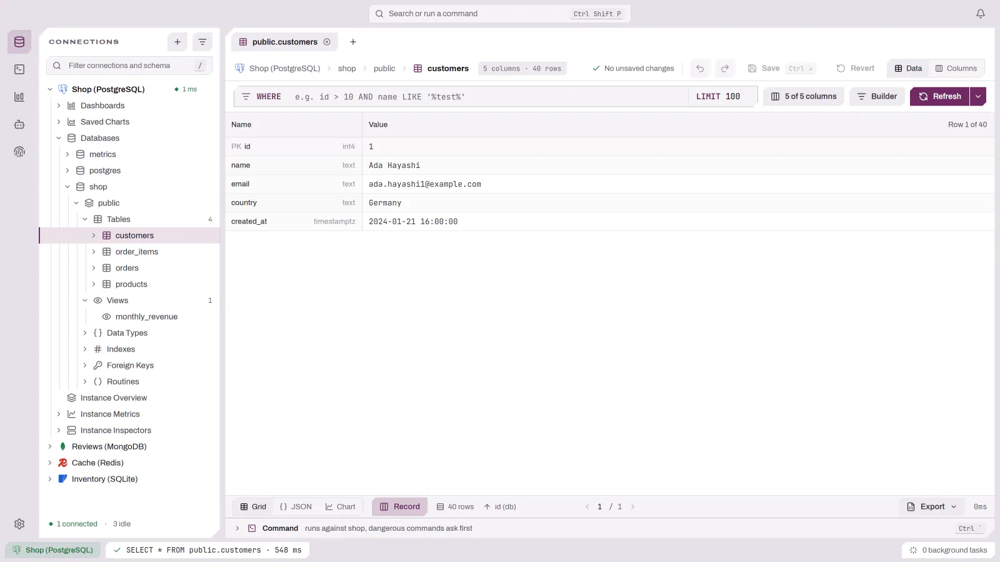
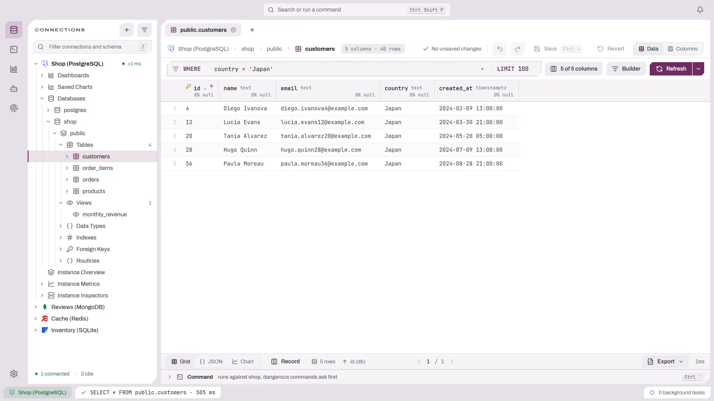
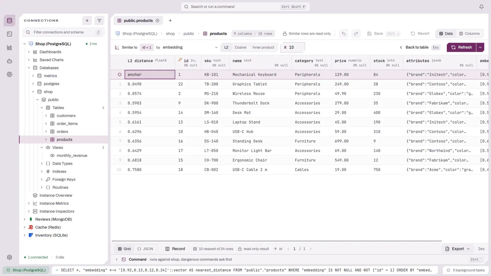
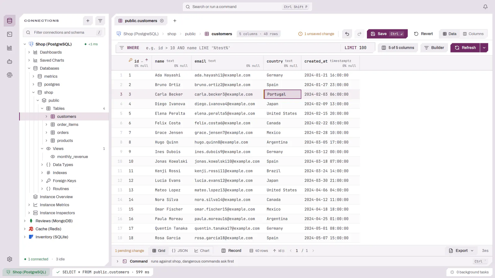

# 결과 다루기

결과는 문서 안의 결과 탭에 렌더링됩니다. 각 테이블이나 컬렉션은 드라이버가 해당 객체에 선언한 뷰로 열리며, 선언된 다른 뷰도 함께 제공합니다:

- 관계형 테이블과 쿼리 결과에는 **테이블 뷰**.
- 문서 컬렉션(예: MongoDB, DynamoDB)에는 **트리 뷰**. 같은 페이지를 **테이블**과 **JSON** 뷰로도 볼 수 있습니다([문서 컬렉션](DOCUMENTS.md) 참고).
- JSON 열이 있는 테이블에는 **테이블 뷰**와 같은 행의 **트리** 뷰([테이블의 JSON 열](DOCUMENTS.md#테이블의-json-열) 참고).
- InfluxDB measurement나 TimescaleDB hypertable 같은 시계열에는 행을 차트로 그릴 수 있을 때 **그리드 위의 차트**([시계열 테이블과 컬렉션](CHARTS.md#시계열-테이블과-컬렉션) 참고).
- Redis에는 **키-값 뷰**([키-값 브라우저](../KEY_VALUE.md) 참고).

드라이버가 해당 표현을 선언하면 이벤트 스트림 방식의 컨테이너는 이벤트 스트림으로 열립니다.

벡터 열이 있는 테이블은 선택한 행과 가장 [유사한 행](#유사한-행)도 보여 줍니다.

## 데이터 그리드 탐색

결과 패널에 포커스가 있을 때:

- `j`/`k` (또는 `Down`/`Up`) — 행 사이를 이동합니다.
- `h`/`l` (또는 `Left`/`Right`) — 열 사이를 이동합니다.
- `g`/`Shift+g` (또는 `Home`/`End`) — 첫 / 마지막 행.
- `Ctrl+d`/`Ctrl+u` (또는 `PageDown`/`PageUp`) — 행을 페이지 단위로 이동합니다.
- `[` / `]` — 이전 / 다음 결과 페이지 (페이지 나누기).
- `f`는 도구 모음으로, `/`는 검색/필터로 포커스를 옮깁니다.
- `z`는 패널 접기를 토글합니다.
- `m` (또는 `Shift+F10`)은 행/셀 상황에 맞는 메뉴를 엽니다.

## 레코드 뷰

`i`를 누르거나 결과 상태 표시줄의 Grid / Record 토글을 사용하면 활성 행이 결과 영역을 채우는 이름/값 목록으로 표시됩니다. 헤더에는 결과에서 해당 행의 위치가 표시됩니다. 필드는 그리드 셀과 정확히 같은 방식으로 편집되므로, 저장하지 않은 변경 사항, 행 저장, 되돌리기는 두 레이아웃에서 똑같이 동작합니다. `Up`/`Down`은 필드 사이를, `Left`/`Right`는 행 사이를 이동합니다. `i`를 다시 누르면 그리드로 돌아갑니다.

<picture>
  <source media="(prefers-color-scheme: dark)" srcset="../images/results/record-view-dark.webp">
  
</picture>

## 열 헤더 메뉴

열 헤더를 마우스 오른쪽 버튼으로 클릭하면 해당 열에 한정된 메뉴가 열립니다. 열 이름 복사, 오름차순 또는 내림차순 정렬, 정렬 지우기, 모든 필터 연산자를 하나의 평면 목록에서 제공합니다. 헤더를 왼쪽 클릭하면 여전히 정렬이 순환됩니다.
테이블 메뉴(`m`)에서도 활성 셀이 속한 열에 대해 **열 이름 복사**를 제공하므로 키보드로도 사용할 수 있습니다.

## 값 패널

셀을 마우스 오른쪽 버튼으로 클릭하고 **값 보기**를 선택하거나 `v`를 누르면 오른쪽 검사기 레일에서 해당 셀이 열립니다. 패널은 값을 JSON, XML 또는 일반 텍스트로 표시합니다. 형식은 내용에서 감지되며 실제로 파싱에 성공할 때만 적용되고, 예쁘게 인쇄(pretty-print), 압축, 단어 줄 바꿈을 지원합니다. 여기서 편집할 수도 있습니다. **저장**은 해당 행을 바로 커밋하고, **되돌리기**는 편집을 버립니다. 패널은 그리드에서 선택하는 셀을 따라 이동하지만, 저장하지 않은 변경 사항이 있을 때는 따라가지 않습니다.

## 행 인스펙터

`Ctrl+Space`를 누르거나 행을 마우스 오른쪽 버튼으로 클릭하고 **행 검사**를 선택하면 선택한 행이 오른쪽 검사기 레일에서 열립니다. 행의 모든 열과 값을 나열하고 기본 키와 외래 키 열을 표시합니다. 그리드에서 이동할 때 인스펙터는 선택한 행을 따라가고, 헤더의 고정 버튼으로 현재 행에 고정할 수 있습니다. 하단의 **편집**, **복제**, **삭제**는 결과를 편집할 수 있을 때 검사 중인 행에 적용됩니다. `Ctrl+Space`를 다시 누르거나 닫기 버튼으로 인스펙터를 끌 수 있습니다.

**참조** 아래에서 인스펙터는 행의 외래 키를 양방향으로 나열합니다:

- **나가는 참조(Outgoing)** — 이 행의 단일 열 외래 키가 다른 테이블을 가리킵니다. 항목은 해당 테이블과 가리키는 행을 표시하는데, 해석되면 참조된 행의 읽을 수 있는 레이블("María López · #8")로, 그 전까지는 키 값으로 표시합니다. 항목을 클릭하면 참조된 테이블이 그 행에서 열립니다. DBFlux는 해당 테이블의 기존 탭을 재사용하고(없으면 새로 열고) 필터를 기본 키 동등 조건으로 바꿔 참조된 행이 보이도록 합니다.
- **들어오는 참조(Incoming)** — 다른 테이블의 외래 키가 이 행을 가리킵니다. 각 항목은 테이블 이름과 그 테이블의 몇 행이 이 행을 참조하는지 표시하며, 개수는 백그라운드에서 로드됩니다. 이 항목은 참고용입니다.

그리드의 외래 키 셀도 id 옆에 같은 참조된 행 레이블을 표시할 수 있습니다. [설정](SETTINGS.md)에서 **외래 키 셀에 참조된 행의 레이블 표시**를 켜면 됩니다. 행 인스펙터는 이 설정과 무관하게 항상 참조를 해석합니다.

## 결과 필터링

데이터 그리드 도구 모음에는 입력한 조건으로 쿼리를 다시 실행하는 `WHERE` 필터 입력 필드가 있습니다. SQL 연결에서는 두 가지 스타일을 지원합니다:

- **Raw `WHERE`** — 일반 조건을 입력합니다(예: `status = 'active'`). 기본 동작입니다.
- **관계형(ORM 스타일) 경로** — 외래 키를 따라가는 점 표기 경로를 입력합니다. 예: `created_by.email LIKE '%@acme.com'` 또는 `created_by.organization.name = 'Acme'`. DBFlux는 테이블의 외래 키 메타데이터를 기준으로 경로를 해석하고 참조된 테이블까지 조인을 대신 수행하므로 JOIN을 직접 작성할 필요가 없습니다.

관계형 필터가 해석되면 추가된 조인 수를 칩으로 표시합니다. 세그먼트가 모호하거나 해석할 수 없으면 인라인 오류가 표시되고, 지금까지 해석된 조인을 미리 채운 시각적 쿼리 빌더를 여는 **빌더에서 열기** 링크가 함께 나타납니다. 점이 없는 입력은 항상 raw-`WHERE` 동작을 유지합니다.

필터 입력 필드에서도 스키마 인식 자동 완성을 사용할 수 있습니다(빌더와 같은 탐색 — [Schema-aware autocomplete](QUERY_BUILDER.md#스키마-인식-자동-완성) 참조).

<picture>
  <source media="(prefers-color-scheme: dark)" srcset="../images/results/filtering-dark.webp">
  
</picture>

## 유사한 행

벡터 열이 있는 테이블(현재는 pgvector `vector` 열이 있는 PostgreSQL 테이블)에서 `Shift+s`를 누르거나 행 메뉴에서 **유사한 행 찾기**를 선택하면 선택한 행과 가장 가까운 행을 보여 줍니다. 메뉴 항목은 읽을 열과 보여 줄 행 수를 표시하며, 실행할 수 없을 때는 그 이유를 표시합니다. 행의 해당 열에 값이 없거나, 그리드에 저장하지 않은 변경이 있어 먼저 저장하거나 되돌려야 하는 경우입니다.

<picture>
  <source media="(prefers-color-scheme: dark)" srcset="../images/results/similar-rows-dark.webp">
  
</picture>

그러면 그리드는 선택한 행을 `기준 행`으로 표시해 맨 위에 고정하고, 그 아래에 가장 가까운 10개 행을 가까운 순서로 보여 줍니다. 첫 번째 열에는 거리가 있으며, 헤더가 거리 종류를 나타냅니다. 필터 행 자리에 막대가 나타납니다:

- 열 선택기로 벡터 열을 고릅니다. 커서가 벡터 열에 있으면 그 열로 검색을 시작하고, 아니면 테이블의 첫 번째 벡터 열로 시작합니다.
- **L2**, **코사인**, **내적**으로 거리를 바꿉니다. 내적은 곱 자체를 큰 값부터 보여 줍니다.
- **K**는 보여 줄 행 수를 1부터 1000까지 정합니다.
- **테이블로 돌아가기** 또는 `Esc`는 필터를 유지한 채 테이블 페이지로 돌아갑니다.

선택한 행은 기본 키로 이웃에서 제외되고, 벡터가 없는 행은 나열되지 않으며, 유사한 행은 읽기 전용입니다. 숫자가 아닌 거리는 대시로 표시됩니다. `halfvec`과 `sparsevec` 열은 이 검색을 제공하지 않습니다.

## 편집과 CRUD

데이터 그리드에서:

- `o` — 행을 추가합니다.
- `x` — 선택한 행을 삭제합니다.
- `r` — 이름 바꾸기 / 편집 (상황에 따라 다름).
- `y` — 선택한 행을 복사합니다.
- `Ctrl+c` (`Cmd+c`) — 선택한 셀을 클립보드로 복사합니다.

<picture>
  <source media="(prefers-color-scheme: dark)" srcset="../images/results/editing-dark.webp">
  
</picture>

### 결과를 편집할 수 있는 경우

기본 키가 있는 테이블의 단순 테이블 조회는 편집할 수 있습니다. **시각적 쿼리 빌더**(SELECT 모드)가 만든 결과도 편집할 수 있지만, 하나의 테이블에 확실하게 바인딩된 경우뿐입니다. 즉, 결과가 하나의 기반이 되는 테이블과 1:1로 대응하고 그 테이블의 모든 기본 키 열이 원래 이름 그대로 프로젝션되어 있어야 합니다. 이 경우 편집과 삭제는 프로젝션된 기본 키 값으로 `WHERE`를 만듭니다.

JOIN은 허용됩니다. 소스 테이블의 열은 편집할 수 있고, 조인된 열은 읽기 전용입니다.

빌더 결과는 다음 중 하나에 해당하면 그 이유를 설명하는 도구 모음 힌트와 함께 **읽기 전용**으로 동작합니다:

- 쿼리가 집계를 하거나 `GROUP BY` / `HAVING`을 사용합니다.
- 프로젝션이 JOIN 전체에 대한 와일드카드입니다.
- 기본 키 열이 없거나 별칭으로 프로젝션되었습니다.
- 테이블의 키가 아직 스키마 캐시에서 로드되지 않았습니다(키가 도착하면 그리드는 스스로 편집 가능 상태로 전환됩니다).

편집기에 직접 입력한 자유 형식 SQL은 읽기 전용으로 유지됩니다. 인라인 편집은 단순 테이블 조회와 빌더가 만든 SELECT에만 적용됩니다.

### 집계된 결과

결과가 그룹화된(`GROUP BY`) 쿼리에서 나온 것이면 행은 집계된 출력을 표시하고 편집은 비활성화됩니다. 행 추가, 행 삭제, 셀 편집, 행 검사를 사용할 수 없으며 그 이유를 설명하는 도구 설명이 표시됩니다. 페이지 나누기는 기반이 되는 행이 아니라 그룹화된 행을 기준으로 세므로 페이지 합계가 정확합니다. 집계 열은 올바른 열 유형을 유지하므로 차트 작성도 여전히 동작합니다.

## 쿼리로 복사

결과 상황에 맞는 메뉴에는 **쿼리로 복사**가 있습니다. 선택한 행에서 드라이버 고유의 쿼리 생성기를 사용해 드라이버별 변경 문(비 SQL 드라이버의 경우 봉투)을 생성합니다.

## 내보내기

결과 패널에서 `Ctrl+e` (`Cmd+e`)를 누르거나 명령 팔레트에서 **결과 내보내기**를 실행합니다. 사용할 수 있는 형식은 결과 형태에 따라 다르며 다음을 포함합니다:

- **CSV**
- **JSON (pretty)** 및 **JSON (compact)**
- **텍스트**
- **바이너리** (바이너리 형태의 결과용)

메뉴의 **불러온 행을 파일로 저장**과 **불러온 행을 클립보드로 복사** 섹션은 그리드가 가진 행, 즉 테이블에서는 현재 페이지를 기록하며, 알림에 파일이나 클립보드로 들어간 행 수가 표시됩니다.

그리드가 페이지 단위로 읽은 테이블이나 컬렉션을 보여 줄 때는 메뉴에 **모든 행을 파일로 내보내기**가 추가되며, CSV, JSON(한 줄에 객체 하나씩 담은 배열) 또는 JSON Lines(한 줄에 객체 하나, `.jsonl`)로 내보내거나, 읽고 공유하기 위한 HTML 표, Markdown 표, XML로 내보낼 수 있습니다. 그리드의 현재 필터, 정렬, 열 선택으로 테이블이나 컬렉션 전체를 한 페이지씩 다시 읽어 선택한 하나의 파일에 스트리밍하므로 데이터 전체가 메모리에 올라갈 필요가 없습니다. 쿼리 빌더나 관계형 필터로 표시된 테이블은 같은 쿼리로 읽으며, 그 쿼리의 오프셋에서 시작하고 한도가 있으면 한도에서 멈춥니다. 내보내기는 작업 패널의 작업으로 실행되며, 작업 패널에서 진행 상황을 보고 취소할 수 있습니다. 알림에는 전체 행 수와 경로가 표시됩니다.

HTML, Markdown, XML 파일은 읽기용이며 가져오기 대상이 아닙니다. 이런 파일이 있는 폴더를 가져오면 가져오기가 해당 테이블에서 멈춥니다. 그 테이블은 형식을 가져올 수 없다는 메시지와 함께 실패하며, 그 뒤의 테이블은 시도하지 않습니다. XML은 행마다 `<row>`, 열마다 `<field name="...">`를 쓰며, NULL은 `null="true"`로 표시해 빈 값과 구분합니다.

내보내기 마법사(사이드바의 **Export Table…**)는 선택한 각 테이블을 새 폴더의 별도 파일로 기록하며, 폴더에는 `manifest.json`이 함께 들어갑니다. Format 단계는 형식이 사용하는 옵션만 보여 주고 나머지는 숨깁니다.

- **구분자**(CSV 전용): 쉼표, 세미콜론, 탭 또는 파이프.
- **인코딩**(CSV 전용): UTF-8, UTF-8(BOM 포함), UTF-16LE(BOM 포함) 또는 Windows-1252. Windows-1252로 표현할 수 없는 문자는 대체되지 않고, 그 문자를 알려 주는 오류와 함께 내보내기가 중단됩니다.
- **NULL 텍스트**(CSV, HTML, Markdown): NULL에 기록할 텍스트이며 기본값은 빈 문자열입니다. JSON과 JSON Lines는 항상 `null`을 기록하고, XML은 `null="true"`로 NULL을 표시합니다. 비어 있지 않은 NULL 텍스트와 텍스트가 같은 값은 가져올 때 NULL로 읽히므로, 내보내기는 그 값과 열을 알려 주는 오류와 함께 중단됩니다. 다른 NULL 텍스트를 고르세요. 기본값인 빈 NULL 텍스트에서는 빈 문자열과 NULL이 똑같이 기록되므로 CSV를 가져오면 둘 다 NULL로 읽힙니다. 빈 문자열을 유지하려면 `\N`처럼 비어 있지 않은 NULL 텍스트를 지정하세요.
- **날짜**(SQL을 제외한 모든 형식): RFC 3339(기본값), UTC 기준 `YYYY-MM-DD HH:MM:SS`, 또는 epoch 초이며 JSON과 JSON Lines는 epoch를 숫자로 기록합니다. 날짜(date)는 앞의 두 형식에서는 `YYYY-MM-DD`로, epoch에서는 그날 자정(UTC)으로 기록하고, 시간(time)은 `YYYY-MM-DD HH:MM:SS`에서는 `HH:MM:SS`로, epoch에서는 자정 이후의 초로 기록합니다.
- **INSERT당 행 수**(SQL 전용): 각 `INSERT` 문에 담는 행 수이며 기본값은 500, 최솟값은 1입니다. SQL Server(1000)처럼 문당 행 수를 제한하는 드라이버는 그 한도로 값을 제한합니다.

SQL은 원본 연결의 드라이버가 대량 `INSERT` 문을 생성할 수 있을 때만 내보내기 마법사에서 제공됩니다. 테이블마다 `<스키마>.<테이블>.sql` 파일 하나에 그 연결의 방언으로 `INSERT` 문을 기록합니다. 각 문은 행 한 묶음을 담고, 방언이 쓰는 방식대로 테이블 이름을 쓰며, `;`로 끝납니다. 스크립트는 빈 테이블 복사본에 재생하는 용도이며, 두 번 실행하면 고유 키 오류가 나거나 행이 중복됩니다. PostgreSQL의 `GENERATED ALWAYS AS IDENTITY` 열은 `OVERRIDING SYSTEM VALUE`와 함께 기록되고, `IDENTITY` 열이 있는 SQL Server 테이블은 `SET IDENTITY_INSERT ... ON;`과 `OFF;`로 감싸므로 원래 id가 유지됩니다. PostgreSQL 테이블은 마지막 문 뒤에서 스크립트가 모든 IDENTITY 열과 serial 열의 시퀀스를 내보낸 값 너머로, 즉 오름차순 시퀀스는 가장 큰 값으로, 내림차순 시퀀스는 가장 작은 값으로 옮기므로(`setval`), 재생 후 기본값으로 삽입해도 id가 재사용되지 않습니다. SQL Server는 명시적 값을 삽입하면 IDENTITY 시드를 스스로 앞으로 옮깁니다. 데이터베이스가 계산하는 열(PostgreSQL과 MySQL/MariaDB 생성 열, SQL Server 계산 열, `rowversion` 열, 시간 테이블의 기간 열 `GENERATED ALWAYS AS ROW START/END`)은 문에서 제외되어 재생할 때 데이터베이스가 다시 계산합니다. 행이 없는 테이블은 빈 파일을 기록합니다. NULL과 날짜는 방언이 기록 방식을 정하므로 NULL 텍스트, 구분자, 인코딩, 날짜 옵션은 적용되지 않으며 숨겨집니다. SQL 파일은 아직 가져올 수 없습니다. SQL 파일이 있는 폴더를 가져오면 해당 테이블은 형식을 가져올 수 없다는 메시지와 함께 실패합니다. **모든 행을 파일로 내보내기**에서는 SQL을 제공하지 않습니다.

원본 연결이 SQL을 기록할 수 없으면 형식 단계는 SQL을 나열하지 않고 형식 선택기 아래에 이유를 알려 줍니다. 드라이버가 `INSERT` 문을 생성할 수 없으므로 CSV 또는 JSON으로 내보내라는 안내입니다. **계속**을 끄는 모든 상태는 이유를 알려 줍니다. 바닥글이 고쳐야 할 항목(**INSERT당 행 수**, **청크 크기**, 폴더, 또는 비어 있는 테이블 선택)을 짚어 주고, 잘못된 필드에는 위험 색 테두리, 경고 아이콘, 힌트가 표시됩니다. 실행이 끝나면 대화 상자가 테이블마다 한 행씩 결과를 나열합니다. 실패 때문에 실행이 도달하지 못한 테이블은 그 사실을 표시하고, 실패한 실행은 다음에 할 일을 알려 줍니다. 이미 기록된 파일은 폴더에 남고, 실패한 실행은 `manifest.json`을 기록하지 않으므로 폴더 전체를 가져올 수 없지만, 완료된 CSV 또는 JSON 파일은 **파일 선택…**으로 각각 가져올 수 있습니다.

기본값은 이전 버전이 기록하던 것과 정확히 같습니다. 매니페스트에는 파일을 만든 옵션이 기록되므로 그 폴더를 가져올 때 같은 방식으로 읽으며, 옵션이 없는 매니페스트는 기본값을 뜻합니다. **모든 행을 파일로 내보내기**는 항상 기본값을 사용합니다.

문서 컬렉션을 JSON 또는 JSON Lines로 내보내면 각 문서를 모든 필드와 함께 한 줄에 하나의 객체로 그대로 기록합니다. CSV, HTML, Markdown 또는 XML로 내보내면 그리드가 첫 페이지에 보여 주는 열(펼친 객체 포함)로 기록됩니다. 한 컬렉션의 문서가 같은 필드를 가질 필요는 없으므로, 이 형식들 모두에서 이후 페이지에서 처음 나타난 필드가 이미 기록된 헤더에 없어 열을 갖지 못합니다. 이 경우 내보내기는 해당 필드를 경고로 알려 줍니다.

쿼리 결과는 모든 행을 내보내려면 쿼리를 다시 실행해야 하므로 불러온 행만 제공합니다. 최근접 이웃 검색도 마찬가지입니다. 이 검색은 가장 가까운 행을 정해진 수만큼 반환하며, 그리드에 이미 모두 들어 있습니다.

## 파일 가져오기

가져오기 마법사는 단일 파일도 읽습니다. 첫 단계에서 폴더 선택 옆의 **파일 선택…**
을 누르고 `.csv`, `.json`, `.jsonl` 파일을 고르세요. HTML, Markdown, XML 파일은
제공되지 않으며 `.sql` 파일은 스크립트로 실행됩니다([SQL 스크립트 실행](#sql-스크립트-실행) 참조). 열은 CSV 헤더 행이나 처음 100개 JSON 레코드의 키(나타나는 순서대로
본 모든 키)에서 읽습니다. 중첩된 객체나 배열은 JSON 텍스트로 가져옵니다.

대상 테이블은 기본적으로 확장자를 뺀 파일 이름입니다. 다른 이름을 입력하고 **테이블
사용**을 누르거나 Enter를 누르면 기존 테이블로 가져옵니다. 열 매핑과 테이블 모드(생성,
기존, 재생성, 비우기, 건너뛰기)는 폴더와 같습니다. 파일에는 열 형식이 없으므로 기존
테이블로 가는 값은 그 테이블의 열 형식으로 읽고, 새 테이블은 필드마다 텍스트 열
(`TEXT`, SQL Server의 `NVARCHAR(MAX)`나 MySQL의 `LONGTEXT`처럼 엔진 고유의 넓은 텍스트 형식)로 만들어지므로
값은 텍스트로 저장됩니다.

CSV 파일은 내보내기 마법사와 같은 구분자, 인코딩, NULL을 나타내는 텍스트 옵션을
제공하며, JSON과 JSON Lines에는 옵션이 없습니다. 구분자나 인코딩을 바꾸면 파일을 다시
읽습니다. 아무것도 쓰기 전에 파일 전체를 한 번 읽으므로, 잘못된 행이나 레코드가 있으면
대상을 건드리지 않고 가져오기가 중단됩니다.

가져오기 대화 상자는 내보내기 마법사와 같은 상단 단계 표시줄과 바닥글을 사용합니다. 처음 두 단계에는 **취소**, 확인 단계에는 **뒤로**와 **취소**가 있고 **계속**이 기본 버튼입니다. 읽을 수 없는 파일이나 폴더는 오류와 다음에 할 일을 담은 위험 블록 하나로 표시됩니다. 헤더를 디코딩할 수 없는 CSV는 구성 단계에 남아 다른 구분자나 인코딩으로 다시 읽을 수 있고, 손상된 JSON은 다른 파일을 선택할 때까지 첫 단계에 남으며, 대상 테이블 조회 실패는 그 사실을 알리고 **테이블 사용**으로 다시 시도합니다. 바닥글은 **계속**이 꺼진 이유(파일을 읽는 중이거나 읽지 못함)를 알려 줍니다. JSON과 JSON Lines에는 옵션이 없다는 안내 줄이 표시되고, 테이블을 비울 수 없는 연결에서는 Truncate가 나열되지 않는 이유를 설명하는 줄이 표시됩니다. 텍스트 필드에서 `Escape`는 필드를 벗어나 키를 대화 상자로 돌려주며, 두 번째 `Escape`가 마법사를 닫습니다. 실행이 끝나면 테이블마다 한 행씩 결과를 나열하고, 실패한 실행은 다음에 할 일을 알려 줍니다.

### SQL 스크립트 실행

쿼리 언어가 SQL인 연결에서는 **파일 선택…**이 `.sql` 파일도 제공합니다. 다른 연결에서는 보이지
않으며, 그래도 들어온 `.sql` 파일은 연결이 SQL이 아니라는 메시지와 함께 거부됩니다. 하나를 고르면
같은 대화 상자에서 **SQL 스크립트 실행** 흐름이 열립니다. 스크립트는 UTF-8로 읽고 편집기와 같은
분할기로 구문을 나누므로 따옴표, 주석, 달러 인용 본문이 올바르게 처리되며, 구분 기호나 인코딩
옵션은 없습니다. 100 MB를 넘는 스크립트, UTF-8이 아니거나 읽을 수 없는 파일, 구문이 없는
스크립트는 이유와 다음에 할 일을 알려 주며 첫 단계에 머뭅니다. 명령줄 클라이언트만 실행할 수 있는
내용이 있는 스크립트도 마찬가지입니다. `DELIMITER` 줄이나 `GO` 배치 구분자, 클라이언트 구분자 없이
구문이 `;`로 끝나는 루틴 본문(프로시저, 함수, 트리거), `COPY … FROM stdin` 데이터 블록, `\connect` 같은
psql 백슬래시 메타 명령, autocommit을 끄는 구문(`SET autocommit = 0`)이나 암시적 트랜잭션을 켜는
구문(연결이 수동 커밋 모드로 남게 됩니다)이 그렇습니다. 각각 아무것도 실행되기 전에 행 번호와 다음에 할 일과 함께
거부됩니다. 데이터베이스 자체의 명령줄 클라이언트로 실행하거나 스크립트를 다시 작성하세요(
`COPY … FROM stdin` 블록이나 psql 메타 명령은 psql로, `\connect` 줄을 지우면 나머지가 이 연결에서 실행되는데 이는 그 명령이 선택하는 데이터베이스가 아닐 수 있습니다). 100 MB가 넘는 스크립트는 더 작은 파일로 나누어도 되지만 각 파일은
따로 실행되므로, 나중 파일이 실패해도 앞선 파일을 되돌릴 수 없습니다.

**구성** 단계는 구문 수와 크기, 분류별 구문 수(편집기와 감사 뷰어가 쓰는 분류이며 관리 포함),
처음 여섯 개 구문과 그 분류를 보여 줍니다. WHERE가 없는 `DELETE`나 `UPDATE`는 표시됩니다.
시퀀스를 변경하는 구문(`setval`, `nextval`, `ALTER SEQUENCE`)은 쓰기로 분류되므로 읽기 전용 연결은 이를
거부합니다.
옵션은 두 가지입니다.

- **오류 시**: **첫 오류에서 중지**(기본값) 또는 **오류 후에도 계속**. 후자는 모든 구문을 실행하고
  실패한 구문을 나열합니다.
- **하나의 트랜잭션으로 실행**: 연결이 트랜잭션을 지원하면 기본으로 켜져 있습니다. 구문이
  실패하면 트랜잭션에서 한 변경이 롤백되고, 마지막 구문이 성공할 때까지 아무것도 저장되지
  않습니다. **오류 후에도 계속**을 고르면 이유와 함께 꺼지며(일부 엔진에서는 실패한 구문이
  트랜잭션을 중단시킵니다), 트랜잭션이 없는 연결에서는 이유와 함께 제공되지 않습니다. 자체적으로 트랜잭션을 관리하는
  스크립트(`BEGIN`, `START TRANSACTION`, `COMMIT`, `END`, `ROLLBACK`, `SAVEPOINT`, `RELEASE`,
  `SET autocommit`)도 구문과 행 번호를 알려 주며 이 옵션을 끕니다. 스크립트는 작성된 그대로
  실행되고, 스크립트의 `COMMIT`이 그 앞의 변경을 저장합니다. 스크립트가 열고 끝내지 않은 트랜잭션은
  스크립트가 끝날 때 롤백되며 대화 상자가 그 사실을 알려 줍니다. 변경을 저장하려면 끝에 `COMMIT`을
  추가하세요. 그 롤백이 실패하면 트랜잭션이 아직 열려 있을 수 있으니 연결을 끊었다가 다시 연결하라는
  안내가 표시됩니다. 트랜잭션을 제어하는 버전 조건부 주석이 있는 스크립트는 실행 여부가 서버에 따라
  달라지므로 거부됩니다. 트랜잭션 밖에서 `SAVEPOINT`를 사용하는 스크립트는 열린 트랜잭션이 남아 있을
  경우에 대비해 끝날 때 예방적 `ROLLBACK`을 실행하며, 대화 상자가 그 사실을 알려 주고 데이터베이스가
  이미 커밋한 변경은 그대로 남습니다.

스키마 구문을 스스로 커밋하는 연결(MySQL과 MariaDB)에서는 `CREATE`, `ALTER`, `DROP`이 실행 즉시
저장되고 그 앞의 모든 구문도 함께 저장되므로, 롤백은 마지막 그런 구문 이후의 변경만 되돌립니다.
시퀀스 변경(`setval`, `nextval`)은 롤백으로 절대 되돌려지지 않습니다. 프로필 설정으로 읽기 전용인
연결은 데이터, 구조 또는 권한을 바꾸는 스크립트를 거부하고, 그런 구문이 몇 개인지 알려 주며 **계속**을
꺼 둡니다. 읽기만 하는 스크립트는 실행할 수 있습니다.

모든 스크립트는 내용과 관계없이 **확인** 단계를 거칩니다. 파괴적인 구문이 없는 스크립트는 분류별
구문 수를 보여 주고 **스크립트 실행**을 제공합니다. 파괴적인 구문이 있는 스크립트는 편집기의 위험
쿼리 종류별로 개수를 세는 위험 블록과 파일 내 번호가 붙은 처음 세 개를 보여 주고 **예, 스크립트
실행**을 제공합니다. **뒤로**는 구성 단계로 돌아갑니다.

**실행 중** 단계는 "구문 N / M 실행 중", 진행 중인 구문, 작업 패널 항목을 보여 줍니다. **실행
취소**는 진행 중인 구문 뒤에 멈추고 드라이버에 그 구문을 중단하도록 요청합니다. 하나의
트랜잭션에서는 변경이 롤백되고, 트랜잭션이 없으면 이미 실행된 구문이 유지됩니다. 어느 쪽인지는
누르기 전에 하단에 표시됩니다.

**완료** 단계는 일어난 일을 알려 줍니다. 중지된 실행은 구문(번호, 행, 텍스트)과 데이터베이스
오류, 앞선 구문이 어떻게 되었는지, 다음에 할 일을 보여 주고, 오류 후에도 계속한 실행은 실패한
구문을 모두 나열합니다. 트랜잭션 없이 멈춘 경우 앞선 구문이 이미 만든 변경을 대조해 정리하고,
나머지를 실행하기 전에 스크립트에 필요한 세션 설정(예: `SET search_path`)을 유지하거나 복원하라는
안내가 표시되며, 오류 후에도 계속한 실행도 같은 안내를 보여 줍니다. 커밋이나 롤백 자체가 실패하면 결과가 불확실하다는 것과 다른 작업 전에
데이터베이스 상태를 확인하라는 안내가 표시됩니다. 모든 실패는 **감사에서 보기**가 있는 토스트로도
한 번 보고되며, 각 실행은 `Query` 감사 이벤트(실패한 구문마다 하나씩 추가, 최대 50개)를
기록하는데, 구문은 첫 줄만 담기고 감사 설정에 따라 가려집니다.
