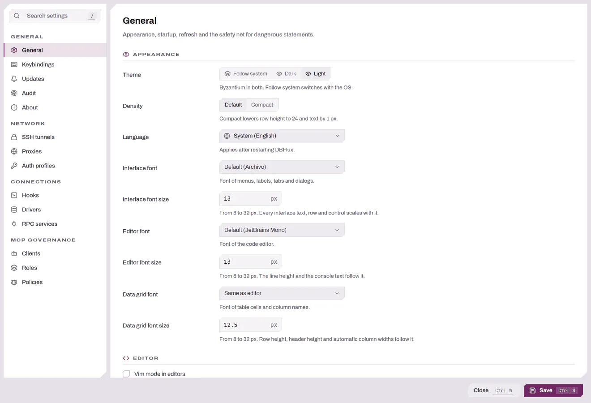
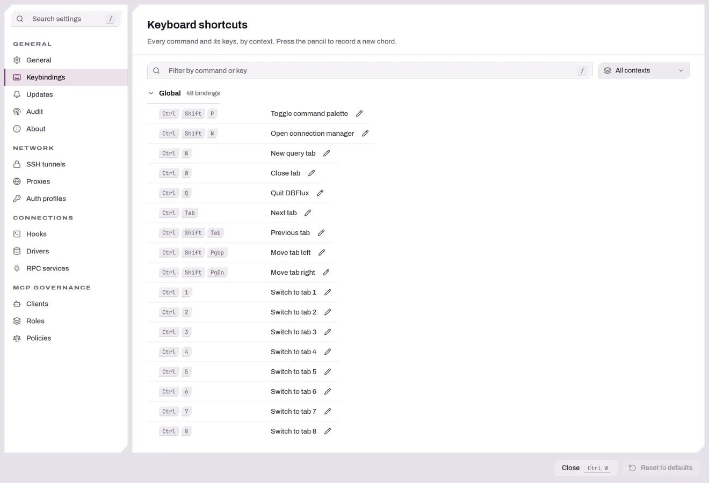

# 설정 및 연결 훅

모든 설정 섹션과 연결 훅 — 연결의 수명 주기를 중심으로 DBFlux가 실행하는 명령,
스크립트 또는 Lua 스니펫 — 에 대한 참조 문서입니다.

명령 팔레트(**Open settings**)나 사이드바에서 설정을 엽니다. 창의 왼쪽에는
섹션별로 정리되어 있습니다.

| 섹션 | 설명 |
|---------|--------|
| [일반](#일반) | 앱 전체 동작: 테마, 시작, 새로고침, 쿼리 안전. |
| [감사](#감사) | 감사 로그가 기록하는 내용과 보존 기간. |
| [키 바인딩](#키-바인딩) | 키맵 탐색 및 변경. |
| [인증 프로필](#인증-프로필-프록시-ssh-터널) | AWS SSO / 공유 자격 증명 프로필. |
| [프록시](#인증-프로필-프록시-ssh-터널) | SOCKS5 / HTTP 프록시 프로필. |
| [SSH 터널](#인증-프로필-프록시-ssh-터널) | 재사용 가능한 SSH 터널 프로필. |
| [서비스](#서비스rpc) | 외부 RPC 드라이버 및 인증 제공자. |
| [훅](#연결-훅) | 재사용 가능한 연결 훅 정의. |
| [드라이버](#드라이버) | 드라이버별 재정의 및 설정. |
| 정보 | 버전 및 빌드 정보. |

MCP 관련 섹션(Clients, Roles, Policies)은 바이너리가 `mcp` 기능과 함께 빌드된
경우에만 나타나며, 기본 빌드에는 이 기능이 포함됩니다. [AI + MCP Integration](MCP_AI_INTEGRATION.md)을 참고하세요.

---
## 일반

<picture>
  <source media="(prefers-color-scheme: dark)" srcset="../images/settings/general-dark.webp">
  
</picture>

저장하면 변경 사항이 즉시 적용되고 DBFlux 데이터베이스(`dbflux.db`,
**Use the stable database**를 켜지 않은 나이틀리 빌드에서는 `dbflux-nightly.db`)에는 백그라운드에서 기록되므로,
데이터베이스가 느리거나 사용 중이어도 창이 멈추지 않습니다. 성공 메시지는 디스크에
기록된 뒤에 표시됩니다. 기록에 실패하면 오류가 표시되고, 변경 사항은 DBFlux를
종료할 때까지 적용된 상태로 남습니다. 유지하려면 다시 저장하세요.

### 모양

| 설정 | 옵션 | 기본값 |
|---------|---------|---------|
| **Theme** | Follow system, Dark, Light | Dark |
| **Density** | Default, Compact | Default |
| **Show scrollbars** | While scrolling, On hover, Always | While scrolling |
| **Language** | System, 그 뒤에 번역 카탈로그가 함께 제공되는 모든 언어 | System |

**Show scrollbars**는 모든 창의 스크롤바가 언제 표시될지 정합니다. 내용이
스크롤되는 동안만, 포인터가 스크롤 영역 위에 있는 동안, 또는 항상 표시할 수
있습니다. 저장하면 열려 있는 모든 창에 바로 적용됩니다.

데이터 그리드의 가로 스크롤바는 예외로 항상 표시됩니다. 마우스 휠 이벤트를
받지 않는 별도의 스크롤러가 이 스크롤바를 움직이므로, 그렇지 않으면 숨겨진
채로 남기 때문입니다.

언어 목록은 DBFlux가 함께 제공하는 번역 카탈로그에서 도출됩니다. 영어가 먼저
표시되고, 나머지 언어는 결정적인 순서로 이어지며 고유 언어명으로 표시됩니다.
System은 운영체제의 로캘을 따르며, 함께 제공된 로캘이 명확하게 일치하지 않으면
영어로 대체됩니다. 언어 변경은 DBFlux를 다시 시작해야 적용되므로, 해당 컨트롤에는
이를 알리는 고정된 안내 문구가 표시됩니다. 일부만 번역된 카탈로그는 번역되지 않은
일반 UI 텍스트에 대해 영어로 대체됩니다. 이 릴리스에서는 General 섹션만 번역되며,
나머지 UI는 크레이트 단위로 전환 중이며 당분간 영어로 유지됩니다.

`Ctrl+=` / `Cmd+=`와 `Ctrl+-` / `Cmd+-`는 General 섹션의 인터페이스, 편집기,
데이터 그리드 글꼴 크기를 한꺼번에 1 px씩 바꾸며 서로의 상대적인 크기를
유지하고, `Ctrl+0` / `Cmd+0`은 기본값으로 되돌립니다. 이 단축키는 워크스페이스
창에서 동작하고, 명령 팔레트에도 있으며, [키 바인딩](#키-바인딩)에서 다시
지정할 수 있습니다. 이미 8 px 또는 32 px에 도달한 크기는 그대로 두고 나머지
크기만 계속 바뀝니다. 새 크기는 다른 설정처럼 저장되므로 재시작 후에도
유지됩니다.

### 편집기

| 설정 | 기본값 | 설명 |
|---------|---------|--------------|
| **Vim mode in code editors** | Off | 코드 편집기의 모드 편집: `h`, `j`, `k`, `l`, `i`, `Escape`, `x`, `u`를 쓰는 노멀 모드와 삽입 모드. 저장하면 열려 있는 편집기에 적용됩니다. 키보드 참조의 [Vim 모드](KEYBOARD.md#vim-모드선택-사항) 섹션을 참고하세요. |
| **Add an alias to table completions** | On | `FROM` 또는 `JOIN` 뒤에서 SQL 자동 완성의 테이블, 뷰 또는 CTE를 선택하면 이름의 머리글자로 만든 별칭과 함께 삽입합니다. `access_control`은 `access_control ac`가 되고 `public.order_items`는 `public.order_items oi`가 됩니다. 문에서 이미 쓰인 별칭, 예약어 또는 알려진 테이블 이름에는 숫자를 붙입니다(`ac2`). 커서 뒤에 별칭이 이미 있거나 `INSERT INTO` 뒤에서는 별칭을 추가하지 않습니다. `UPDATE`와 `DELETE FROM`의 대상 테이블은 그 위치에서 별칭을 허용하는 데이터베이스에서만 별칭을 받습니다: PostgreSQL과 DuckDB, 그리고 `AS`를 붙인 SQLite와 Turso입니다. |
| **Write the alias with AS** | Off | `access_control ac` 대신 `access_control AS ac`를 삽입합니다. |

### 데이터 그리드

| 설정 | 기본값 | 설명 |
|---------|---------|--------------|
| **외래 키 셀에 참조된 행의 레이블 표시** | 끔 | 외래 키를 담은 셀은 참조된 행의 레이블을 id와 함께 확인해 표시합니다. 저장한 이후에 불러오는 페이지에 적용됩니다. 행 인스펙터는 항상 참조를 확인합니다. |

### 시작 및 세션

| 설정 | 기본값 | 설명 |
|---------|---------|--------------|
| **Restore session on startup** | On | 마지막에 열어 두었던 탭을 다시 엽니다. |
| **Reopen last connections** | Off | 시작할 때 마지막으로 종료할 당시 열려 있던 연결과 복원된 탭이 사용하는 연결에 다시 연결합니다. 세션 복원 여부와 관계없이 동작합니다. |
| **Default focus** | Sidebar | 실행 시 포커스가 놓이는 위치(사이드바 또는 마지막 탭). |
| **Max history entries** | 1000 | 쿼리 기록 상한(최소 10). |
| **Auto-save interval (ms)** | 2000 | 열려 있는 편집기가 자동 저장되는 주기(최소 500). 파일로 관리되는 스크립트는 해당 파일에 기록되고, 저장하지 않은 제목 없는 콘텐츠는 sessions 폴더에 보관됩니다. |

### 새로고침 및 백그라운드

| 설정 | 기본값 | 설명 |
|---------|---------|--------------|
| **Default refresh policy** | Manual | 데이터 뷰에 대한 수동 또는 간격 자동 새로고침. |
| **Default refresh interval (seconds)** | 5 | 정책이 Interval일 때 사용되는 간격(최소 1). |
| **Max concurrent background tasks** | 8 | 연결과 스키마 작업의 상한(최소 1). 실행 중인 연결, 연결 해제, 연결 훅, 데이터베이스 전환, 스키마 로드·새로 고침·삭제, 키-값 스캔이 상한에 포함됩니다. 상한에 도달하면 실행 중인 작업이 끝날 때까지 새 연결, 데이터베이스 전환, 스키마나 테이블 세부 정보 로드, 키-값 페이지 이동은 알림과 함께 거부되며 대기열에 들어가지 않습니다. 쿼리, 데이터 그리드 로드, 내보내기, 대시보드, 변경 작업은 상한에 포함되지도 제한되지도 않습니다. |
| **Pause auto-refresh on error** | On | 뷰에서 오류가 발생하면 자동 새로고침을 멈춥니다. |
| **Auto-refresh only if tab is visible** | Off | 보고 있지 않은 탭은 새로고침을 건너뜁니다. |

### 알림

| 설정 | 옵션 | 기본값 |
|---------|---------|---------|
| **알림 표시 시간** | 4초, 8초, 15초, 닫을 때까지 유지 | 8초 |

**알림 표시 시간** 은 알림이 스스로 닫히기까지 화면에 남는 시간을 정합니다.
성공 및 정보 알림은 이 시간 뒤에 닫히고, 경고 알림은 두 배 뒤에 닫힙니다.
오류 알림과 동작 버튼이나 진행률 표시줄이 있는 알림은 닫을 때까지 남습니다.
**닫을 때까지 유지** 를 고르면 모든 알림의 자동 닫기가 꺼집니다. 알림 위에
포인터를 올리면 타이머가 멈추고, 포인터가 벗어나면 다시 시작됩니다.

알림은 문서 영역의 오른쪽 위에 쌓입니다. 한 번에 최대 네 개가 표시되며, 더
오래된 알림은 *N개 더 보기* 항목으로 접혀 함께 펼치거나 함께 닫을 수 있습니다.

### 실행 안전(위험 쿼리 확인)

이 세 가지 설정은 **모든** 드라이버와 쿼리 언어에 걸쳐 DBFlux가 위험한 쿼리를
다루는 방식을 결정합니다. 데이터베이스별 토글은 없습니다 — 동일한 규칙이 SQL
`DELETE`/`DROP`/`TRUNCATE`, MongoDB `deleteMany`/`drop`, Redis `FLUSHALL`/`FLUSHDB`
등에 똑같이 적용됩니다.

| 설정 | 설명 |
|---------|--------------|
| **Confirm dangerous queries** | 기본적으로 켜짐; 위험한 쿼리를 실행하기 전에 확인을 표시합니다. 끄면 확인 절차 없이 실행할 수 있습니다. |
| **Require WHERE for DELETE/UPDATE** | 기본적으로 켜짐; `WHERE`가 없는 `DELETE`/`UPDATE`를 위험한 쿼리로 취급합니다. |
| **Always require preview (ignore suppressions)** | 기본적으로 꺼짐; 이전에 확인을 생략하기로 선택했던 쿼리에 대해서도 확인/미리 보기 모달을 강제합니다. |

**Editor row limit**(에디터 행 제한, 기본값 10,000)은 쿼리 에디터에서 실행한
쿼리가 반환하는 행 수를 제한합니다. 위의 세 가지 위험 쿼리 설정과는 별개의 실행
안전 설정입니다. 1 이상의 정수만 허용하며 0으로 설정하거나 끌 수 없습니다. 다른
값을 저장하면 오류가 표시되고 이전 제한이 유지됩니다. DBFlux는 쿼리 텍스트에
`LIMIT`을 추가하는 대신 이 제한을 드라이버에 전달합니다.
결과에서 행이 생략되면 결과 하단에는 행 수 대신 "처음 10,000개 행 로드됨"이
표시됩니다. 읽기만 하는 단일 문장이면 하단에서 **행 수 세기**를 제공하며, 이는
행을 가져오지 않고 문장을 `SELECT COUNT(*)` 안에서 실행해 "10,000/52,310개 행
로드됨"을 표시합니다(SQL 연결만 해당). **모든 행 로드**는 같은 결과 탭에서 제한
없이 문장을 다시 실행합니다. 두 동작은 테이블 메뉴(`m`)에도 있습니다. 마지막으로
로드된 행까지 스크롤하거나 커서를 그 행으로 옮기면 해당 문장의 다음 행을 제한만큼
가져와 끝에 추가하며, 문장에 더 이상 행이 없을 때까지 이를 반복합니다. 그리드에서
열을 정렬한 동안에는 다음 행을 가져오지 않습니다. 여러 문장으로
된 스크립트에서는 모든 결과 집합이 하나의 제한을 함께 사용하며, 모든 문장은 그대로
실행됩니다.

제한은 `execute`가 이를 적용하는 드라이버에만 전달됩니다: PostgreSQL,
MySQL/MariaDB, SQL Server, SQLite, DuckDB, MongoDB, Redis, Turso, InfluxDB,
ClickHouse, Redshift, CloudWatch, DynamoDB. 이 중 일부는 응답 전체를 읽은 뒤에
자르며, Redis는 테이블로 표시되는 응답만 제한합니다. 각 드라이버의 한계는 해당
드라이버 페이지에 있습니다. 외부 RPC 드라이버는 DBFlux와 드라이버가 모두
driver RPC 1.6 이상을 사용하고 드라이버가 `REQUEST_ROW_LIMIT`를 선언할 때 제한을
받습니다. 그 밖의 외부 드라이버에는 제한이 전달되지 않고 쿼리는 제한 없이 실행됩니다. 제한이 없던 결과는 생략된 행이 없으므로
전체 행 수를 표시하고, 하단에서 행 수 세기와 모든 행 로드를 제공하지 않습니다.
결과가 클 수 있다면 문장에 `LIMIT`이나 `.limit()`을 넣으세요. 이 제한은 시간
제한을 추가하지 않으며 Lua, Python, Bash 스크립트, 연결 훅, 메트릭에는 적용되지
않습니다. [콘솔](CONSOLE.md)은 제한을 적용할 수 있는 드라이버에는 같은 제한을
보내고, 나머지 드라이버에서는 제한 없이 명령을 실행합니다.

### 스토리지(나이틀리 빌드 전용)

| 설정 | 기본값 | 설명 |
|---------|---------|--------------|
| **Use the stable database** | Off | 나이틀리 빌드가 `dbflux-nightly.db` 대신 안정(stable) 버전의 `dbflux.db`를 공유하도록 합니다. 다음 실행 시 적용됩니다. |

나이틀리 데이터베이스와 안정 데이터베이스가 어떻게 분리되어 있는지는
[Data & Privacy](PRIVACY.md#데이터-위치)를 참고하세요.

---

## 감사

감사 섹션은 통합 감사 로그를 제어합니다. 사용자가 접하는 주요 컨트롤은
**Log Capture → Minimum Level**(trace / debug / info / warn / error)로, DBFlux의
내부 로깅 중 감사 추적에 얼마나 반영할지를 결정합니다. 저장하면 다시 시작하지
않고도 적용됩니다.

보존(Retention, 이벤트를 얼마나 유지하는지)이 설정되어 있으면 주기적인 백그라운드
제거가 수행됩니다. 일상적인 감사 사용 경험 — 뷰어 열기, 필터링, 내보내기 — 에
대해서는 [감사 → 감사 뷰어](AUDIT.md#감사-뷰어)를 참고하세요.
전체 이벤트 스키마와 마스킹 동작은 [Audit](AUDIT.md) 및
[Data & Privacy](PRIVACY.md#감사-및-개인정보)를 참고하세요.

---

## 키 바인딩

이 섹션은 컨텍스트별로 그룹화된 활성 키맵을 나열합니다. 텍스트 필드로 명령,
키, 컨텍스트 조건식을 기준으로 필터링하거나, 컨텍스트 필터로 하나의 컨텍스트만
표시할 수 있습니다. 다른 컨텍스트를 상속하는 컨텍스트(편집기는 전역을 상속)는
자신이 가리지 않는 상속 바인딩도 함께 나열합니다. 전체 기본 키맵은
[키보드 참조](KEYBOARD.md)에 문서화되어 있습니다.

<picture>
  <source media="(prefers-color-scheme: dark)" srcset="../images/settings/keybindings-dark.webp">
  
</picture>

**단축키 변경.** 바인딩의 연필을 누르거나, 바인딩을 선택하고 `Enter`를 누른 뒤
새 키를 누르세요. 단축키는 수정 키를 포함한 키 하나이거나 `g g`, `Ctrl+K Ctrl+S`
처럼 최대 네 개의 키 시퀀스일 수 있습니다. 키를 차례로 누르면 1초 동안 멈춘 뒤
기록이 저장됩니다. `Esc`는 취소합니다. 기록하는 동안 **단축키 제거**를 누르면
바인딩에 키가 없어집니다. 설정 창 자체가 사용하는 `Ctrl+S`나 `Tab` 같은 키도
기록할 수 있습니다. 단독 `Esc`는 취소에 쓰이므로 기록할 수 없습니다.

**컨텍스트.** 모든 바인딩은 Zed와 같은 언어로 쓴 조건식인 컨텍스트에서
적용됩니다. 바인딩의 레이어 버튼을 누르거나, 바인딩을 선택하고 `p`를 눌러 편집할
수 있으며, `Enter`는 저장하고 `Esc`는 취소합니다. 조건식은 이름을 `&&`, `||`,
`!`로 결합하고, 값을 `==` 또는 `!=`로 비교하며, "A 안의 B"에는 `A > B`를 쓰고,
괄호로 묶을 수 있습니다:

| 조건식 | 적용 범위 |
|--------|-----------|
| `Editor && !Modal` | 코드 편집기에서, 대화상자가 열려 있지 않을 때 |
| `Editor && vim_mode == normal` | Vim 노멀 모드의 코드 편집기에서 |
| `Editor && language == mongo` | MongoDB 쿼리용 코드 편집기에서 |
| `Results \|\| Audit` | 결과 그리드 또는 감사 뷰어에서 |
| `SidebarPanel && tab == scripts` | 사이드바의 스크립트 탭에서 |
| `CodeEditor > Input` | 코드 편집기의 텍스트 버퍼에서 |

이름으로는 컨텍스트 필터에 표시되는 컨텍스트 이름(`Global`, `Sidebar`,
`Editor`, `Results`, `DataTable`, `Input`, `Modal`, …), 창 이름 `Workspace`,
`SettingsWindow`, `ConnectionManagerWindow`, 그리고 패널 이름 `ActivityRail`,
`CommandSearch`, `SidebarPanel`, `CodeEditor`, `ResultPanel`, `RowInspector`,
`KeyValueConsole`, `NativeConsole`, `DocumentQueryBar`, `DocumentSchema`, `DocumentAggregate`,
`DashboardsPanel`,
`SettingsSection`을 쓸 수 있습니다. 값으로는 `vim_mode`(`normal`, `insert`,
`replace`, `visual`, `visual_line`, `visual_block`, Vim 편집이 켜져 있을 때만),
`language`(`sql`, `mongo`, `redis`, `lua`, `python`, `bash`, …), `tab`,
`section`, `focus`가 있습니다. 구문을 해석할 수 없는 조건식은 저장되지 않으며,
DBFlux가 설정하지 않는 이름을 쓴 조건식은 절대 일치하지 않으므로 경고와 함께
저장됩니다.

**어떤 바인딩이 우선하는가.** 포커스를 가진 요소(텍스트 필드, 데이터 테이블,
대화상자, 문서 트리)의 바인딩은 그 요소를 둘러싼 패널의 바인딩보다 우선하며,
사용자가 변경한 바인딩은 같은 위치에서 같은 키에 지정된 기본 바인딩보다
우선합니다. Vim 편집이 켜져 있으면 `Editor && vim_mode == normal`의 `space r`처럼
Vim 모드용으로 만든 바인딩은 Vim이 키를 읽기 전에 실행되며, 기본 바인딩은 Vim
자체의 키를 Vim에 맡깁니다. 포커스를 가진 버튼, 체크박스, 목록 행은 항상
`Enter`와 `Space`를 스스로 처리합니다.

**경고와 충돌.** 새 키를 동시에 활성일 수 있는 컨텍스트의 다른 명령이 이미
사용 중이면 아직 아무것도 저장되지 않습니다. 경고에 다른 명령과 그 컨텍스트가
표시됩니다. **취소**는 모든 것을 그대로 둡니다. **바꾸기**는 편집 중인 바인딩에
키를 지정하고 다른 바인딩에서는 제거하며, 그 바인딩은 재설정할 때까지 단축키가
없습니다. 다른 바인딩과 충돌하는 바인딩에는 "충돌" 배지가 표시되고, 바닥글에
충돌 개수가 표시됩니다. 두 배지는 막지 않고 경고만 합니다. "키 시퀀스를 공유함"은
한 바인딩의 키가 다른 바인딩 키의 시작일 때이며(이때 DBFlux는 짧은 쪽 다음에 긴
쪽이 이어지는지 1초 기다립니다), "입력한 텍스트를 가로챔"은 텍스트 필드나 Vim
노멀·비주얼 모드 밖의 코드 편집기처럼 텍스트를 입력하는 곳에 수정 키 없는
문자를 지정했을 때입니다.

**재설정.** 변경된 바인딩에는 기본 키와 컨텍스트로 되돌리는 재설정 화살표가
표시됩니다(선택한 바인딩에서 `r`을 눌러도 같고, `Delete`는 단축키를
제거합니다). 바닥글의 **기본값으로 재설정**은 모든 변경을 버립니다. 바닥글에는
변경된 바인딩 수도 표시됩니다.

변경 사항은 재시작 없이 모든 창에 즉시 적용됩니다. 변경한 내용만
`dbflux.db`의 `cfg_keybinding_overrides` 테이블에 저장되므로, 변경하지 않은
바인딩은 이후 릴리스의 기본값을 따릅니다. 이후 릴리스에서 기본 바인딩이 제거된
변경 사항은 무시됩니다.

---

## 인증 프로필, 프록시, SSH 터널

이 세 섹션은 이후 각 연결의 Access 탭에서 선택하게 되는 재사용 가능한 프로필을
관리합니다. 필드, AWS SSO 흐름, no-proxy 규칙, SSH 인증 방법 등 전체 내용은
[Connecting to a Database → Advanced Setup](CONNECTIONS.md)에 문서화되어 있습니다:

- [인증 프로필](CONNECTIONS.md#인증-프로필-aws-sso-및-공유-자격-증명)
- [프록시](CONNECTIONS.md#프록시)
- [SSH 터널](CONNECTIONS.md#ssh-터널)

여기에 입력한 자격 증명은 데이터베이스가 아니라 운영체제 키링에 저장됩니다.
[Data & Privacy → Secrets](PRIVACY.md#비밀과-os-키링)를
참고하세요.

---

## 서비스(RPC)

외부 드라이버와 인증 제공자는 별도의 프로세스로 실행되며, DBFlux는 로컬 소켓을
통해 이들과 통신합니다. 여기에 추가하는 각 서비스는 다음과 같은 항목을 갖습니다:

| 필드 | 설명 |
|-------|-------|
| **Socket ID** | 고유 식별자이며 소켓 파일 이름으로 사용됩니다. ASCII 알파벳, 숫자, `.`, `_`, `-`만 허용됩니다. |
| **Command** | 실행할 실행 파일(일부 구성에서는 선택 사항). |
| **Startup Timeout (ms)** | 프로세스가 뜰 때까지 기다리는 시간. 기본값 5000. |
| **Service Type** | **Driver** 또는 **Auth Provider**. |
| **Enable this service** | 서비스를 시작할지 여부. 기본적으로 켜짐. |
| **Arguments** | 순서가 있는 프로세스 인수. |
| **Environment Variables** | 프로세스에 전달되는 `KEY=value` 쌍. |

여기서 변경한 내용은 **다음 실행 시 적용됩니다**. 전체 참조:
[RPC Services Config](RPC_SERVICES_CONFIG.md) 및
[Driver RPC Protocol](DRIVER_RPC_PROTOCOL.md).

---

## 드라이버

드라이버를 선택하면 해당 동작을 확인하고 재정의할 수 있습니다. 편집할 수 있는
그룹은 두 가지입니다:

**전역 재정의(Global overrides)** — General 설정의 드라이버별 버전입니다. 각 항목은
삼중 상태(Inherit / On / Off, 또는 명시적 값)이며, *Inherit*로 두면 컨트롤 옆에
표시된 General 기본값이 사용됩니다:

- 새로고침 정책 및 간격
- 위험 쿼리 확인
- WHERE 요구
- 미리 보기 요구

**드라이버 설정(Driver settings)** — 드라이버 자체가 정의한 옵션입니다(드라이버의
고유 스키마에서 일반적인 방식으로 렌더링되므로, 사용 가능한 필드는 드라이버에 따라
다릅니다).

이 섹션에는 드라이버의 **기능 매트릭스(capability matrix)**, 카테고리, 쿼리 언어도
읽기 전용으로 표시됩니다.

---

## 연결 훅

훅은 연결의 수명 주기를 중심으로 실행되는 재사용 가능한 명령, 스크립트 또는 Lua
스니펫입니다. **Settings → Hooks**에서 전역으로 훅을 **정의**하고, Connection
Manager의 **Hooks** 탭에서 개별 연결의 단계에 훅을 **바인딩**합니다.

### 빠른 경로

1. **Settings → Hooks에서 훅을 추가합니다.** **Hook ID**를 지정하고, **Type**을
   선택하고, 명령/스크립트를 채웁니다.
2. **Connection Manager → Hooks 탭**에서 연결을 엽니다.
3. 네 단계 드롭다운(Pre-connect, Post-connect,
   Pre-disconnect, Post-disconnect) 중 하나에서 훅을 선택합니다.
4. 연결합니다. 훅 출력은 **Tasks** 패널로 스트리밍됩니다.

### 훅 유형

| 유형 | 실행 내용 | 제공할 항목 |
|------|--------------|------------------|
| **Command** | 실행 파일 | 명령과 공백으로 구분된 인수. |
| **Script** | Bash 또는 Python 파일 | 언어, 파일 경로, 선택적인 인터프리터 재정의(비워 두면 플랫폼에 맞게 `bash` / `python3`). |
| **Lua** | 인프로세스 Lua 스크립트 | 파일 경로와 기능 집합(아래 참고). Lua는 DBFlux 내부에서 실행됩니다 — 외부 인터프리터가 필요 없습니다. |

스크립트는 DBFlux의 편집기에서 편집되며, 기본적으로 `hooks/` 폴더 아래에
저장됩니다.

#### Lua 기능

Lua 훅은 사용자가 활성화한 기능만 얻습니다:

| 기능 | 부여되는 권한 |
|------------|--------|
| **Logging** | 기본적으로 켜짐; 훅 출력에 기록합니다. |
| **Environment read** | 기본적으로 켜짐; 환경 변수를 읽습니다. |
| **Connection metadata** | 기본적으로 켜짐; 연결 중인 프로필의 메타데이터를 읽습니다. |
| **Controlled process run** | 기본적으로 꺼짐; `dbflux.process.run(...)`을 호출해 외부 프로세스를 실행할 수 있습니다. |

> **Controlled process run**을 활성화하면 훅이 임의의 외부 명령을 실행할 수
> 있습니다. 활성화하면 DBFlux가 훅 정의와 연결별 바인딩 양쪽에서 보안 경고를
> 표시합니다. 신뢰하는 훅에만 활성화하세요.

내장 Lua 런타임(사용 가능한 API, 샌드박싱)은 [Lua Scripting](LUA.md)에
문서화되어 있습니다.

### 훅 옵션

| 옵션 | 설명 |
|--------|-------|
| **Enabled** | 비활성화된 훅은 건너뜁니다. |
| **Working Directory** | 프로세스/스크립트의 작업 디렉터리(Lua에서는 사용하지 않음). |
| **Environment** | 추가 `KEY=value` 쌍. |
| **Inherit parent environment** | 기본적으로 켜짐; DBFlux의 환경을 훅에 전달합니다. |
| **Env Denylist** | 상속받은 환경에서 제거할 변수 이름. |
| **Timeout (ms)** | 비워 두면 시간 초과 없음. 시간 초과 시 프로세스 그룹을 종료합니다. |
| **Execution mode** | **Blocking**(기본값)은 훅이 끝날 때까지 기다립니다; **Detached**는 백그라운드에서 실행되며 연결/연결 끊기를 막지 않습니다. |
| **Ready signal** (Detached) | 계속 진행하기 전에 DBFlux가 훅 출력에서 기다리는 텍스트. |
| **On Failure** | 실패 정책 — 아래를 참고하세요. |

DBFlux는 항상 프로세스 훅에 컨텍스트 환경 변수를 주입합니다: `DBFLUX_PROFILE_ID`,
`DBFLUX_PROFILE_NAME`, `DBFLUX_DB_KIND`, 그리고 알려진 경우 `DBFLUX_HOST`,
`DBFLUX_PORT`, `DBFLUX_DATABASE`.

> **비밀은 실수로 훅에 새어 나가지 않습니다.** Env Denylist에 더해, DBFlux는
> 이름에 `SECRET`, `TOKEN`, `PASSWORD`, `_KEY`가 포함된 상속된 변수와 모든
> `AWS_*` 변수를 항상 제거합니다.

### 실패 정책

훅이 실패했을 때(0이 아닌 종료 코드, 시간 초과, 오류) 어떤 일이 일어나는지:

| 정책 | 효과 |
|--------|--------|
| **Disconnect** (기본값) | 단계를 중단합니다 — 연결 또는 연결 끊기 흐름이 멈춥니다. |
| **Warn** | 계속 진행하되 경고를 표시합니다. |
| **Ignore** | 계속 진행하며, 실패는 기록만 됩니다. |

### 단계

| 단계 | 실행 시점 |
|-------|------|
| **Pre-connect** | 연결이 열리기 전. |
| **Post-connect** | 연결에 성공한 후. |
| **Pre-disconnect** | 연결을 끊기 전. |
| **Post-disconnect** | 연결을 끊은 후. |

연결의 Hooks 탭에는 단계별 드롭다운이 하나씩 있습니다(추가 훅 ID를 바인딩하기 위한
"Extra" 입력도 있습니다). 드롭다운에는 Settings → Hooks에서 정의한 재사용 가능한
훅이 나열됩니다. 각 훅은 자체 백그라운드 작업으로 실행되며 Tasks 패널에 실시간
stdout/stderr가 표시됩니다. 출력은 훅당 4 MiB로 제한됩니다.

---

## 관련 문서

- [시작하기](GETTING_STARTED.md) — 핵심 워크플로.
- [키보드 참조](KEYBOARD.md) — 전체 기본 키맵.
- [Connecting → Advanced Setup](CONNECTIONS.md) — SSH, 프록시, 인증, 값 소스.
- [Data & Privacy](PRIVACY.md#이-컴퓨터에-저장되는-데이터) — 설정과 비밀이 저장되는 위치.
- [Lua Scripting](LUA.md) — 훅을 위한 내장 Lua 런타임.
