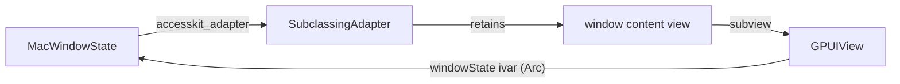

# Vendored `gpui-pre-macos`

This directory is the published `gpui-pre-macos` 0.3.5 crate source plus one patch,
`release-accesskit-adapter.patch`. The root `Cargo.toml` points `[patch.crates-io]` at it.

## Why

Every closed window on macOS kept its graphics memory. After a day of opening and closing
the connection manager and the settings window, the process held hundreds of megabytes of
IOSurface and Metal memory. Only the main window was open, and the heap still held one
`GPUIView` and one `CAMetalLayer` per window ever opened.

The cause is a reference cycle that the published crate never breaks:



`MacWindow::a11y_init` stores an `accesskit_macos::SubclassingAdapter` built with
`for_window`, which retains the window's content view. The content view holds the
`GPUIView` subview, and that view's `windowState` ivar holds an `Arc` to the same
`MacWindowState`. `dealloc_view` would release that `Arc`, but the view is never
deallocated while the adapter retains it, and the adapter lives inside the state. The state
owns the `MetalRenderer`, so its drawables, path textures and atlas stay allocated too, about
30 to 50 MB per window on a Retina display.

The patch drops the adapter in `MacWindow::drop`, next to the other teardown that already
happens there, which breaks the cycle. AccessKit's own `Drop` restores the view's original
class, so the view deallocates normally afterwards.

## Refreshing

```bash
vendor/gpui-pre-macos/refresh.sh 0.3.6
```

The script replaces `src/`, `Cargo.toml` and the license with the published version and
re-applies the patch. If the patch no longer applies, check whether upstream now releases
the adapter when the window closes. If it does, delete this directory and its
`[patch.crates-io]` entry.

To check that the cycle is gone, open and close a secondary window a few times. Then
count the live views with `heap <pid> | grep -E "GPUIView|CAMetalLayer "`. The count
should equal the number of open windows.
